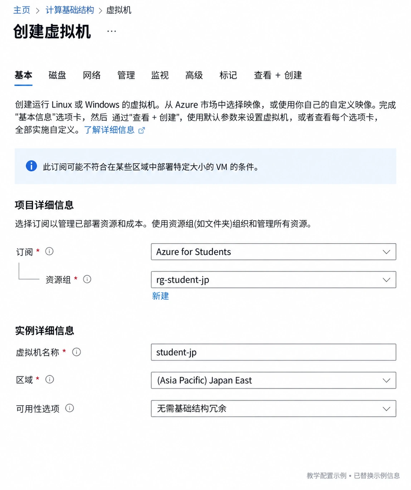
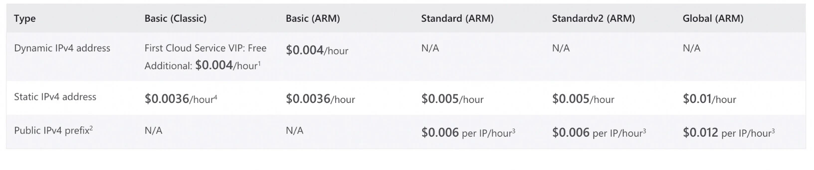

Unter den Studentenvorteilen steht Azure bei mir ziemlich weit oben: jedes Jahr 100 Dollar Guthaben, keine Kreditkarte nötig, und in den ersten 12 Monaten gibt es zusätzlich kostenlose Kontingente für kleine Server-Instanzen und zwei Systemdatenträger – genau richtig, um eigene Projekte darauf laufen zu lassen.

Ich empfehle, zuerst die Region Japan zu nehmen und Ubuntu als System zu installieren. Erstmal SSH zum Laufen bringen und dann ganz entspannt das einrichten, was man selbst hosten möchte. In diesem Beitrag geht es nur darum, den Server sauber aufzusetzen – auf App-Deployments gehe ich hier nicht ein, da könnt ihr bei Interesse selbst nachschauen, wie man was aufsetzt.

Die folgende Übersicht basiert auf den Konditionen und Preisen vom 17. Oktober 2026. Ob ihr den Weg über das Webportal oder die CLI nehmt, bleibt euch überlassen – eine der beiden Varianten reicht völlig.

Die Screenshots orientieren sich an den normalen Microsoft-Seiten, persönliche Daten habe ich unkenntlich gemacht.

## Zuerst Azure for Students sichern

Für die Beantragung müsst ihr mindestens 18 Jahre alt sein, Vollzeit an einer berechtigten Hochschule studieren und sowohl ein Microsoft-Konto als auch eine Uni-E-Mail-Adresse bereithalten, über die ihr Mails empfangen könnt.

### Weg 1: Über das GitHub Student Pack einsteigen

Wenn ihr bereits bei GitHub Education verifiziert seid, öffnet direkt das [GitHub Student Developer Pack](https://education.github.com/pack), sucht dort Microsoft Azure, klickt auf den Einlöse-Link und meldet euch anschließend mit eurem Microsoft-Konto an, um den Antrag abzuschließen.

Achtet darauf, dass ihr wirklich **Azure for Students (100 Dollar, 12 Monate)** auswählt und es nicht mit „Azure for Students Starter“ verwechselt, das für jüngere Schüler gedacht ist.

Falls ihr auf der Seite zur akademischen Verifizierung eine Methode auswählen müsst, nehmt GitHub und folgt den Anweisungen zur Kontoverknüpfung.


### Weg 2: Mit der Uni-E-Mail verifizieren

Öffnet [Azure for Students](https://azure.microsoft.com/en-us/free/students/), meldet euch mit eurem Microsoft-Konto an und tragt nach Aufforderung eure Hochschule und eure Uni-E-Mail-Adresse ein.


Das `student@example.edu` oben dient nur als Beispiel – tragt beim Antrag eure echten Daten ein und wählt auch das tatsächliche Land eurer Hochschule. Das hat nichts damit zu tun, dass wir den Server später in Japan anlegen.

Sobald die Bestätigungsmail angekommen ist, klickt auf den Link darin und kehrt zur Antragsseite zurück, um die restlichen Schritte abzuschließen. Wie lange der Link gültig ist, steht in der Mail – falls er abläuft, fordert einfach eine neue an.

Mit der Bestätigungsmail allein ist es aber noch nicht getan: Schaut zum Schluss im [Azure-Portal](https://portal.azure.com/) unter „Abonnements“ nach, ob **Azure for Students** dort auftaucht, und prüft Guthaben sowie Ablaufdatum.


Über beide Wege bekommt ihr exakt denselben Vorteil. Falls es über die Uni-E-Mail hakt, probiert einfach den Einstieg über das Student Pack.

## Was genau ist kostenlos?

Hier muss man zwei Dinge sauber trennen: **Die 100 Dollar Guthaben gelten für 12 Monate und lassen sich bei bestehendem Studentenstatus jährlich erneuern; die kostenlosen Ressourcen für Neukunden in den ersten 12 Monaten starten bei einer Verlängerung hingegen nicht noch einmal neu.**

| Posten | Kostenloses Kontingent | Empfehlung für dieses Setup |
| --- | --- | --- |
| `Standard_B2ats_v2` | Erste 12 Monate für Neukunden, 750 Stunden/Monat | x64, erste Wahl |
| `Standard_B2pts_v2` | Erste 12 Monate für Neukunden, 750 Stunden/Monat | Arm64, gut als zweite Testmaschine |
| `Standard_B1s` | Auf der Infoseite für Studierende noch mit 750 Std./Monat gelistet | Erst unter „Kostenlose Dienste“ prüfen, ob in der Region verfügbar |
| Verwalteter Systemdatenträger | Erste 12 Monate: zwei 64 GiB P6 Premium SSD LRS | `Premium_LRS`, einer pro VM |
| Ausgehender Internet-Traffic | Die ersten 100 GB pro Monat | Wird über alle Maschinen zusammengerechnet, nicht pro VM |
| Öffentliche IPv6-Adresse | Keine Adressgebühr | Ausgehender Traffic wird normal mitgezählt |
| Standard öffentliche IPv4 | Nicht im kostenlosen Adresskontingent enthalten | Region Japan ca. 0,005 Dollar/Stunde |

Die 750 Stunden gelten pro kostenloser VM-Größe getrennt. Das reicht im Monat locker für eine Maschine im Dauerbetrieb; zwei VMs derselben Größe verbrauchen aber gemeinsam dasselbe Stundenkontingent. Wer zwei Server laufen lassen will, kombiniert also am besten eine B2ats_v2 mit einer B2pts_v2.

Noch eine klassische Stolperfalle: **Kostenlos sind zwei Datenträger vom Typ P6 Premium SSD LRS mit 64 GiB.**


Im Screenshot sind vor allem „Linux Virtual Machines“, „Azure Disk Storage“ und die 100 GB ausgehender Traffic relevant – auch die Traffic-Rechnung weiter unten basiert auf diesem monatlichen 100-GB-Freikontingent.

Schaut unter „Abonnements → Azure for Students → Kostenlose Dienste“ nach, was bei euch freigeschaltet ist. Nachdem der Server läuft und erste Nutzungsdaten auftauchen, kontrolliert dort noch einmal, ob VM-Stunden und Datenträger tatsächlich über die kostenlosen Dienste abgerechnet werden.

## Als Region empfehle ich Japan

Prüft zuerst, welche Regionen bei euch überhaupt freigeschaltet sind. Sucht oben im [Azure-Portal](https://portal.azure.com/) nach **Richtlinie (Policy)**, wählt links **Zuweisungen (Assignments)** und setzt den Bereich auf euer **Azure for Students**-Abonnement.

Öffnet **Allowed resource deployment regions**, geht auf **Parameter (Parameters)** und schaut unter **Allowed locations** nach – dort stehen normalerweise die fünf Regionen, die für euer Abonnement erlaubt sind.

Bei mir sieht das zum Beispiel so aus:

```json
["centralindia","indiasouthcentral","uaenorth","malaysiawest","japaneast"]
```

Diese Liste ist nicht bei jedem identisch. Da Japan Ost bei mir dabei ist, nehme ich direkt `japaneast`.

Für den Zugriff aus China empfehle ich die Reihenfolge **Japan → Singapur → Indien → Hongkong** – die USA lasse ich als Standard-Ausweichoption mal außen vor. Geht eure erlaubten Regionen einfach in dieser Reihenfolge durch.

| Region | CLI-Name | Meine Wahl |
| --- | --- | --- |
| Japan | `japaneast` / `japanwest` | Erste Wahl, bevorzugt Japan Ost |
| Singapur | `southeastasia` | Falls sich in Japan nichts erstellen lässt |
| Indien | `centralindia` / `indiasouthcentral` usw. | Je nachdem, welche indische Region in der Richtlinie steht |
| Hongkong | `eastasia` | Nur als letzte Option, siehe Einschränkungen bei KI-Diensten unten |

**Hongkong gehört derzeit weder zu den [offiziell unterstützten Regionen von ChatGPT](https://help.openai.com/en/articles/7947663-chatgpt-supported-countries) noch zu den [offiziell unterstützten Regionen von Claude](https://support.claude.com/en/articles/8461763-where-can-i-access-claude).** Wenn ihr solche KI-Dienste nutzen wollt, solltet ihr Hongkong also nicht als Standort einplanen, sondern euch zuerst an Japan, Singapur und Indien halten.

Selbst wenn eine Region auf der Erlaubnisliste steht, solltet ihr danach noch VM-Größe und Kontingente prüfen – nur weil eine Region im Dropdown-Menü auftaucht, heißt das noch lange nicht, dass euer Studenten-Abonnement dort auch wirklich eine VM anlegen darf.

Wenn `RequestDisallowedByAzure` erscheint, schaut in der Fehlermeldung nach, welche Regionsrichtlinie greift; falls eine Größe nicht verfügbar ist oder die Kapazität in der Region nicht reicht, wechselt in eine andere erlaubte Region. Nur die Verfügbarkeitszone zu ändern, umgeht die Regionsrichtlinie nicht.

## Web-Variante: Im Azure-Portal erstellen

### Basisdaten und Systemdatenträger

Geht auf „Virtuelle Computer → Erstellen → Virtueller Azure-Computer“ und stellt Folgendes ein:

| Einstellung | Wert |
| --- | --- |
| Abonnement | Azure for Students |
| Ressourcengruppe | Neu erstellen: `rg-student-jp` |
| Name des virtuellen Computers | `student-jp` |
| Region | Japan East |
| Verfügbarkeitsoptionen | Für den Einstieg „Keine Infrastrukturredundanz erforderlich“; bei Bedarf Verfügbarkeitszone wählen |
| Image | Ubuntu Server 24.04 LTS, x64 Gen2 |
| Sicherheitstyp | Standard |
| Größe | `Standard_B2ats_v2` |
| Authentifizierungstyp | Öffentlicher SSH-Schlüssel |
| Benutzername | `student` |
| Öffentliche eingehende Ports | Nur SSH 22 zulassen |
| Betriebssystem-Datenträgertyp | Premium SSD LRS |
| Größe des Betriebssystemdatenträgers | 64 GiB, P6 |
| Datenträger | Keinen hinzufügen |

Wählt zuerst Abonnement, Ressourcengruppe und Region aus. Legt hier direkt die neue Ressourcengruppe `rg-student-jp` an – dort landen später auch die öffentliche IP und die Netzwerkschnittstelle.



Weiter unten wählt ihr System und Größe aus: B2ats_v2 ist die x64-Variante, als Authentifizierung nehmt ihr den öffentlichen SSH-Schlüssel und als Benutzernamen durchgehend `student`.


Wenn ihr das SSH-Schlüsselpaar direkt vom Portal generieren lasst, ladet den privaten Schlüssel beim Erstellen unbedingt herunter – ohne ihn kommt ihr später nicht auf den Server. Falls ihr schon einen eigenen öffentlichen SSH-Schlüssel habt, könnt ihr ihn natürlich auch direkt einfügen.

Verwechselt **Premium SSD v2** nicht mit **Premium SSD LRS** und kontrolliert auf der Datenträger-Seite noch einmal, dass wirklich P6 und 64 GiB ausgewählt sind.

### Netzwerkeinstellungen

Beim ersten Mal empfehle ich, eine neue **Standard öffentliche IPv4-Adresse** anzulegen – IPv6 lässt sich jederzeit später nachrüsten. Mit IPv4 klappt SSH aus fast jedem Netz direkt, und beim Installieren von Paketen spart man sich unnötigen Ärger.

Falls das Erstellen der öffentlichen IP direkt im Netzwerk-Tab der VM etwas hakelig ist, sucht im Portal einfach nach „Öffentliche IP-Adressen“, legt dort eine eigene Ressource in derselben Ressourcengruppe und in Japan East unter dem Namen `student-jp-ip4` an (IP-Version IPv4, SKU Standard) und wählt sie danach im Netzwerk-Tab der VM aus.


Wenn ihr sicher seid, dass euer eigener Internetzugang IPv6 unterstützt, könnt ihr bei der öffentlichen IPv4-Adresse auch „Keine“ wählen und IPv6 nach dem Erstellen ergänzen:

1. Öffnet das virtuelle Netzwerk der VM und fügt im Adressraum `fd12:3456:789a::/48` hinzu.
2. Ergänzt im Subnetz der VM `fd12:3456:789a:1::/64` – IPv6-Subnetze in Azure verwenden immer `/64`.
3. Erstellt eine Standard öffentliche IP in derselben Region, wählt als Adressversion IPv6 und als Zuweisung „Statisch“.
4. Öffnet die Netzwerkschnittstelle der VM, legt unter „IP-Konfigurationen“ eine neue IPv6-Konfiguration an und wählt das eben eingerichtete Subnetz sowie die öffentliche IPv6-Adresse aus.
5. Lasst die bestehende private IPv4-Konfiguration unverändert und prüft, ob die Netzwerksicherheitsgruppe TCP 22 zulässt.

Die Maske in Schritt 3 sieht fast genauso aus wie beim Erstellen von IPv4: Nehmt als Namen `student-jp-ip6`, wählt IPv6 als IP-Version und bleibt bei der SKU „Standard“ – nicht „Standard v2“ mit NAT Gateway erwischen.


Mit „reinem IPv6“ ist hier gemeint, dass man **keine öffentliche IPv4-Adresse kauft**. Die private IPv4-Adresse auf der Netzwerkkarte der Azure-VM bleibt trotzdem bestehen und darf nicht gelöscht werden.

Backups, zusätzliches Monitoring und kostenpflichtige Add-ons lasst ihr erstmal weg. Prüft unter „Überprüfen + erstellen“ noch einmal alle Ressourcen und startet die Bereitstellung. Lasst euch von den angezeigten Preisen im Portal nicht irritieren – die müsst ihr immer mit euren kostenlosen Dienstkontingenten gegenrechnen; ein angezeigter Preis heißt nicht automatisch, dass der Vorteil nicht greift.

### Mit dem Server verbinden

Mit öffentlicher IPv4-Adresse:

```powershell
ssh -i "$HOME\.ssh\azure-student" student@你的公网IPv4
```

Nur mit öffentlicher IPv6-Adresse:

```powershell
ssh -6 -i "$HOME\.ssh\azure-student" student@你的公网IPv6
```

Ersetzt `$HOME\.ssh\azure-student` durch den Pfad zu eurem gespeicherten privaten Schlüssel; die öffentliche Adresse findet ihr auf der Netzwerk-Seite der VM.

## CLI-Variante: Per Befehl erstellen

Im Folgenden nutze ich unter Windows PowerShell 7.4 oder neuer; der private SSH-Schlüssel liegt lokal auf dem eigenen Rechner.

### Installieren, anmelden und prüfen

Installiert die Azure CLI nach der [Windows-Installationsanleitung von Microsoft](https://learn.microsoft.com/en-us/cli/azure/install-azure-cli-windows) – falls sie schon drauf ist, könnt ihr diesen Teil überspringen:

```powershell
winget install --exact --id Microsoft.AzureCLI
winget install --exact --id Microsoft.PowerShell
```

Öffnet nach der Installation ein neues PowerShell-7-Fenster und führt alle folgenden Befehle darin aus. Zuerst sorgen wir dafür, dass das Skript bei Fehlern sofort stoppt, danach folgen Login und Auswahl des Abonnements:

```powershell
$ErrorActionPreference = 'Stop'
$PSNativeCommandUseErrorActionPreference = $true

az login
az account list -o table
az account set --subscription '你的 Azure for Students 订阅 ID'
```

Setzt als Nächstes diese Variablen: `$publicIpv4 = $true` kauft eine öffentliche IPv4-Adresse, mit `$false` wird nur eine öffentliche IPv6-Adresse angelegt – in beiden Fällen bleibt das private Dual-Stack-Netz erhalten.

```powershell
$region = 'japaneast'
$group = 'rg-student-jp'
$vm = 'student-jp'
$size = 'Standard_B2ats_v2'
$image = 'Canonical:ubuntu-24_04-lts:server:latest'
$publicIpv4 = $true

az policy assignment list -o jsonc
az vm list-usage --location $region -o table
az vm list-skus --location $region --size $size `
  --resource-type virtualMachines --all `
  --query '[].{SKU:name,Restrictions:restrictions,Zones:locationInfo[0].zones}' -o jsonc
az vm image show --location $region --urn $image -o table
```

Prüft zuerst die erlaubten Regionen aus der Richtlinie sowie das vCPU-Kontingent für die jeweilige Region und VM-Familie und werft dann einen Blick auf `Restrictions`. `Zones` zeigt allerdings nur die grundsätzliche Zonenunterstützung und ist keine Kapazitätsgarantie; ob die kostenlosen Kontingente aktiv sind, prüft ihr weiterhin unter „Kostenlose Dienste“ im Abonnement.

Falls ihr stattdessen auf B2pts_v2 wechseln wollt, müsst ihr gleichzeitig `$size` in `'Standard_B2pts_v2'` und `$image` in `'Canonical:ubuntu-24_04-lts:server-arm64:latest'` ändern.

### Netzwerk und Adressen anlegen

Weiter geht es im selben PowerShell-7-Fenster. Die Backticks am Zeilenende dienen als Zeilenfortsetzung, danach folgt direkt ein Zeilenumbruch.

```powershell
New-Item -ItemType Directory -Path "$HOME\.ssh" -Force | Out-Null
ssh-keygen -t ed25519 -f "$HOME\.ssh\azure-student" -C azure-student

az group create --name $group --location $region

az network vnet create -g $group -n vnet-student -l $region `
  --address-prefixes 10.20.0.0/16 fd12:3456:789a::/48 `
  --subnet-name snet-student `
  --subnet-prefixes 10.20.1.0/24 fd12:3456:789a:1::/64

az network nsg create -g $group -n nsg-student -l $region
az network nsg rule create -g $group --nsg-name nsg-student `
  -n allow-ssh --priority 1000 --direction Inbound --access Allow `
  --protocol Tcp --source-address-prefixes Internet `
  --source-port-ranges '*' --destination-address-prefixes '*' `
  --destination-port-ranges 22

az network public-ip create -g $group -n "${vm}-ip6" -l $region `
  --sku Standard --version IPv6 --allocation-method Static

az network nic create -g $group -n "${vm}-nic" -l $region `
  --vnet-name vnet-student --subnet snet-student `
  --network-security-group nsg-student

az network nic ip-config create -g $group --nic-name "${vm}-nic" `
  -n ipconfig6 --private-ip-address-version IPv6 `
  --vnet-name vnet-student --subnet snet-student `
  --public-ip-address "${vm}-ip6"

if ($publicIpv4) {
  az network public-ip create -g $group -n "${vm}-ip4" -l $region `
    --sku Standard --version IPv4 --allocation-method Static
  az network nic ip-config update -g $group --nic-name "${vm}-nic" `
    -n ipconfig1 --public-ip-address "${vm}-ip4"
}
```

Wenn `ssh-keygen` fragt, ob eine vorhandene Datei überschrieben werden soll, überschreibt auf keinen Fall euren alten Schlüssel – wählt einfach einen neuen Dateinamen und passt den Pfad zum öffentlichen Schlüssel weiter unten entsprechend an.

### VM erstellen und Systemdatenträger prüfen

```powershell
az vm create -g $group -n $vm -l $region `
  --size $size --image $image --security-type Standard `
  --admin-username student --authentication-type ssh `
  --ssh-key-values "$HOME\.ssh\azure-student.pub" `
  --nics "${vm}-nic" --os-disk-name "${vm}-os" `
  --storage-sku Premium_LRS --os-disk-size-gb 64

az vm get-instance-view -g $group -n $vm `
  --query 'instanceView.statuses[].displayStatus' -o tsv
az disk show -g $group -n "${vm}-os" `
  --query '{Disk:name,Storage:sku.name,GiB:diskSizeGb,Tier:tier}' -o table
az network public-ip list -g $group `
  --query '[].{Name:name,Version:publicIPAddressVersion,Address:ipAddress}' -o table
```

Der Systemdatenträger sollte vom Typ `Premium_LRS` sein, mit 64 GiB und P6. Notiert euch die ausgegebene öffentliche Adresse und verbindet euch mit dem SSH-Befehl von oben. Die Befehle geben bewusst keine Verfügbarkeitszone vor, damit man sich nicht unnötig auf die Kapazität einer einzelnen Zone festnagelt.

## Ihr könnt das Ganze auch von einer KI einrichten lassen

Wenn ihr einen KI-Assistenten nutzt, der euer lokales Terminal bedienen kann, schickt ihm einfach diesen Block – den Login und eventuelle Bestätigungscodes erledigt ihr dann selbst auf der Microsoft-Seite.

```text
帮我用 PowerShell 7 安装 Azure CLI、登录 Azure for Students，检查允许地区、配额和免费服务；地区依次选日本、新加坡、印度、香港，列出费用等我确认，再创建一台 B2ats_v2、Ubuntu 24.04 LTS x64 Gen2、64 GiB P6 Premium_LRS 的 VM，配好双栈网络、公网 IPv4 和 IPv6、SSH 公钥与 TCP 22，验证 SSH 后给出地址、连接命令和资源清单
```

Wenn ihr nur IPv6 nutzen wollt, ändert den Punkt zur öffentlichen IP einfach auf „Standard öffentliche IPv6-Adresse, privates Dual-Stack-Netz beibehalten“. Bei einer normalen Chat-KI lasst ihr euch die PowerShell-Befehle ausgeben und führt sie selbst per Copy-and-Paste aus.

## Lohnt sich eine öffentliche IPv4-Adresse?

**Wer es unkompliziert mag, behält eine IPv4-Adresse; wer die Adressgebühr sparen will und mit Kompatibilitätseinschränkungen leben kann, nutzt nur eine öffentliche IPv6-Adresse.**

Die IPv6-Adresse selbst ist kostenlos, ausgehende Daten zählen aber trotzdem ganz normal als Traffic. Außerdem braucht euer eigenes Netz für die Verbindung zum Server natürlich IPv6 – und wenn der Server selbst auf Websites oder Paket-Mirrors zugreifen muss, die nur IPv4 unterstützen, klappt die Verbindung eventuell nicht.


Nach dem Einrichten mit reinem IPv6 verbindet ihr euch also zuerst per SSH mit dem Ubuntu-Server, prüft im Bash-Terminal IPv6-Adresse sowie Routing und testet System-Updates und die Paketquellen, die ihr später braucht:

```bash
ip -6 addr show scope global
ip -6 route
curl -6 -I https://www.microsoft.com/
sudo apt update
curl -I https://github.com/
curl -I https://registry-1.docker.io/v2/
```

Wenn die Docker Registry `401 Unauthorized` zurückgibt, heißt das in der Regel, dass der Dienst erreichbar ist und nur die Authentifizierung fehlt. Sollten GitHub oder bestimmte Paketquellen nicht erreichbar sein, prüft gezielt deren IPv6-Unterstützung, statt pauschal ein kostenpflichtiges NAT Gateway dazuzubuchen.

## Wie viel Traffic hat man im Monat?

**Eingehender Internet-Traffic ist kostenlos, beim ausgehenden Traffic sind die ersten 100 GB pro Monat frei.** Die folgenden Zahlen gelten für das standardmäßige Routing über das globale Microsoft-Netzwerk; darüber hinaus kosten Japan, Singapur, Indien und Hongkong einheitlich 0,12 Dollar pro GB.

Eine Standard öffentliche IPv4-Adresse kostet in diesen Regionen 0,005 Dollar pro Stunde. Bei 730 Stunden im Monat sind das rund **3,65 Dollar/Monat** bzw. etwa 43,80 Dollar im Jahr; für öffentliche IPv6-Adressen fallen keine Adressgebühren an.



Teilt man die 100 Dollar gleichmäßig auf 12 Monate auf, bleiben rund 8,33 Dollar pro Monat. Wenn VM und die ersten beiden P6-Datenträger komplett im kostenlosen Kontingent liegen und sonst keine Kosten anfallen, sieht die Rechnung so aus:

| Region und IP-Konfiguration | Adressgebühr/Monat | Zusätzlicher ausgehender Traffic durch Guthaben/Monat | Zusammen mit den 100 GB frei |
| --- | --- | --- | --- |
| Japan / Singapur / Indien / Hongkong, eine IPv4, IPv6 optional parallel | ca. $3,65 | ca. 39 GB | **ca. 139 GB/Monat** |
| Japan / Singapur / Indien / Hongkong, nur öffentliche IPv6 | $0 | ca. 69 GB | **ca. 169 GB/Monat** |

Die Formel dahinter ist denkbar simpel:

```text
每月总出站 GB
= 100 + (100 ÷ 12 - 公网 IPv4 月费 - 其他月费) ÷ 每 GB 出站价格
```

Wichtig: Das ist das Gesamtbudget für das ganze Setup – nicht jede VM bekommt eigene 100 GB und 100 Dollar. Betreibt ihr zwei Maschinen in Japan mit nur einer gemeinsamen IPv4-Adresse, bleibt es bei insgesamt rund 139 GB/Monat; kauft ihr zwei IPv4-Adressen, steigen die Adresskosten auf etwa 7,30 Dollar/Monat, und für Traffic bleibt deutlich weniger Guthaben übrig.

Außerdem werden die 100 Dollar als Jahresguthaben auf einmal gutgeschrieben und nicht monatlich mit 8,33 Dollar neu aufgefüllt. Die kostenlosen 100 GB Traffic hingegen werden jeden Monat zurückgesetzt – ungenutztes Volumen verfällt, und Traffic zwischen Regionen oder andere Posten werden extra berechnet.

## Wie räumt man hinterher wieder auf?

Im Alltag behaltet ihr den Ressourcenverbrauch am besten im Abonnement unter „Kostenlose Dienste“ im Blick und kontrolliert IPv4-Kosten sowie zusätzlichen Traffic unter „Kostenverwaltung“. Restguthaben und Ablaufdatum solltet ihr euch auch kurz notieren.

Solange ihr weiterhin als Studierende berechtigt seid, könnt ihr die 100 Dollar jährlich verlängern. Nach Ablauf der ersten 12 Monate endet allerdings die kostenlose Phase für VM und Datenträger – danach müsst ihr diese Kosten wieder mit einplanen, und altes Restguthaben wird nicht übertragen.

Wenn ihr den Server nicht mehr braucht, sichert zuerst eure Daten und löscht dann einfach die eigens zum Testen angelegte Ressourcengruppe – dabei verschwinden VM, Datenträger, Netzwerkkarte und öffentliche IP auf einen Schlag:

```powershell
az group delete --name rg-student-jp
```

Nur die VM anzuhalten reicht nicht, denn Datenträger und reservierte statische IPv4-Adressen laufen sonst kostenpflichtig weiter. Genau deshalb empfehle ich, alles sauber in einer eigenen Ressourcengruppe zu bündeln – das Aufräumen ist danach ein Kinderspiel.

## Quellen und weiterführende Links

- [Azure for Students: Infos zu 100 Dollar, Verlängerung und kostenlosen VMs](https://azure.microsoft.com/en-us/free/students/)
- [Teilnahmebedingungen und Kontingente für Azure for Students](https://azure.microsoft.com/en-us/pricing/offers/ms-azr-0170p/)
- [GitHub Student Developer Pack](https://education.github.com/pack)
- [Übersicht der kostenlosen Azure-Dienste](https://azure.microsoft.com/en-us/pricing/free-services/)
- [Microsoft Community: Die fünf erlaubten Bereitstellungsregionen im Studenten-Abonnement prüfen](https://learn.microsoft.com/en-us/answers/questions/5924508/requestdisallowedbyazure-allowed-resource-deployme)
- [Microsoft Community: Hinweise zu den zwei kostenlosen 64-GiB-P6-Datenträgern](https://learn.microsoft.com/en-us/answers/questions/5556769/which-storage-type-is-free-12months-in-free-tier)
- [Preise für öffentliche IP-Adressen](https://azure.microsoft.com/en-us/pricing/details/ip-addresses/)
- [Offizielle API für Einzelhandelspreise öffentlicher IPs in Japan](https://prices.azure.com/api/retail/prices?$filter=serviceName%20eq%20%27Virtual%20Network%27%20and%20armRegionName%20eq%20%27japaneast%27)
- [Preise für ausgehende Bandbreite](https://azure.microsoft.com/en-us/pricing/details/bandwidth/)
- [Azure IPv6: Adresskosten, Dual-Stack-NICs und Subnetz-Limits](https://learn.microsoft.com/en-us/azure/virtual-network/ip-services/ipv6-overview)
- [Standardmäßiger ausgehender Zugriff und neu erstellte private Subnetze](https://learn.microsoft.com/en-us/azure/virtual-network/ip-services/default-outbound-access)
- [Azure CLI unter Windows installieren](https://learn.microsoft.com/en-us/cli/azure/install-azure-cli-windows)
- [Azure CLI in PowerShell verwenden](https://learn.microsoft.com/en-us/cli/azure/use-azure-cli-successfully-powershell)
- [Interaktive Anmeldung und Abonnementauswahl in der Azure CLI](https://learn.microsoft.com/en-us/cli/azure/authenticate-azure-cli-interactively)

## Weiterlesen

Weitere offizielle Studentenvorteile findet ihr in der [[edumails-glados-student-benefits|Übersicht der Studentenvorteile]]; alternativ könnt ihr auch einen Blick auf den [[aliyun-student-300-voucher-guide|Alibaba-Cloud-Studentengutschein]] werfen und eine passende Maschine aussuchen.

Wenn der Server läuft, geht es weiter mit [[docker-compose-minimum-start|Docker-Einstieg]] und der [[2c2g-server-service-index|Diensteliste für kleine Server]], danach könnt ihr euch [[selfhost-ntfy-on-2c2g|ntfy-Benachrichtigungen]] oder den [[selfhost-vaultwarden-on-2c2g|Vaultwarden-Passwortmanager]] aussuchen – Domain und HTTPS übernimmt [[cloudflare-free-tier-developer-guide|Cloudflare]].
