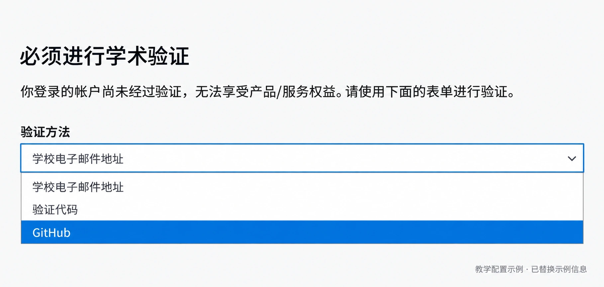
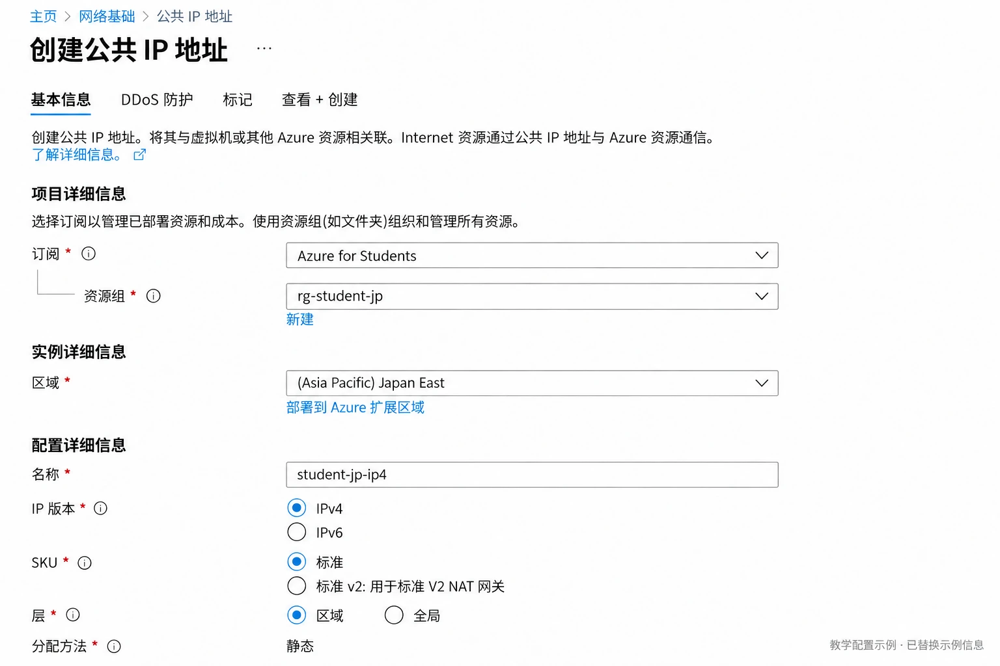

Entre todos los beneficios para estudiantes, suelo poner el de Azure bastante arriba: 100 dólares de crédito al año, sin necesidad de tarjeta de crédito, y durante los primeros 12 meses incluye cuota gratuita para servidores de especificación baja y dos discos del sistema, lo justo para alojar tus propios proyectos.

Te recomiendo empezar creando la instancia en la región de Japón con Ubuntu, dejar listo el acceso por SSH y luego ir trasteando poco a poco con lo que quieras montar. En esta guía llegaremos hasta dejar el servidor creado, sin entrar en el despliegue de aplicaciones; si te interesa, ya puedes buscar por tu cuenta cómo montar cada cosa~

A continuación tienes todo organizado según los beneficios y precios vigentes al 17 de octubre de 2026. Puedes seguir tanto el método web como el de CLI, elige el que prefieras.

Las capturas de paso a paso toman como referencia las páginas normales de Microsoft, pero con los datos privados modificados.

## Primero, reclama Azure for Students

Para solicitarlo debes tener al menos 18 años, estudiar a tiempo completo en una institución de educación superior elegible, y contar con una cuenta de Microsoft además de un correo educativo que pueda recibir mensajes.

### Ruta 1: Entrar desde el paquete de estudiantes de GitHub

Si ya tienes verificada tu cuenta en GitHub Education, abre directamente [GitHub Student Developer Pack](https://education.github.com/pack), busca Microsoft Azure, haz clic en el enlace para reclamarlo y luego inicia sesión con tu cuenta de Microsoft para completar la solicitud.

Asegúrate de que lo que estás reclamando sea **Azure for Students, 100 dólares, 12 meses**, y no lo confundas con Azure for Students Starter, que está pensado para estudiantes más jóvenes.

Si tras entrar en la página de verificación académica te pide elegir un método, selecciona GitHub y sigue las instrucciones en pantalla para autorizar la cuenta.



### Ruta 2: Verificar con tu correo universitario

Abre [Azure for Students](https://azure.microsoft.com/en-us/free/students/), inicia sesión con tu cuenta de Microsoft y rellena el nombre de tu centro educativo y tu correo universitario siguiendo las indicaciones de la página.


El `student@example.edu` de arriba es solo un ejemplo; al hacer la solicitud pon tus datos reales y elige también el país real donde está tu universidad, que eso no tiene nada que ver con elegir después la región de Japón para el servidor.

Cuando recibas el correo de verificación académica, haz clic en el enlace que incluye y vuelve a la página de solicitud para completar los pasos restantes. La validez del enlace aparece indicada en el propio correo; si caduca, vuelve a pedir otro.

Recibir el correo de verificación todavía no significa que ya tengas el beneficio activado: al final entra en «Suscripciones» dentro del [Portal de Azure](https://portal.azure.com/) para confirmar que aparece **Azure for Students**, y revisa ahí el saldo y la fecha de caducidad.


Ambas rutas dan acceso exactamente al mismo beneficio; si te quedas atascado con la verificación por correo, prueba desde el paquete de estudiantes.

## Qué incluye la capa gratuita

Conviene distinguir dos cosas desde el principio: **los 100 dólares de crédito duran 12 meses y se pueden renovar cada año mientras mantengas la condición de estudiante; en cambio, los recursos gratuitos de los primeros 12 meses para nuevos clientes no vuelven a reiniciarse con cada renovación anual**.

| Elemento                  | Alcance gratuito                                 | Qué elegimos en esta guía              |
| ------------------- | ------------------------------------ | ------------------ |
| `Standard_B2ats_v2` | Primeros 12 meses para nuevos clientes, 750 horas al mes                 | x64, opción prioritaria          |
| `Standard_B2pts_v2` | Primeros 12 meses para nuevos clientes, 750 horas al mes                 | Arm64, ideal como segunda máquina de pruebas    |
| `Standard_B1s`      | La página de ayuda para estudiantes sigue listando 750 horas al mes                    | Revisa primero en tu página de servicios gratuitos si sigue disponible en tu región |
| Disco del sistema administrado               | Primeros 12 meses, dos discos P6 Premium SSD LRS de 64 GiB | `Premium_LRS`, uno por máquina |
| Tráfico saliente de Internet       | Primeros 100 GB al mes                           | Se calcula sumando todas las máquinas, no se duplica por cada instancia    |
| Dirección IPv6 pública          | Sin coste por dirección                                 | El tráfico saliente se factura con normalidad           |
| IPv4 pública Standard    | No entra en esta cuota gratuita de direcciones                         | En Japón cuesta unos 0,005 dólares/hora   |

Las 750 horas de cada tamaño gratuito de VM se contabilizan por separado: dan de sobra para tener una máquina encendida todo el mes, pero si creas dos del mismo tamaño compartirán esa misma bolsa de horas. Si quieres levantar dos máquinas, te conviene combinar una B2ats_v2 con una B2pts_v2.

Otro punto donde es fácil equivocarse: **los discos gratuitos son dos P6 Premium SSD LRS de 64 GiB**.


En esa captura fíjate sobre todo en Linux Virtual Machines, Azure Disk Storage y los 100 GB de tráfico saliente; el cálculo de ancho de banda que haremos más abajo también parte de ese límite de 100 GB mensuales.

Entra en «Suscripciones → Azure for Students → Servicios gratuitos» para comprobar tus cuotas disponibles. Después de crear la máquina, espera a que empiecen a registrarse métricas de uso y vuelve aquí para confirmar que las horas de VM y el disco efectivamente se están descontando de los servicios gratuitos.

## De región recomiendo Japón

Primero comprueba dónde tienes permitido desplegar recursos. En la barra superior del [Portal de Azure](https://portal.azure.com/), busca **Directiva (Policy)**, entra, selecciona **Asignaciones (Assignments)** en el menú izquierdo y elige como ámbito tu suscripción **Azure for Students**.

Abre **Allowed resource deployment regions**, entra en **Parámetros (Parameters)** y mira el valor de **Allowed locations**; ahí suelen aparecer las cinco regiones permitidas para esa suscripción.

En mi caso, por ejemplo, salen estas:

```json
["centralindia","indiasouthcentral","uaenorth","malaysiawest","japaneast"]
```

Esta lista no siempre es igual para todo el mundo; como en la mía aparece Japón Oriental, elijo directamente `japaneast`.

Para conectarte desde China continental, mi orden recomendado es **Japón → Singapur → India → Hong Kong** (Estados Unidos ni lo incluyo como alternativa habitual). Busca siguiendo ese orden dentro de las regiones que tengas permitidas.

| Región | Nombre en CLI | Mi elección |
| --- | --- | --- |
| Japón | `japaneast` / `japanwest` | Primera opción, mejor Japón Oriental |
| Singapur | `southeastasia` | Si no te deja crear en Japón |
| India | `centralindia` / `indiasouthcentral` etc. | Elige la región de India que figure en tu directiva |
| Hong Kong | `eastasia` | Déjala para el final y ten en cuenta la limitación con servicios de IA de abajo |

**Hong Kong actualmente no forma parte de las [regiones compatibles oficialmente con ChatGPT](https://help.openai.com/en/articles/7947663-chatgpt-supported-countries) ni de las [regiones compatibles oficialmente con Claude](https://support.claude.com/en/articles/8461763-where-can-i-access-claude)**; si piensas usar ese tipo de servicios de IA, no uses Hong Kong para desbloquearlos y prioriza Japón, Singapur o India.

Asegúrate primero de que la región esté en tu lista permitida y luego revisa los tamaños disponibles y las cuotas: que una región aparezca en el desplegable de creación no garantiza que esta suscripción de estudiante te deje desplegar ahí.

Si te salta `RequestDisallowedByAzure`, revisa la directiva de región que indique el mensaje de error; si el tamaño no está disponible o falta capacidad en la región, cambia a otra región permitida. Cambiar únicamente de zona de disponibilidad no sirve para saltarse la directiva de región.

## Versión web: crear desde el Portal de Azure

### Datos básicos y disco del sistema

Entra en «Máquinas virtuales → Crear → Máquina virtual de Azure» y selecciona lo siguiente:

| Configuración | Qué poner |
| --- | --- |
| Suscripción | Azure for Students |
| Grupo de recursos | Crear nuevo `rg-student-jp` |
| Nombre de la máquina virtual | `student-jp` |
| Región | Japan East |
| Opciones de disponibilidad | Para empezar, elige «No se requiere redundancia de infraestructura»; si necesitas zonas, elige «Zona de disponibilidad» |
| Imagen | Ubuntu Server 24.04 LTS, x64 Gen2 |
| Tipo de seguridad | Estándar |
| Tamaño | `Standard_B2ats_v2` |
| Tipo de autenticación | Clave pública SSH |
| Nombre de usuario | `student` |
| Puertos de entrada públicos | Permitir solo SSH 22 |
| Tipo de disco del SO | Premium SSD LRS |
| Tamaño del disco del SO | 64 GiB, P6 |
| Discos de datos | No agregar |

Primero rellena la suscripción, el grupo de recursos y la región. Aquí crea directamente el grupo de recursos `rg-student-jp`, que luego también meteremos ahí la IP pública y la tarjeta de red


Más abajo elige el sistema y el tamaño: B2ats_v2 corresponde a x64. En autenticación selecciona clave pública SSH y de nombre de usuario usa en todo `student`


Si generas las claves SSH desde el portal, descarga bien la clave privada al crear la VM, porque luego la necesitarás para conectarte; si ya tienes tu propia clave pública SSH, también puedes pegarla directamente

No confundas **Premium SSD v2** con **Premium SSD LRS**, y al entrar en la pestaña de Discos vuelve a comprobar que pone P6 y 64 GiB

### Qué red elegir

Si es tu primera vez, te recomiendo crear una **IPv4 pública Estándar** nueva; IPv6 siempre puedes añadirla después. La mayoría de las redes permiten conectarse por SSH sin líos y te ahorras dolores de cabeza al instalar programas

Si en la pestaña de Redes de la VM no te resulta cómodo crear la IP pública, también puedes buscar «Direcciones IP públicas» en el portal y crearla aparte: elige el mismo grupo de recursos y Japan East, ponle de nombre `student-jp-ip4`, selecciona versión IPv4 y SKU Estándar, y luego vuelve a la pestaña de Redes de la VM para seleccionarla



Si estás seguro de que la red desde la que te conectas soporta IPv6, puedes dejar la IPv4 pública en «Ninguno» y añadir IPv6 después de crear la máquina:

1. Abre la red virtual donde está la VM y añade `fd12:3456:789a::/48` al espacio de direcciones
2. Añade `fd12:3456:789a:1::/64` a la subred de la VM; en Azure las subredes IPv6 usan siempre `/64`
3. Crea una IP pública Estándar en la misma región, selecciona versión de dirección IPv6 y asignación estática
4. Abre la interfaz de red de la VM, añade una nueva configuración IP en «Configuraciones IP» para IPv6 y selecciona la subred y la IPv6 pública que acabas de crear
5. Conserva la configuración IPv4 privada original y comprueba que el grupo de seguridad de red permita TCP 22

La pantalla del paso 3 es muy parecida a la de crear una IPv4: cambia el nombre a `student-jp-ip6`, selecciona IPv6 como versión de IP y deja el SKU en Estándar (no elijas Estándar v2, que viene con NAT Gateway)


Cuando hablo aquí de «solo IPv6» me refiero a **no pagar por una IPv4 pública**; la tarjeta de red de la VM en Azure sigue necesitando su IPv4 privada, así que no hace falta borrarla

De momento no añadas copias de seguridad, monitorización extra ni complementos de pago. Revisa los recursos en «Revisar y crear» y lánzala. El precio que muestra el portal para la VM también hay que mirarlo teniendo en cuenta tu cuota de servicios gratuitos; que aparezca una tarifa no significa que no tengas derecho al nivel gratuito

### Conectarse al servidor

Con IPv4 pública:

```powershell
ssh -i "$HOME\.ssh\azure-student" student@你的公网IPv4
```

Solo con IPv6 pública:

```powershell
ssh -6 -i "$HOME\.ssh\azure-student" student@你的公网IPv6
```

Cambia `$HOME\.ssh\azure-student` por la ruta donde guardaste tu clave privada; la dirección pública la puedes consultar en la pestaña de Redes de la VM

## Versión CLI: crearla con comandos

A continuación usaremos PowerShell 7.4 o superior en Windows, con la clave privada SSH guardada en tu propio ordenador

### Instalación, inicio de sesión y comprobaciones

Instala Azure CLI siguiendo [el método de instalación en Windows de Microsoft](https://learn.microsoft.com/en-us/cli/azure/install-azure-cli-windows); si ya lo tienes instalado, puedes saltarte el comando correspondiente:

```powershell
winget install --exact --id Microsoft.AzureCLI
winget install --exact --id Microsoft.PowerShell
```

Una vez instalado, vuelve a abrir PowerShell 7. Todos los comandos siguientes se ejecutan en esta ventana: primero configuramos que se detenga si falla algún comando, luego iniciamos sesión y elegimos la suscripción:

```powershell
$ErrorActionPreference = 'Stop'
$PSNativeCommandUseErrorActionPreference = $true

az login
az account list -o table
az account set --subscription '你的 Azure for Students 订阅 ID'
```

Configura estas variables: `$publicIpv4 = $true` significa comprar una IPv4 pública, mientras que cambiarlo a `$false` crea únicamente una IPv6 pública; ambas opciones mantienen una red privada de doble pila

```powershell
$region = 'japaneast'
$group = 'rg-student-jp'
$vm = 'student-jp'
$size = 'Standard_B2ats_v2'
$image = 'Canonical:ubuntu-24_04-lts:server:latest'
$publicIpv4 = $true

az policy assignment list -o jsonc
az vm list-usage --location $region -o table
az vm list-skus --location $region --size $size `
  --resource-type virtualMachines --all `
  --query '[].{SKU:name,Restrictions:restrictions,Zones:locationInfo[0].zones}' -o jsonc
az vm image show --location $region --urn $image -o table
```

Primero revisa las ubicaciones permitidas por la directiva, las zonas y la cuota de vCPU disponible de la familia de tamaños, y luego comprueba `Restrictions`. Ten en cuenta que `Zones` solo indica compatibilidad por zona, no garantiza que haya capacidad real, y el derecho a gratuidad sigue teniéndose que verificar en «Servicios gratuitos» dentro de tu suscripción

Si cambias a B2pts_v2, tendrás que cambiar también `$size` a `'Standard_B2pts_v2'` y `$image` a `'Canonical:ubuntu-24_04-lts:server-arm64:latest'`

### Crear la red y las direcciones

Seguimos ejecutando todo en la misma ventana de PowerShell 7; el acento grave al final de los comandos sirve para continuar en la siguiente línea, así que va seguido directamente de un salto de línea

```powershell
New-Item -ItemType Directory -Path "$HOME\.ssh" -Force | Out-Null
ssh-keygen -t ed25519 -f "$HOME\.ssh\azure-student" -C azure-student

az group create --name $group --location $region

az network vnet create -g $group -n vnet-student -l $region `
  --address-prefixes 10.20.0.0/16 fd12:3456:789a::/48 `
  --subnet-name snet-student `
  --subnet-prefixes 10.20.1.0/24 fd12:3456:789a:1::/64

az network nsg create -g $group -n nsg-student -l $region
az network nsg rule create -g $group --nsg-name nsg-student `
  -n allow-ssh --priority 1000 --direction Inbound --access Allow `
  --protocol Tcp --source-address-prefixes Internet `
  --source-port-ranges '*' --destination-address-prefixes '*' `
  --destination-port-ranges 22

az network public-ip create -g $group -n "${vm}-ip6" -l $region `
  --sku Standard --version IPv6 --allocation-method Static

az network nic create -g $group -n "${vm}-nic" -l $region `
  --vnet-name vnet-student --subnet snet-student `
  --network-security-group nsg-student

az network nic ip-config create -g $group --nic-name "${vm}-nic" `
  -n ipconfig6 --private-ip-address-version IPv6 `
  --vnet-name vnet-student --subnet snet-student `
  --public-ip-address "${vm}-ip6"

if ($publicIpv4) {
  az network public-ip create -g $group -n "${vm}-ip4" -l $region `
    --sku Standard --version IPv4 --allocation-method Static
  az network nic ip-config update -g $group --nic-name "${vm}-nic" `
    -n ipconfig1 --public-ip-address "${vm}-ip4"
}
```

Cuando `ssh-keygen` pregunte si quieres sobrescribir un archivo existente, no machaques tus claves antiguas: ponle un nombre de archivo nuevo y actualiza también la ruta de la clave pública más adelante

### Crear la VM y comprobar el disco del sistema

```powershell
az vm create -g $group -n $vm -l $region `
  --size $size --image $image --security-type Standard `
  --admin-username student --authentication-type ssh `
  --ssh-key-values "$HOME\.ssh\azure-student.pub" `
  --nics "${vm}-nic" --os-disk-name "${vm}-os" `
  --storage-sku Premium_LRS --os-disk-size-gb 64

az vm get-instance-view -g $group -n $vm `
  --query 'instanceView.statuses[].displayStatus' -o tsv
az disk show -g $group -n "${vm}-os" `
  --query '{Disk:name,Storage:sku.name,GiB:diskSizeGb,Tier:tier}' -o table
az network public-ip list -g $group `
  --query '[].{Name:name,Version:publicIPAddressVersion,Address:ipAddress}' -o table
```

El disco del sistema debería ser `Premium_LRS`, de 64 GiB y P6. Apunta la dirección pública que salga en pantalla y conéctate usando el comando SSH de antes; este conjunto de comandos no especifica ninguna zona de disponibilidad por defecto para no atarte a la capacidad de una zona concreta

## También puedes pedirle a una IA que lo configure por ti

Si usas un asistente de IA con acceso a tu terminal local, pásale este bloque; el inicio de sesión de la cuenta y el código de verificación los completas tú en la página de Microsoft

```text
帮我用 PowerShell 7 安装 Azure CLI、登录 Azure for Students，检查允许地区、配额和免费服务；地区依次选日本、新加坡、印度、香港，列出费用等我确认，再创建一台 B2ats_v2、Ubuntu 24.04 LTS x64 Gen2、64 GiB P6 Premium_LRS 的 VM，配好双栈网络、公网 IPv4 和 IPv6、SSH 公钥与 TCP 22，验证 SSH 后给出地址、连接命令和资源清单
```

Si quieres usar solo IPv6, cambia la opción de red pública a «IPv6 pública Estándar, conservando red privada de doble pila»; si usas una IA de chat normal, pídele que te dé los comandos de PowerShell y los vas copiando y ejecutando tú

## ¿Merece la pena pagar por una IPv4 pública?

**Si quieres tranquilidad, quédate con una IPv4; si prefieres ahorrarte el coste de la dirección y asumes los problemas de compatibilidad, usa solo IPv6 pública**

La dirección IPv6 en sí es gratuita, pero los datos que salen de ella siguen contando como tráfico saliente; además, la red desde la que te conectes al servidor también tiene que tener IPv6, y cuando el servidor intente acceder a webs o repositorios que solo soporten IPv4, es posible que no conecte


Por eso, si dejas solo IPv6, conéctate primero por SSH al servidor Ubuntu y revisa en la terminal Bash las direcciones y rutas IPv6, probando a actualizar el sistema y los repositorios que vayas a usar:

```bash
ip -6 addr show scope global
ip -6 route
curl -6 -I https://www.microsoft.com/
sudo apt update
curl -I https://github.com/
curl -I https://registry-1.docker.io/v2/
```

Que Docker Registry devuelva `401 Unauthorized` suele indicar que ya hay conexión con el servicio, simplemente falta autenticarse; si GitHub o algún repositorio no responden, revisa el soporte IPv6 de cada servicio en concreto y no añadas automáticamente un NAT Gateway con coste fijo solo para tapar ese hueco

## Cuánto tráfico puedes usar al mes

**El tráfico entrante desde Internet es gratuito, y los primeros 100 GB mensuales de tráfico saliente también son gratuitos**. Lo siguiente se calcula según el enrutamiento predeterminado por la red global de Microsoft: en Japón, Singapur, India y Hong Kong el exceso se cobra a 0,12 USD/GB

La IPv4 pública Standard en las regiones mencionadas cuesta 0.005 dólares/hora; calculado sobre 730 horas al mes, una dirección sale por unos **3.65 dólares/mes**, y unos 43.80 dólares al año; la IPv6 pública no tiene coste de dirección


Si repartimos los 100 dólares equitativamente entre 12 meses, el presupuesto mensual es de unos 8.33 dólares; con la VM y los dos primeros discos P6 dentro del nivel gratuito y sin otros gastos, las cuentas salen así:

| Región y configuración de red pública | Coste de dirección/mes | Salida adicional cubierta por el crédito/mes | Sumando los 100 GB gratis |
| --- | --- | --- | --- |
| Japón / Singapur / India / Hong Kong, una IPv4, con opción de añadir IPv6 a la vez | aprox. $3.65 | aprox. 39 GB | **aprox. 139 GB/mes** |
| Japón / Singapur / India / Hong Kong, solo IPv6 pública | $0 | aprox. 69 GB | **aprox. 169 GB/mes** |

La fórmula tampoco tiene mucho misterio:

```text
每月总出站 GB
= 100 + (100 ÷ 12 - 公网 IPv4 月费 - 其他月费) ÷ 每 GB 出站价格
```

Aquí estamos calculando el presupuesto total de todo el montaje, no es que cada VM se lleve 100 GB y 100 dólares por separado: si tienes dos máquinas y solo compras una IPv4, el total en la región de Japón sigue rondando los 139 GB/mes; si compras dos IPv4, el coste de las direcciones sube a unos 7.30 dólares/mes y te queda mucho menos crédito para tráfico

Además, los 100 dólares son un saldo anual que entra de golpe, no es que te ingresen 8.33 dólares nuevos cada mes; en cambio, los 100 GB gratuitos sí se reinician mensualmente y lo que no gastes no se acumula para el mes siguiente, mientras que el tráfico entre regiones y otros conceptos van aparte

## Cómo recoger todo cuando termines

En el día a día puedes revisar el consumo de recursos en «Servicios gratuitos» de la suscripción, y mirar la IPv4 y el tráfico extra en «Administración de costos»; de paso, apúntate el saldo del crédito de estudiante y su fecha de caducidad

Mientras sigas cumpliendo los requisitos de estudiante podrás renovar los 100 dólares año tras año; eso sí, cuando pasen los primeros 12 meses gratuitos de la VM y los discos, tendrás que volver a meter su coste en el presupuesto, y el crédito antiguo no se traspasa

Si ya no lo vas a usar, guarda primero tus datos y borra este grupo de recursos creado expresamente para practicar; así se eliminarán a la vez la VM, los discos, la tarjeta de red y la IP pública:

```powershell
az group delete --name rg-student-jp
```

Detener solo la VM no hace que desaparezcan los discos ni la IPv4 estática reservada, y por eso mismo recomiendo meter todo este tinglado en un grupo aparte: limpiar después es muchísimo más sencillo

## Referencias

- [Azure for Students: información sobre los 100 dólares, renovación y VM gratuitas](https://azure.microsoft.com/en-us/free/students/)
- [Requisitos y términos de crédito de Azure for Students](https://azure.microsoft.com/en-us/pricing/offers/ms-azr-0170p/)
- [GitHub Student Developer Pack](https://education.github.com/pack)
- [Lista de servicios gratuitos de Azure](https://azure.microsoft.com/en-us/pricing/free-services/)
- [Comunidad de Microsoft: consultar las cinco regiones permitidas para desplegar con suscripción de estudiante](https://learn.microsoft.com/en-us/answers/questions/5924508/requestdisallowedbyazure-allowed-resource-deployme)
- [Aclaración de la comunidad de Microsoft sobre los dos discos P6 gratuitos de 64 GiB](https://learn.microsoft.com/en-us/answers/questions/5556769/which-storage-type-is-free-12months-in-free-tier)
- [Precios de direcciones IP públicas](https://azure.microsoft.com/en-us/pricing/details/ip-addresses/)
- [API oficial de precios minoristas de IP públicas en la región de Japón](https://prices.azure.com/api/retail/prices?$filter=serviceName%20eq%20%27Virtual%20Network%27%20and%20armRegionName%20eq%20%27japaneast%27)
- [Precios de ancho de banda de salida](https://azure.microsoft.com/en-us/pricing/details/bandwidth/)
- [Azure IPv6: costes de direcciones, tarjetas de red de doble pila y límites de subred](https://learn.microsoft.com/en-us/azure/virtual-network/ip-services/ipv6-overview)
- [Acceso saliente predeterminado y creación de subredes privadas](https://learn.microsoft.com/en-us/azure/virtual-network/ip-services/default-outbound-access)
- [Instalar Azure CLI en Windows](https://learn.microsoft.com/en-us/cli/azure/install-azure-cli-windows)
- [Usar Azure CLI en PowerShell](https://learn.microsoft.com/en-us/cli/azure/use-azure-cli-successfully-powershell)
- [Inicio de sesión interactivo y selección de suscripción en Azure CLI](https://learn.microsoft.com/en-us/cli/azure/authenticate-azure-cli-interactively)

## Seguir leyendo

El resto de ventajas oficiales están en [[edumails-glados-student-benefits|Tabla general de beneficios para estudiantes]], y también puedes comparar con [[aliyun-student-300-voucher-guide|Cupones de estudiante de Alibaba Cloud]] para elegir una máquina que te encaje

Con el servidor ya montado, sigue con [[docker-compose-minimum-start|Introducción a Docker]] y [[2c2g-server-service-index|Lista de servicios para servidores pequeños]], luego elige entre [[selfhost-ntfy-on-2c2g|Notificaciones con ntfy]] o [[selfhost-vaultwarden-on-2c2g|Gestor de contraseñas Vaultwarden]], y deja el dominio y el HTTPS en manos de [[cloudflare-free-tier-developer-guide|Cloudflare]]
