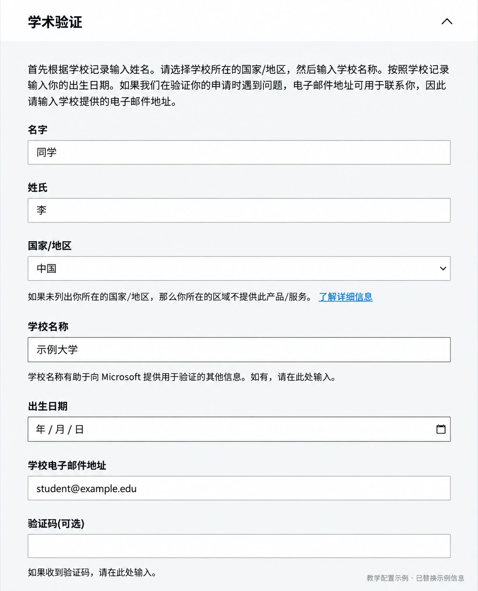
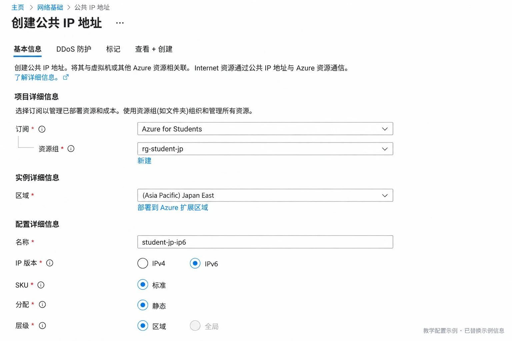

Parmi les avantages étudiants, je mets Azure assez haut dans la liste : 100 $ de crédit par an, sans carte bancaire, plus des quotas gratuits pendant les 12 premiers mois sur une petite VM et deux disques OS — pile ce qu'il faut pour héberger ses petits projets.

Je conseille plutôt de partir sur la région Japon avec Ubuntu, de valider d'abord la connexion SSH, puis de bidouiller tranquillement ce qu'on veut y mettre ; ce billet s'arrête une fois le serveur lancé, sans détailler le déploiement d'applis, donc si ça vous tente, vous pourrez chercher comment les monter de votre côté.

Ci-dessous, tout est rangé selon les avantages et tarifs au 17 octobre 2026, avec le portail web et la CLI au choix.

Les captures d'écran reprennent des pages Microsoft normales, adaptées avec des infos privées.

## Réclamer d'abord Azure for Students

Il faut avoir au moins 18 ans, être inscrit à temps plein dans un établissement éligible, et préparer un compte Microsoft ainsi qu'une adresse e-mail étudiante capable de recevoir des messages.

### Option 1 : passer par le pack étudiant GitHub

Si votre statut GitHub Education est déjà validé, ouvrez directement [GitHub Student Developer Pack](https://education.github.com/pack), repérez Microsoft Azure, cliquez sur le lien d'activation puis connectez-vous avec votre compte Microsoft pour finaliser la demande.

Vérifiez bien qu'il s'agit d'**Azure for Students, 100 $, 12 mois**, sans confondre avec Azure for Students Starter destiné aux plus jeunes.

Si la page de vérification académique demande de choisir une méthode, sélectionnez GitHub et suivez l'autorisation de compte indiquée à l'écran.


### Option 2 : vérifier avec son adresse universitaire

Ouvrez [Azure for Students](https://azure.microsoft.com/en-us/free/students/), connectez-vous au compte Microsoft, puis renseignez votre établissement et votre adresse e-mail étudiante selon les indications.



Les `student@example.edu` ci-dessus ne sont qu'un exemple : mettez vos vraies informations à l'inscription et choisissez le pays de votre établissement, ce qui n'a rien à voir avec le choix du Japon pour le serveur ensuite.

Une fois l'e-mail de vérification académique reçu, cliquez sur le lien qu'il contient puis revenez sur la page de demande pour finir les étapes ; la validité du lien est indiquée dans le message, et s'il a expiré, refaites-en simplement envoyer un.

Recevoir l'e-mail de vérification ne veut pas dire que tout est déjà actif : allez enfin dans « Abonnements » sur le [portail Azure](https://portal.azure.com/) pour vérifier que **Azure for Students** apparaît bien, puis consultez le solde et la date d'expiration.


Ces deux entrées donnent accès au même avantage ; si la voie par e-mail coince, tentez celle du pack étudiant.

## Ce qui est gratuit

Distinguez bien deux choses : **les 100 $ de crédit s'utilisent sur 12 mois et peuvent être renouvelés chaque année si l'éligibilité étudiante continue ; les ressources gratuites des 12 premiers mois pour les nouveaux clients ne repartent pas à zéro à chaque renouvellement annuel.**

| Élément | Périmètre gratuit | Choix retenu ici |
| --- | --- | --- |
| `Standard_B2ats_v2` | 750 heures/mois pendant les 12 premiers mois pour les nouveaux clients | x64, à prendre en priorité |
| `Standard_B2pts_v2` | 750 heures/mois pendant les 12 premiers mois pour les nouveaux clients | Arm64, pratique comme seconde machine de test |
| `Standard_B1s` | Toujours listé à 750 heures/mois sur la page dédiée aux étudiants | Vérifiez d'abord vos services gratuits et la dispo régionale |
| Disque OS managé | Deux disques P6 Premium SSD LRS de 64 GiB pendant les 12 premiers mois | `Premium_LRS`, un par machine |
| Trafic sortant Internet | Premiers 100 Go/mois | Cumulé sur l'ensemble des VM, pas par machine |
| Adresse IPv6 publique | Pas de frais d'adresse | Le trafic sortant reste décompté normalement |
| IPv4 publique Standard | Pas dans le quota d'adresses gratuites ici | Environ 0,005 $/heure au Japon |

Les 750 heures de chaque taille de VM gratuite sont comptées séparément : un mois suffit pour faire tourner une machine en continu, mais deux VM de même taille consomment cette enveloppe ensemble ; pour en lancer deux, on peut envisager une `B2ats_v2` plus une `B2pts_v2`.

Autre piège classique : **les disques gratuits sont deux P6 Premium SSD LRS de 64 GiB**.


Sur cette capture, regardez surtout Linux Virtual Machines, Azure Disk Storage et les 100 Go sortants ; le budget trafic ci-dessous est aussi calculé sur ce palier de 100 Go/mois.

Ouvrez « Abonnements → Azure for Students → Services gratuits » pour vérifier vos quotas disponibles, puis après création — une fois l'usage remonté — revenez confirmer que les heures de VM et le disque sont bien comptabilisés dans les services gratuits.

## Je recommande la région Japon

Vérifiez d'abord où vous pouvez déployer : dans la barre du haut du [portail Azure](https://portal.azure.com/), cherchez **Stratégie** (`Policy`), ouvrez puis sélectionnez **Affectations** (`Assignments`) à gauche, et choisissez votre abonnement **Azure for Students** comme étendue.

Ouvrez **Allowed resource deployment regions**, allez dans **Paramètres** (`Parameters`), et regardez la valeur de **Allowed locations** : vous verrez en général cinq régions autorisées pour cet abonnement.

Chez moi par exemple :

```json
["centralindia","indiasouthcentral","uaenorth","malaysiawest","japaneast"]
```

Cette liste varie selon chacun ; la mienne contient Japon Est, donc je prends directement `japaneast`.

Depuis la Chine continentale, je recommande **Japon → Singapour → Inde → Hong Kong** ; les États-Unis ne figurent pas dans mes options courantes, et il faut chercher dans cet ordre parmi vos régions autorisées.

| Région | Nom CLI | Mon choix |
| --- | --- | --- |
| Japon | `japaneast` / `japanwest` | Premier choix, Japon Est en priorité |
| Singapour | `southeastasia` | À regarder si le Japon ne passe pas |
| Inde | `centralindia` / `indiasouthcentral` etc. | Selon les régions indiennes de votre stratégie |
| Hong Kong | `eastasia` | Tout à la fin, en gardant en tête les restrictions IA ci-dessous |

**Hong Kong ne figure actuellement ni dans [les régions officiellement prises en charge par ChatGPT](https://help.openai.com/en/articles/7947663-chatgpt-supported-countries) ni dans [les régions officiellement prises en charge par Claude](https://support.claude.com/en/articles/8461763-where-can-i-access-claude)** : si vous visez ce type de service IA, ne comptez pas sur Hong Kong comme région de contournement, et regardez plutôt le Japon, Singapour et l'Inde.

Une fois la région confirmée dans la liste autorisée, vérifiez les tailles et les quotas : voir une région dans le menu déroulant de création ne garantit pas qu'un abonnement étudiant puisse y déployer.

Si vous tombez sur `RequestDisallowedByAzure`, lisez la stratégie régionale pointée par l'erreur ; en cas de taille indisponible ou de capacité insuffisante dans la région, passez à une autre région autorisée, car changer uniquement de zone de disponibilité ne contourne pas une stratégie régionale.

## Version web : créer dans le portail Azure

### Infos de base et disque système

Allez dans « Machines virtuelles → Créer → Machine virtuelle Azure » et renseignez comme suit :

| Paramètre | Valeur à renseigner |
| --- | --- |
| Abonnement | Azure for Students |
| Groupe de ressources | Créer `rg-student-jp` |
| Nom de la machine virtuelle | `student-jp` |
| Région | Japan East |
| Options de disponibilité | Choisir Sans redondance d'infrastructure pour débuter ; une zone de disponibilité uniquement si vous avez un besoin précis |
| Image | Ubuntu Server 24.04 LTS, x64 Gen2 |
| Type de sécurité | Standard |
| Taille | `Standard_B2ats_v2` |
| Authentification | Clé publique SSH |
| Nom d'utilisateur | `student` |
| Ports entrants publics | Autoriser uniquement SSH 22 |
| Type de disque OS | Premium SSD LRS |
| Taille du disque OS | 64 GiB, P6 |
| Disques de données | Ne pas ajouter |

Remplissez d'abord l'abonnement, le groupe de ressources et la région en créant directement `rg-student-jp` : l'IP publique et la carte réseau iront aussi dans ce groupe ensuite.


Descendez ensuite pour choisir l'OS et la taille (`B2ats_v2` correspond au x64), sélectionnez Clé publique SSH pour l'authentification, et mettez `student` comme nom d'utilisateur.


Si le portail génère la clé SSH, téléchargez bien la clé privée à la création car vous en aurez besoin pour vous connecter ; si vous avez déjà votre clé publique SSH, collez-la directement.

Ne mélangez pas **Premium SSD v2** et **Premium SSD LRS**, et vérifiez encore P6 et 64 GiB sur l'onglet des disques.

### Quel choix côté réseau

Pour un premier essai, je conseille plutôt de créer une **IPv4 publique Standard** : l'IPv6 pourra s'ajouter plus tard, la connexion SSH passe directement depuis la plupart des réseaux, et l'installation de paquets est plus tranquille.

Si créer l'IP publique directement dans l'onglet réseau de la VM n'est pas pratique, cherchez « Adresses IP publiques » dans le portail pour la créer à part dans le même groupe de ressources et en `Japan East`, sous le nom `student-jp-ip4`, version IPv4, SKU Standard, puis sélectionnez-la dans l'onglet réseau de la VM.


Si vous êtes sûr que votre accès réseau gère l'IPv6, vous pouvez mettre l'IPv4 publique sur « Aucun » puis ajouter l'IPv6 après création :

1. Ouvrez le réseau virtuel de la VM et ajoutez `fd12:3456:789a::/48` dans l'espace d'adressage.
2. Ajoutez `fd12:3456:789a:1::/64` au sous-réseau de la VM ; Azure impose `/64` pour les sous-réseaux IPv6.
3. Créez une IP publique Standard dans la même région, version IPv6, attribution statique.
4. Ouvrez la carte réseau de la VM et ajoutez une configuration IPv6 dans « Configurations IP » en choisissant ce sous-réseau et cette IPv6 publique.
5. Gardez la configuration IPv4 privée d'origine et vérifiez que le groupe de sécurité réseau autorise TCP 22.

L'écran de l'étape 3 ressemble beaucoup à celui de l'IPv4 : nommez-la `student-jp-ip6`, choisissez la version IPv6, gardez le SKU Standard et évitez Standard v2 avec NAT Gateway.



Ici, IPv6 uniquement signifie **ne pas acheter d'IPv4 publique** ; la carte réseau de la VM Azure doit garder son IPv4 privée, ne la supprimez pas.

N'ajoutez ni sauvegarde, ni surveillance supplémentaire, ni option payante à ce stade ; vérifiez tout dans « Vérifier + créer » avant de lancer, et relisez les prix affichés sur le portail à l'aune de vos quotas gratuits : voir un tarif affiché ne veut pas dire qu'il n'y a pas d'avantage gratuit.

### Se connecter au serveur

Avec une IPv4 publique :

```powershell
ssh -i "$HOME\.ssh\azure-student" student@你的公网IPv4
```

Avec une IPv6 publique uniquement :

```powershell
ssh -6 -i "$HOME\.ssh\azure-student" student@你的公网IPv6
```

Remplacez `$HOME\.ssh\azure-student` par le chemin de votre clé privée enregistrée, et récupérez l'adresse publique dans l'onglet réseau de la VM.

## Version CLI : créer en ligne de commande

La suite utilise PowerShell 7.4 ou plus récent sous Windows, avec la clé privée SSH enregistrée sur votre machine.

### Installer, se connecter et vérifier

Installez Azure CLI selon [la méthode d'installation Windows de Microsoft](https://learn.microsoft.com/en-us/cli/azure/install-azure-cli-windows) (passez la commande correspondante si c'est déjà fait) :

```powershell
winget install --exact --id Microsoft.AzureCLI
winget install --exact --id Microsoft.PowerShell
```

Rouvrez PowerShell 7 après installation et exécutez toutes les commandes suivantes dans cette fenêtre : on arrête d'abord l'exécution en cas d'erreur, puis on se connecte et on sélectionne l'abonnement :

```powershell
$ErrorActionPreference = 'Stop'
$PSNativeCommandUseErrorActionPreference = $true

az login
az account list -o table
az account set --subscription '你的 Azure for Students 订阅 ID'
```

Définissez ces variables : `$publicIpv4 = $true` achète une IPv4 publique ; passez à `$false` pour ne créer qu'une IPv6 publique, tout en gardant le double stack privé dans les deux cas.

```powershell
$region = 'japaneast'
$group = 'rg-student-jp'
$vm = 'student-jp'
$size = 'Standard_B2ats_v2'
$image = 'Canonical:ubuntu-24_04-lts:server:latest'
$publicIpv4 = $true

az policy assignment list -o jsonc
az vm list-usage --location $region -o table
az vm list-skus --location $region --size $size `
  --resource-type virtualMachines --all `
  --query '[].{SKU:name,Restrictions:restrictions,Zones:locationInfo[0].zones}' -o jsonc
az vm image show --location $region --urn $image -o table
```

Consultez d'abord les régions autorisées par stratégie, les zones et le solde de vCPU de la famille, puis vérifiez `Restrictions` : `Zones` n'indique que le support de zone, pas une garantie de capacité, et l'éligibilité gratuite se confirme toujours dans « Services gratuits » de l'abonnement.

Si vous passez sur `B2pts_v2`, modifiez en même temps `$size` en `'Standard_B2pts_v2'` et `$image` en `'Canonical:ubuntu-24_04-lts:server-arm64:latest'`.

### Créer le réseau et les adresses

Poursuivez dans la même fenêtre PowerShell 7 ; l'accent grave (`) est un caractère de continuation de ligne, donc passez directement à la ligne après lui.

```powershell
New-Item -ItemType Directory -Path "$HOME\.ssh" -Force | Out-Null
ssh-keygen -t ed25519 -f "$HOME\.ssh\azure-student" -C azure-student

az group create --name $group --location $region

az network vnet create -g $group -n vnet-student -l $region `
  --address-prefixes 10.20.0.0/16 fd12:3456:789a::/48 `
  --subnet-name snet-student `
  --subnet-prefixes 10.20.1.0/24 fd12:3456:789a:1::/64

az network nsg create -g $group -n nsg-student -l $region
az network nsg rule create -g $group --nsg-name nsg-student `
  -n allow-ssh --priority 1000 --direction Inbound --access Allow `
  --protocol Tcp --source-address-prefixes Internet `
  --source-port-ranges '*' --destination-address-prefixes '*' `
  --destination-port-ranges 22

az network public-ip create -g $group -n "${vm}-ip6" -l $region `
  --sku Standard --version IPv6 --allocation-method Static

az network nic create -g $group -n "${vm}-nic" -l $region `
  --vnet-name vnet-student --subnet snet-student `
  --network-security-group nsg-student

az network nic ip-config create -g $group --nic-name "${vm}-nic" `
  -n ipconfig6 --private-ip-address-version IPv6 `
  --vnet-name vnet-student --subnet snet-student `
  --public-ip-address "${vm}-ip6"

if ($publicIpv4) {
  az network public-ip create -g $group -n "${vm}-ip4" -l $region `
    --sku Standard --version IPv4 --allocation-method Static
  az network nic ip-config update -g $group --nic-name "${vm}-nic" `
    -n ipconfig1 --public-ip-address "${vm}-ip4"
}
```

Si `ssh-keygen` demande d'écraser un fichier existant, n'écrasez pas votre ancienne clé : donnez un autre nom de fichier et mettez à jour le chemin de clé publique ensuite.

### Créer la VM, puis vérifier le disque OS

```powershell
az vm create -g $group -n $vm -l $region `
  --size $size --image $image --security-type Standard `
  --admin-username student --authentication-type ssh `
  --ssh-key-values "$HOME\.ssh\azure-student.pub" `
  --nics "${vm}-nic" --os-disk-name "${vm}-os" `
  --storage-sku Premium_LRS --os-disk-size-gb 64

az vm get-instance-view -g $group -n $vm `
  --query 'instanceView.statuses[].displayStatus' -o tsv
az disk show -g $group -n "${vm}-os" `
  --query '{Disk:name,Storage:sku.name,GiB:diskSizeGb,Tier:tier}' -o table
az network public-ip list -g $group `
  --query '[].{Name:name,Version:publicIPAddressVersion,Address:ipAddress}' -o table
```

Le disque OS doit être `Premium_LRS`, 64 GiB, P6 ; notez l'adresse publique renvoyée et connectez-vous avec la commande SSH précédente. Ces commandes ne fixent pas de zone de disponibilité par défaut afin d'éviter de figer la contrainte de capacité d'une seule zone.

## Vous pouvez aussi laisser une IA configurer tout ça

Avec un assistant IA capable d'agir sur votre terminal local, envoyez-lui ce bloc et gérez vous-même la connexion au compte ainsi que les codes de vérification sur les pages Microsoft.

```text
帮我用 PowerShell 7 安装 Azure CLI、登录 Azure for Students，检查允许地区、配额和免费服务；地区依次选日本、新加坡、印度、香港，列出费用等我确认，再创建一台 B2ats_v2、Ubuntu 24.04 LTS x64 Gen2、64 GiB P6 Premium_LRS 的 VM，配好双栈网络、公网 IPv4 和 IPv6、SSH 公钥与 TCP 22，验证 SSH 后给出地址、连接命令和资源清单
```

Pour n'utiliser que l'IPv6, passez l'option publique sur « IPv6 publique Standard, double stack privé conservé » ; avec une IA de chat classique, demandez-lui les commandes PowerShell et exécutez-les vous-même.

## L'IPv4 publique vaut-elle son prix ?

**Gardez une IPv4 pour la tranquillité, ou mettez uniquement une IPv6 publique si vous voulez économiser les frais d'adresse et accepter les compromis de compatibilité.**

L'adresse IPv6 est gratuite en tant que telle, mais les données sortantes comptent toujours comme du trafic sortant, votre propre connexion vers le serveur doit aussi avoir l'IPv6, et l'accès depuis le serveur vers des sites ou miroirs uniquement en IPv4 peut échouer.


Donc avec l'IPv6 seule, connectez-vous d'abord en SSH à la VM Ubuntu, puis dans le shell Bash du serveur vérifiez l'adresse IPv6 et le routage, et testez la mise à jour ainsi que les dépôts de paquets que vous utilisez :

```bash
ip -6 addr show scope global
ip -6 route
curl -6 -I https://www.microsoft.com/
sudo apt update
curl -I https://github.com/
curl -I https://registry-1.docker.io/v2/
```

Un retour `401 Unauthorized` du registre Docker signifie en général que la liaison au service a réussi mais qu'il manque l'authentification ; si GitHub ou un dépôt de paquets ne répond pas, vérifiez le support IPv6 du service concerné sans ajouter aussitôt une NAT Gateway à coût fixe juste pour combler cela.

## Combien de trafic mensuel vous pouvez utiliser

**Le trafic entrant Internet est gratuit, et les 100 premiers Go sortants par mois sont gratuits** ; les calculs ci-dessous suivent le routage réseau mondial Microsoft par défaut, avec un dépassement à 0,12 $/Go au Japon, à Singapour, en Inde et à Hong Kong.

L'IPv4 publique Standard coûte 0,005 $/heure dans ces régions : sur 730 heures par mois, une adresse revient à environ **3,65 $/mois**, soit environ 43,80 $ par an ; l'IPv6 publique n'a pas de frais d'adresse.


Si l'on répartit les 100 $ sur 12 mois, cela fait environ 8,33 $/mois ; tant que la VM et les deux premiers disques P6 restent dans le gratuit et qu'il n'y a pas d'autres frais, on peut poser le calcul ainsi :

| Région et configuration publique | Frais d'adresse/mois | Trafic sortant supp./mois couvert par le crédit | Avec les 100 Go gratuits |
| --- | --- | --- | --- |
| Japon / Singapour / Inde / Hong Kong, une IPv4, IPv6 possible en plus | ~ 3,65 $ | ~ 39 Go | **~ 139 Go/mois** |
| Japon / Singapour / Inde / Hong Kong, IPv6 publique uniquement | 0 $ | ~ 69 Go | **~ 169 Go/mois** |

La formule est simple :

```text
每月总出站 GB
= 100 + (100 ÷ 12 - 公网 IPv4 月费 - 其他月费) ÷ 每 GB 出站价格
```

Ici, c'est le budget global de l'installation qui est calculé, pas 100 Go et 100 $ par VM : avec deux machines pour une seule IPv4, le total au Japon reste autour de 139 Go/mois, alors qu'avec deux IPv4 les frais d'adresse montent à environ 7,30 $/mois et réduisent nettement ce qui reste pour le trafic.

Par ailleurs, les 100 $ arrivent en une seule enveloppe annuelle et ne sont pas re crédités de 8,33 $ chaque mois, tandis que les 100 Go gratuits se réinitialisent tous les mois sans report du reliquat, et le trafic inter-régions ou d'autres postes se comptent séparément.

## Faire le ménage quand ce n'est plus utile

En usage courant, suivez l'utilisation des ressources dans « Services gratuits » de l'abonnement, surveillez l'IPv4 et le trafic supplémentaire dans « Gestion des coûts », et notez le solde de crédit étudiant ainsi que sa date d'expiration.

Tant que vous remplissez les conditions étudiantes, vous pouvez renouveler les 100 $ chaque année ; à la fin des 12 premiers mois de gratuité sur la VM et les disques, réintégrez leur coût dans votre budget, car l'ancien crédit ne se reporte pas.

Quand vous n'en avez plus besoin, sauvegardez d'abord vos données puis supprimez ce groupe de ressources dédié aux essais : la VM, les disques, la carte réseau et l'IP publique disparaîtront ensemble :

```powershell
az group delete --name rg-student-jp
```

Arrêter uniquement la VM ne supprime ni le disque ni une IPv4 statique conservée : c'est aussi pour ça que je conseille d'isoler ces ressources dans un groupe dédié, ce qui rend le nettoyage bien plus simple.

## Références

- [Azure for Students : 100 $, renouvellement et présentation des VM gratuites](https://azure.microsoft.com/en-us/free/students/)
- [Conditions d'éligibilité et de crédit Azure for Students](https://azure.microsoft.com/en-us/pricing/offers/ms-azr-0170p/)
- [GitHub Student Developer Pack](https://education.github.com/pack)
- [Liste des services gratuits Azure](https://azure.microsoft.com/en-us/pricing/free-services/)
- [Communauté Microsoft : vérifier les cinq régions autorisées d'un abonnement étudiant](https://learn.microsoft.com/en-us/answers/questions/5924508/requestdisallowedbyazure-allowed-resource-deployme)
- [Explication de la communauté Microsoft sur les deux disques gratuits P6 de 64 GiB](https://learn.microsoft.com/en-us/answers/questions/5556769/which-storage-type-is-free-12months-in-free-tier)
- [Tarification des adresses IP publiques](https://azure.microsoft.com/en-us/pricing/details/ip-addresses/)
- [API officielle de prix détail des IP publiques pour la région Japon](https://prices.azure.com/api/retail/prices?$filter=serviceName%20eq%20%27Virtual%20Network%27%20and%20armRegionName%20eq%20%27japaneast%27)
- [Tarification de la bande passante sortante](https://azure.microsoft.com/en-us/pricing/details/bandwidth/)
- [IPv6 Azure : frais d'adresse, cartes réseau double stack et limites de sous-réseau](https://learn.microsoft.com/en-us/azure/virtual-network/ip-services/ipv6-overview)
- [Accès sortant par défaut et création d'un sous-réseau privé](https://learn.microsoft.com/en-us/azure/virtual-network/ip-services/default-outbound-access)
- [Installer Azure CLI sous Windows](https://learn.microsoft.com/en-us/cli/azure/install-azure-cli-windows)
- [Utiliser Azure CLI dans PowerShell](https://learn.microsoft.com/en-us/cli/azure/use-azure-cli-successfully-powershell)
- [Connexion interactive et sélection d'abonnement dans Azure CLI](https://learn.microsoft.com/en-us/cli/azure/authenticate-azure-cli-interactively)

## À lire ensuite

Les autres avantages officiels sont regroupés dans [[edumails-glados-student-benefits|Récapitulatif des avantages étudiants]], et vous pouvez aussi comparer avec [[aliyun-student-300-voucher-guide|Bons étudiants Alibaba Cloud]] pour choisir une machine adaptée.

Une fois le serveur lancé, enchaînez avec [[docker-compose-minimum-start|Débuter avec Docker]] et [[2c2g-server-service-index|Liste de services pour petit serveur]], puis choisissez [[selfhost-ntfy-on-2c2g|Notifications ntfy]] ou [[selfhost-vaultwarden-on-2c2g|Coffre Vaultwarden]], en confiant le domaine et le HTTPS à [[cloudflare-free-tier-developer-guide|Cloudflare]].
