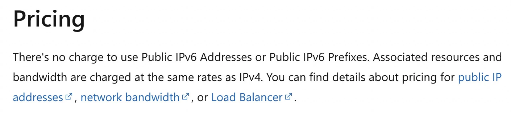

学生向け特典の中でも、個人的に Azure はかなり上位に推したい。毎年 100 ドル分のクレジットがもらえてクレジットカード不要、最初の 12 か月間は小さめスペックのサーバーとシステムディスク 2 枚分の無料枠まで付いてくるので、個人プロジェクトを置くにはちょうどいい

まずは日本リージョンで立てて、OS は Ubuntu にし、とりあえず SSH を通してから置きたいものをゆっくりいじるのがおすすめ。この記事ではサーバーを立てるところまでにして、アプリのデプロイまでは広げないので、興味がある人は自分で構築方法を調べてみてね～

以下は 2026 年 10 月 17 日時点の特典内容と価格をもとに整理している。Web 版と CLI 版の 2 通りのやり方を載せているので、どちらか好きなほうを選べば OK

手順の画像は通常の Microsoft ページを参考にしつつ、プライバシーに関わる情報だけ差し替えてある

## まずは Azure for Students を受け取る

申し込み条件は満 18 歳以上で、対象となる高等教育機関にフルタイムで在籍していること。Microsoft アカウントと、メールを受信できる学校発行のメールアドレスを用意しておこう

### ルート1：GitHub Student Developer Pack から進む

すでに GitHub Education の認証が通っているなら、[GitHub Student Developer Pack](https://education.github.com/pack) を直接開き、Microsoft Azure を探して特典の受け取りリンクをクリックし、自分の Microsoft アカウントでログインして申請を完了させる

受け取る対象が **Azure for Students（100 ドル、12 か月）** になっているか確認しよう。より低年齢層向けの Azure for Students Starter と間違えないように注意

アカデミック認証ページに進んだあと認証方法の選択を求められたら、GitHub を選んで画面の指示どおりにアカウント連携を済ませる


### ルート2：学校のメールアドレスで認証する

[Azure for Students](https://azure.microsoft.com/en-us/free/students/) を開いて Microsoft アカウントでログインし、画面の案内に従って学校名と学校のメールアドレスを入力する


上の `student@example.edu` はあくまで例なので、申請時は自分の本当の情報を入力すること。学校の所在国も実際の通りを選べばよく、あとでサーバーに日本リージョンを選ぶのとはまったく別物

アカデミック認証メールが届いたら、メール内の認証リンクをクリックし、申請ページに戻って残りのステップを完了させる。リンクの有効期限はメールの記載を確認し、切れていたら再送をリクエストしよう

認証メールが届いただけではまだ受け取り完了ではない。最後に [Azure Portal](https://portal.azure.com/) の「サブスクリプション」を開いて **Azure for Students** が表示されていることを確認し、残高と有効期限もチェックしておく


どちらの入り口から申し込んでも受け取れる特典は同じなので、メール認証ルートで詰まったら GitHub 学生パック側の入り口を試してみるといい

## 無料枠の対象はどれ？

最初に 2 つの違いをはっきりさせておこう。**100 ドルのクレジットは 12 か月間有効で、学生資格を満たしていれば毎年更新できる。一方で、新規顧客向けの最初の 12 か月間無料リソースは、毎年の更新に合わせてリセットされるわけではない**

| 項目                  | 無料範囲                                 | この記事での選び方              |
| ------------------- | ------------------------------------ | ------------------ |
| `Standard_B2ats_v2` | 新規顧客の最初の 12 か月間、毎月 750 時間                 | x64。まずはこちらを優先          |
| `Standard_B2pts_v2` | 新規顧客の最初の 12 か月間、毎月 750 時間                 | Arm64。2 台目の検証機向き    |
| `Standard_B1s`      | 学生向け案内ページには引き続き毎月 750 時間の記載あり                    | 自分の無料サービス画面と対象リージョンでまだ使えるか要確認 |
| マネージド OS ディスク               | 最初の 12 か月間、64 GiB P6 Premium SSD LRS が 2 枚 | `Premium_LRS`、1 台につき 1 枚 |
| インターネット送信トラフィック       | 毎月最初の 100 GB                           | 複数台の合計でカウントされ、台数分だけ増えるわけではない    |
| パブリック IPv6 アドレス          | アドレス料金なし                                 | 送信トラフィックは通常どおり計測される           |
| Standard パブリック IPv4    | この無料アドレス枠には含まれない                         | 日本リージョンで約 0.005 ドル/時間   |

無料対象の VM サイズごとの 750 時間は別々にカウントされる。1 か月あたり 1 台を常時稼働させるには十分だが、同じサイズを 2 台立てるとこの時間枠を一緒に消費してしまう。2 台立てたいなら B2ats_v2 を 1 台＋ B2pts_v2 を 1 台という組み合わせを考えるといい

もうひとつ選び間違えやすいポイントがある。**無料対象のディスクは P6 Premium SSD LRS（64 GiB）が 2 枚まで**


画像の中で重点的に見るべきなのは Linux Virtual Machines、Azure Disk Storage、それと 100 GB の送信トラフィック。このあとの通信量予算も毎月 100 GB の枠を前提に計算していく

「サブスクリプション → Azure for Students → 無料サービス」に入って自分が使える無料枠を確認し、作成後に使用量が表示され始めたら、もう一度戻って VM の稼働時間とディスクがちゃんと無料サービスに計上されているか確かめよう

## リージョンは日本がおすすめ

まずは自分がどこに作成できるか確認する。[Azure Portal](https://portal.azure.com/) 上部の検索バーで **ポリシー（Policy）** を検索して開き、左メニューの **割り当て（Assignments）** を選択して、スコープに自分の **Azure for Students** サブスクリプションを指定する

**Allowed resource deployment regions** を開いて **パラメーター（Parameters）** に入り、**Allowed locations** の値を見れば、通常はそのサブスクリプションで許可されている 5 つのリージョンが確認できる

たとえば自分の場合はこんな感じ：

```json
["centralindia","indiasouthcentral","uaenorth","malaysiawest","japaneast"]
```

この一覧は人によって違うこともある。自分のリストには東日本が入っていたので、迷わず `japaneast` を選んだ

中国国内から使うなら、**日本 → シンガポール → インド → 香港** の順がおすすめ。アメリカは普段使いの候補からは外して、自分の許可リストにあるリージョンの中からこの優先順で探すといい

| 地域 | CLI 名 | 個人的チョイス |
| --- | --- | --- |
| 日本 | `japaneast` / `japanwest` | 最優先。できれば東日本を優先 |
| シンガポール | `southeastasia` | 日本で作れないときの次点 |
| インド | `centralindia` / `indiasouthcentral` など | 自分のポリシーで許可されているインドリージョンを選択 |
| 香港 | `eastasia` | 最後の手段。下の AI サービス制限に注意 |

**香港は現在 [ChatGPT 公式サポート対象地域](https://help.openai.com/en/articles/7947663-chatgpt-supported-countries) にも [Claude 公式サポート対象地域](https://support.claude.com/en/articles/8461763-where-can-i-access-claude) にも含まれていない**。この手の AI サービスを使いたいなら香港を解除用リージョンとして当てにせず、日本・シンガポール・インドを優先しよう

許可リストにリージョンが入っていることを確認したら、次に VM サイズとクォータを見る。作成画面のドロップダウンにリージョンが表示されていても、この学生サブスクリプションで実際に作成できるとは限らない

`RequestDisallowedByAzure` にぶつかったら、エラー文に書かれているリージョンポリシーを確認しよう。VM サイズが使えない場合やリージョンのキャパシティ不足が出た場合は、別の許可済みリージョンに切り替えること。可用性ゾーンだけ変えてもリージョンポリシーは回避できない

## Web 版：Azure Portal で作成する

### 基本情報とシステムディスク

「仮想マシン → 作成 → Azure 仮想マシン」に進み、以下のとおり選択する：

| 設定 | 入力内容 |
| --- | --- |
| サブスクリプション | Azure for Students |
| リソース グループ | 新規作成 `rg-student-jp` |
| 仮想マシン名 | `student-jp` |
| リージョン | Japan East |
| 可用性オプション | 最初はインフラストラクチャ冗長不要を選択。ゾーン指定が必要な場合は可用性ゾーンを選択 |
| イメージ | Ubuntu Server 24.04 LTS、x64 Gen2 |
| セキュリティの種類 | Standard |
| サイズ | `Standard_B2ats_v2` |
| 認証の種類 | SSH 公開キー |
| ユーザー名 | `student` |
| パブリック受信ポート | SSH 22 のみ許可 |
| OS ディスクの種類 | Premium SSD LRS |
| OS ディスク サイズ | 64 GiB、P6 |
| データ ディスク | 追加しない |

まずはサブスクリプション、リソース グループ、リージョンを入力します。リソース グループはここでそのまま `rg-student-jp` を新規作成しておけば、あとのパブリック IP や NIC もまとめてこのグループに入れられます


次に下にスクロールして OS とサイズを選びます。B2ats_v2 は x64 に対応していて、認証の種類は SSH 公開キー、ユーザー名はここで `student` に統一しておきます


ポータルで SSH キーを生成する場合は、作成時に秘密キーをしっかりダウンロードしておきましょう。あとで接続するときにこれを使います。すでに手持ちの SSH 公開キーがあるなら、それを直接貼り付けても大丈夫です

**Premium SSD v2** と **Premium SSD LRS** を間違えて選ばないように注意してください。ディスクのタブに進んだら、もう一度 P6 と 64 GiB になっているか確認しておきます

### ネットワークはどう選ぶか

初めて使うなら、**Standard パブリック IPv4** を新規作成するのがおすすめです。IPv6 はあとからでも追加できますし、たいていの回線からそのまま SSH できて、ソフトを入れるときも余計な手間がかかりません

VM のネットワーク設定画面からパブリック IP を新規作成しづらい場合は、ポータルの検索バーから「パブリック IP アドレス」を開いて単体で作ることもできます。同じリソース グループと Japan East を選び、名前は `student-jp-ip4`、IP バージョンは IPv4、SKU は Standard にして作成してから、VM のネットワーク画面に戻って選択してください


自分のネット環境が IPv6 に対応していると確実な場合は、パブリック IPv4 を「なし」にして作成し、あとから IPv6 を追加することもできます：

1. VM が属する仮想ネットワークを開き、アドレス空間に `fd12:3456:789a::/48` を追加する
2. VM が属するサブネットに `fd12:3456:789a:1::/64` を追加する（Azure の IPv6 サブネットは `/64` 固定）
3. 同じリージョンで Standard パブリック IP を作成する（IP バージョンは IPv6、割り当ては静的を選択）
4. VM のネットワーク インターフェイスを開き、「IP 構成」から IPv6 構成を新規追加して、先ほどのサブネットとパブリック IPv6 を選ぶ
5. もともとあるプライベート IPv4 構成はそのまま残し、ネットワーク セキュリティ グループで TCP 22 が許可されているか確認する

手順 3 の画面は IPv4 を作るときとよく似ています。名前を `student-jp-ip6` にして、IP バージョンは IPv6、SKU は引き続き Standard を選びます。NAT Gateway 付きの Standard v2 は選ばないでください


ここで言う「IPv6 のみ」とは、**パブリック IPv4 を買わない**という意味です。Azure の VM の NIC にはプライベート IPv4 を残しておく必要があるので、消さないでください

バックアップや追加の監視機能、有料のアドオンはとりあえず全部オフのままにして、「確認および作成」でリソースをチェックしてから作成します。ポータルに表示される VM の参考価格も自分の無料サービス枠と照らし合わせて見る必要があり、価格が表示されているからといって無料枠が使えないわけではありません

### サーバーに接続する

パブリック IPv4 がある場合：

```powershell
ssh -i "$HOME\.ssh\azure-student" student@你的公网IPv4
```

パブリック IPv6 のみの場合：

```powershell
ssh -6 -i "$HOME\.ssh\azure-student" student@你的公网IPv6
```

`$HOME\.ssh\azure-student` は自分が保存した秘密キーのパスに置き換えてください。パブリックアドレスは VM のネットワーク画面で確認できます

## CLI 版：コマンドで作成する

ここからは Windows 上の PowerShell 7.4 以降を使い、SSH 秘密キーは自分の PC に保存する手順です

### インストール、ログイン、事前確認

[Microsoft の Windows 向けインストール手順](https://learn.microsoft.com/en-us/cli/azure/install-azure-cli-windows) に沿って Azure CLI をインストールします。すでに導入済みなら該当コマンドは飛ばして構いません：

```powershell
winget install --exact --id Microsoft.AzureCLI
winget install --exact --id Microsoft.PowerShell
```

インストールが終わったら PowerShell 7 を開き直し、以降のコマンドはすべてこのウィンドウで実行します。まずはエラー時に停止する設定にしてから、ログインしてサブスクリプションを選択します：

```powershell
$ErrorActionPreference = 'Stop'
$PSNativeCommandUseErrorActionPreference = $true

az login
az account list -o table
az account set --subscription '你的 Azure for Students 订阅 ID'
```

続いて以下の変数を設定します。`$publicIpv4 = $true` はパブリック IPv4 を 1 つ購入する設定で、`$false` に変えるとパブリック IPv6 のみを作成します。どちらの場合もプライベート側はデュアルスタックを維持します

```powershell
$region = 'japaneast'
$group = 'rg-student-jp'
$vm = 'student-jp'
$size = 'Standard_B2ats_v2'
$image = 'Canonical:ubuntu-24_04-lts:server:latest'
$publicIpv4 = $true

az policy assignment list -o jsonc
az vm list-usage --location $region -o table
az vm list-skus --location $region --size $size `
  --resource-type virtualMachines --all `
  --query '[].{SKU:name,Restrictions:restrictions,Zones:locationInfo[0].zones}' -o jsonc
az vm image show --location $region --urn $image -o table
```

先にポリシーで許可されている地域や、リージョンと VM サイズファミリーの vCPU 残枠を確認し、そのあとで `Restrictions` を見ます。`Zones` はあくまでゾーンの対応状況であって在庫保証ではありません。また、無料対象かどうかは引き続きサブスクリプションの「無料サービス」から確認してください

B2pts_v2 に変更する場合は、あわせて `$size` を `'Standard_B2pts_v2'` に、`$image` を `'Canonical:ubuntu-24_04-lts:server-arm64:latest'` に書き換える必要があります

### ネットワークとアドレスの作成

続けて同じ PowerShell 7 ウィンドウで実行します。コマンド内のバッククォートは改行用の継続文字なので、後ろにすぐ改行を入れてください

```powershell
New-Item -ItemType Directory -Path "$HOME\.ssh" -Force | Out-Null
ssh-keygen -t ed25519 -f "$HOME\.ssh\azure-student" -C azure-student

az group create --name $group --location $region

az network vnet create -g $group -n vnet-student -l $region `
  --address-prefixes 10.20.0.0/16 fd12:3456:789a::/48 `
  --subnet-name snet-student `
  --subnet-prefixes 10.20.1.0/24 fd12:3456:789a:1::/64

az network nsg create -g $group -n nsg-student -l $region
az network nsg rule create -g $group --nsg-name nsg-student `
  -n allow-ssh --priority 1000 --direction Inbound --access Allow `
  --protocol Tcp --source-address-prefixes Internet `
  --source-port-ranges '*' --destination-address-prefixes '*' `
  --destination-port-ranges 22

az network public-ip create -g $group -n "${vm}-ip6" -l $region `
  --sku Standard --version IPv6 --allocation-method Static

az network nic create -g $group -n "${vm}-nic" -l $region `
  --vnet-name vnet-student --subnet snet-student `
  --network-security-group nsg-student

az network nic ip-config create -g $group --nic-name "${vm}-nic" `
  -n ipconfig6 --private-ip-address-version IPv6 `
  --vnet-name vnet-student --subnet snet-student `
  --public-ip-address "${vm}-ip6"

if ($publicIpv4) {
  az network public-ip create -g $group -n "${vm}-ip4" -l $region `
    --sku Standard --version IPv4 --allocation-method Static
  az network nic ip-config update -g $group --nic-name "${vm}-nic" `
    -n ipconfig1 --public-ip-address "${vm}-ip4"
}
```

`ssh-keygen` で既存ファイルの上書き確認が出たときは、古いキーを上書きしないよう別のファイル名に変えて、あとの公開キーのパスも合わせて修正してください

### VM を作成し、システムディスクを確認する

```powershell
az vm create -g $group -n $vm -l $region `
  --size $size --image $image --security-type Standard `
  --admin-username student --authentication-type ssh `
  --ssh-key-values "$HOME\.ssh\azure-student.pub" `
  --nics "${vm}-nic" --os-disk-name "${vm}-os" `
  --storage-sku Premium_LRS --os-disk-size-gb 64

az vm get-instance-view -g $group -n $vm `
  --query 'instanceView.statuses[].displayStatus' -o tsv
az disk show -g $group -n "${vm}-os" `
  --query '{Disk:name,Storage:sku.name,GiB:diskSizeGb,Tier:tier}' -o table
az network public-ip list -g $group `
  --query '[].{Name:name,Version:publicIPAddressVersion,Address:ipAddress}' -o table
```

システムディスクが `Premium_LRS`、64 GiB、P6 になっているはずです。出力されたパブリックアドレスを控えて、先ほどの SSH コマンドで接続します。この一連のコマンドでは特定のゾーンに空きがないケースを避けるため、あえて可用性ゾーンを指定していません

## AI に設定を任せることもできる

ローカルのターミナルを操作できる AI アシスタントを使う場合は、以下の内容をそのまま渡して、アカウントのログインや認証コードの入力だけ自分で Microsoft のページ上で済ませれば OK です

```text
帮我用 PowerShell 7 安装 Azure CLI、登录 Azure for Students，检查允许地区、配额和免费服务；地区依次选日本、新加坡、印度、香港，列出费用等我确认，再创建一台 B2ats_v2、Ubuntu 24.04 LTS x64 Gen2、64 GiB P6 Premium_LRS 的 VM，配好双栈网络、公网 IPv4 和 IPv6、SSH 公钥与 TCP 22，验证 SSH 后给出地址、连接命令和资源清单
```

IPv6 だけを使いたい場合は、パブリックネットワークの方針を「Standard パブリック IPv6、プライベート側はデュアルスタック維持」に書き換えてください。普通のチャット型 AI を使うなら、PowerShell コマンドを出させて自分でコピペ実行すれば大丈夫です

## パブリック IPv4 は買う価値があるか

**手間を省きたいなら IPv4 を 1 つ残し、アドレス代を浮かせたくて互換性の妥協ができるならパブリック IPv6 のみにする**、これが結論です

IPv6 アドレス自体は無料ですが、外に出ていくデータは通常どおり送信トラフィックとしてカウントされます。さらに、接続元の回線側も IPv6 に対応している必要がありますし、サーバーから IPv4 しか対応していないサイトやミラーサーバーへアクセスしようとすると繋がらないこともあります



そのため IPv6 のみにした場合は、まず Ubuntu サーバーに SSH 接続してから、サーバーの Bash ターミナルで IPv6 アドレスとルーティングを確認し、アップデートや普段使うリポジトリへの疎通を試してみてください：

```bash
ip -6 addr show scope global
ip -6 route
curl -6 -I https://www.microsoft.com/
sudo apt update
curl -I https://github.com/
curl -I https://registry-1.docker.io/v2/
```

Docker Registry から `401 Unauthorized` が返ってくるのは、たいていサービス自体には到達できていて未認証なだけというサインです。もし GitHub や各種リポジトリに繋がらない場合はサービスごとに IPv6 対応状況を確認すればよく、その穴埋めのために固定費がかかる NAT Gateway をわざわざ追加する必要はありません

## 毎月どれくらいのトラフィックが使えるか

**インターネットからの受信は無料、送信は毎月最初の 100 GB まで無料**です。以下はデフォルトの Microsoft グローバル ネットワーク ルーティング基準での計算で、日本・シンガポール・インド・香港はいずれも超過分が 1 GB あたり 0.12 米ドルになります

上記リージョンの Standard パブリック IPv4 は 1 時間あたり 0.005 ドルで、月 730 時間で計算すると 1 アドレスあたり約 **3.65 ドル/月**、年間約 43.80 ドルになる。パブリック IPv6 にはアドレス料金がかからない


100 ドルを 12 か月で均等に割ると、月の予算は約 8.33 ドルになる。VM と最初の P6 ディスク 2 枚が無料枠に収まり、他に費用がかからない場合、次のように計算できる。

| リージョンとパブリック構成 | アドレス料金/月 | クレジットで賄える追加アウトバウンド/月 | 無料の 100 GB を足した合計 |
| --- | --- | --- | --- |
| 日本 / シンガポール / インド / 香港、IPv4 1 つ（IPv6 の併用可） | 約 $3.65 | 約 39 GB | **約 139 GB/月** |
| 日本 / シンガポール / インド / 香港、パブリック IPv6 のみ | $0 | 約 69 GB | **約 169 GB/月** |

計算式もシンプルだ。

```text
每月总出站 GB
= 100 + (100 ÷ 12 - 公网 IPv4 月费 - 其他月费) ÷ 每 GB 出站价格
```

ここで計算しているのは構成全体の合計予算であって、VM 1 台ごとに 100 GB と 100 ドルがもらえるわけではない。2 台構成で IPv4 を 1 つだけ買うなら、日本リージョン合計で変わらず約 139 GB/月になるが、IPv4 を 2 つ買うとアドレス料金が約 7.30 ドル/月になり、通信量に回せるクレジットが一気に減る

また、100 ドルは 1 年分の残高がまとめて付与される仕組みで、毎月 8.33 ドルが再支給されるわけではない。一方、無料の 100 GB は毎月リセットされ、使い残しは翌月に繰り越されない。リージョン間通信などその他の項目は別計算になる

## 使い終わったあとの片付け方

普段はサブスクリプションの「無料サービス」でリソースの使用量を、「コスト管理」で IPv4 と追加トラフィックを確認し、学生クレジットの残高と有効期限もついでに控えておく

まだ学生資格を満たしていれば 1 年ごとに 100 ドルを更新できるが、最初の 12 か月間の VM とディスクの無料期間が終わったら、それらの費用も改めて予算に組み込む必要がある。古いクレジットは繰り越されない

もう使わなくなったら、まず自分のデータを保存してから、この検証専用に作ったリソースグループごと削除すれば、中の VM、ディスク、NIC、パブリック IP もまとめて消える。

```powershell
az group delete --name rg-student-jp
```

VM を停止しただけではディスクや確保済みの静的 IPv4 は消えない。この一式のリソースを専用グループにまとめておくよう勧めたのも、後片付けがずっと楽になるからだ

## 参考資料

- [Azure for Students：100 ドル、更新、無料 VM の説明](https://azure.microsoft.com/en-us/free/students/)
- [Azure for Students の資格とクレジット規約](https://azure.microsoft.com/en-us/pricing/offers/ms-azr-0170p/)
- [GitHub Student Developer Pack](https://education.github.com/pack)
- [Azure 無料サービス一覧](https://azure.microsoft.com/en-us/pricing/free-services/)
- [Microsoft コミュニティ：学生サブスクリプションでデプロイ可能な 5 つのリージョンの確認方法](https://learn.microsoft.com/en-us/answers/questions/5924508/requestdisallowedbyazure-allowed-resource-deployme)
- [Microsoft コミュニティによる 64 GiB P6 無料ディスク 2 枚についての説明](https://learn.microsoft.com/en-us/answers/questions/5556769/which-storage-type-is-free-12months-in-free-tier)
- [パブリック IP の価格](https://azure.microsoft.com/en-us/pricing/details/ip-addresses/)
- [日本リージョンのパブリック IP 公式小売価格 API](https://prices.azure.com/api/retail/prices?$filter=serviceName%20eq%20%27Virtual%20Network%27%20and%20armRegionName%20eq%20%27japaneast%27)
- [アウトバウンド帯域幅の価格](https://azure.microsoft.com/en-us/pricing/details/bandwidth/)
- [Azure IPv6：アドレス料金、デュアルスタック NIC、サブネットの制限](https://learn.microsoft.com/en-us/azure/virtual-network/ip-services/ipv6-overview)
- [既定のアウトバウンドアクセスと新しいプライベートサブネット](https://learn.microsoft.com/en-us/azure/virtual-network/ip-services/default-outbound-access)
- [Windows に Azure CLI をインストールする](https://learn.microsoft.com/en-us/cli/azure/install-azure-cli-windows)
- [PowerShell で Azure CLI を使用する](https://learn.microsoft.com/en-us/cli/azure/use-azure-cli-successfully-powershell)
- [Azure CLI の対話型ログインとサブスクリプションの選択](https://learn.microsoft.com/en-us/cli/azure/authenticate-azure-cli-interactively)

## あわせて読む

その他の公式特典は [[edumails-glados-student-benefits|学生特典まとめ]] に載せているし、[[aliyun-student-300-voucher-guide|Alibaba Cloud 学生クーポン]] と見比べて自分に合った 1 台を選ぶのもいい

サーバーが立ち上がったら、次は [[docker-compose-minimum-start|Docker 入門]] と [[2c2g-server-service-index|ミニサーバー向けサービス一覧]] を読んで、[[selfhost-ntfy-on-2c2g|ntfy 通知]] や [[selfhost-vaultwarden-on-2c2g|Vaultwarden パスワード管理]] あたりを入れてみよう。ドメインと HTTPS は [[cloudflare-free-tier-developer-guide|Cloudflare]] に任せておけばいい
