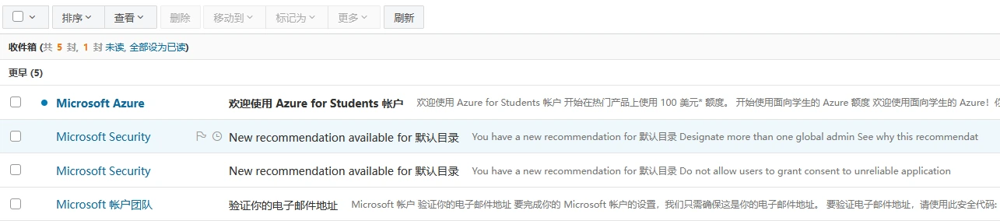
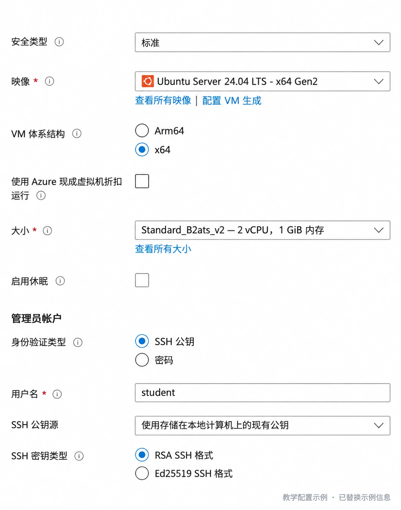

학생 혜택 중에서도 Azure는 꽤 상위권에 두는 편입니다. 매년 100달러 크레딧을 주고 신용카드도 필요 없으며, 첫 12개월 동안은 소형 서버와 시스템 디스크 2장에 대한 무료 제공량까지 나와서 개인 프로젝트를 돌리기에 딱 좋거든요.

개인적으로는 먼저 일본 지역으로 만들고 시스템은 Ubuntu를 올린 뒤, SSH부터 먼저 연결해 두고 나서 올리고 싶은 걸 천천히 주물러 보는 걸 추천합니다. 이번 글은 서버 생성이 끝나는 지점까지만 다루고 앱 배포까지는 깊게 들어가지 않으니, 관심 있으신 분들은 구축 방법을 직접 검색해 보세요~

아래 내용은 2026년 10월 17일 자 혜택과 가격 기준으로 정리해 두었으며, 웹과 CLI 두 가지 방법 중 편한 걸로 하나만 골라서 진행하시면 됩니다.

단계별 스크린샷은 일반적인 Microsoft 페이지를 참고하여 개인정보만 수정해 두었습니다.

## 일단 Azure for Students부터 받기

신청 자격은 만 18세 이상, 요건을 충족하는 정규 대학(원) 재학생이어야 하며, Microsoft 계정 하나와 이메일을 수신할 수 있는 학교 이메일 주소를 준비해 주세요.

### 루트 1: GitHub 학생 팩을 통해 진입하기

이미 GitHub Education 인증을 마친 상태라면, 바로 [GitHub Student Developer Pack](https://education.github.com/pack)을 열어 Microsoft Azure를 찾은 뒤 혜택 받기 버튼을 누르고, 본인의 Microsoft 계정으로 로그인하여 신청을 완료합니다.

발급받는 혜택이 **Azure for Students, $100, 12개월**이 맞는지 꼭 확인하세요. 연령대가 더 어린 학생 대상인 Azure for Students Starter와 헷갈리면 안 됩니다.

학술 인증 페이지에 진입한 후 인증 방법을 선택하라고 나오면 GitHub를 고르고, 화면 안내에 따라 계정 권한 부여를 완료하면 됩니다.


### 루트 2: 학교 이메일로 인증하기

[Azure for Students](https://azure.microsoft.com/en-us/free/students/)를 열고 Microsoft 계정으로 로그인한 뒤, 화면 안내에 따라 학교 이름과 학교 이메일을 입력합니다.


위의 `student@example.edu` 예시는 어디까지나 예시일 뿐이니, 신청할 때는 본인의 실제 정보를 입력하세요. 학교 소재 국가도 실제에 맞게 선택해야 하며, 나중에 서버 지역을 일본으로 고르는 것과는 별개입니다.

학술 신분 인증 이메일을 받으면 메일 안의 인증 링크를 클릭한 후, 다시 신청 페이지로 돌아와 다음 단계를 진행합니다. 링크 유효 기간은 메일에 나와 있는 대로이며, 만료되면 메일을 다시 요청해야 합니다.

인증 메일을 받았다고 해서 발급이 완전히 끝난 것은 아닙니다. 마지막으로 [Azure 포털](https://portal.azure.com/)의 '구독'에 들어간 뒤 **Azure for Students**가 제대로 나타나는지, 잔액과 만료일은 어떻게 되는지 확인하세요.



이 두 진입로를 통해 받는 혜택은 동일하므로, 이메일 인증 루트에서 막히면 학생 팩 진입로로 바꿔서 시도해 보세요.

## 정확히 어떤 게 무료일까?

우선 두 가지를 구분해야 합니다. **100달러 크레딧은 12개월 동안 사용하며 학생 자격이 유지되면 매년 갱신해서 받을 수 있지만, 신규 고객 대상 첫 12개월 무료 리소스는 매년 갱신될 때마다 리셋되어 새로 들어오는 게 아닙니다.**

| 항목                  | 무료 범위                                 | 이 글에서는 어떻게 고를까?              |
| ------------------- | ------------------------------------ | ------------------ |
| `Standard_B2ats_v2` | 신규 고객 첫 12개월, 매월 750시간                 | x64, 이걸 최우선으로 선택          |
| `Standard_B2pts_v2` | 신규 고객 첫 12개월, 매월 750시간                 | Arm64, 두 번째 실험용 머신으로 적합    |
| `Standard_B1s`      | 학생 안내 페이지에는 여전히 매월 750시간으로 명시됨                    | 본인 계정의 무료 서비스 페이지와 해당 지역에서 여전히 사용 가능한지 먼저 확인 |
| 관리되는 시스템 디스크               | 첫 12개월, 64 GiB P6 Premium SSD LRS 2장 | `Premium_LRS`, 머신당 1장씩 |
| Internet 아웃바운드 트래픽       | 매월 첫 100GB                           | 여러 대의 머신 합산으로 계산되며, 머신별로 중복 제공되지 않음    |
| 공용 IPv6 주소          | 주소 이용료 없음                                 | 아웃바운드 트래픽은 정상적으로 청구됨           |
| Standard 공용 IPv4    | 여기서 말하는 무료 주소 제공량에 포함되지 않음                         | 일본 지역 기준 약 시간당 0.005달러   |

각 무료 VM 스펙별 750시간은 각각 따로 계산됩니다. 한 달에 한 대를 24시간 내내 띄워두기에 충분한 시간입니다. 다만 동일한 스펙으로 두 대를 띄우면 이 시간 수량을 함께 소모하게 되므로, 두 대를 띄우고 싶다면 B2ats_v2 한 대와 B2pts_v2 한 대 조합을 고려해 보는 것도 좋습니다.

그리고 또 하나 잘못 고르기 쉬운 부분: **무료 디스크는 P6 Premium SSD LRS 64 GiB 2장입니다.**


사진에 보이는 항목 중 Linux Virtual Machines, Azure Disk Storage, 그리고 100GB 아웃바운드를 중점적으로 보세요. 아래쪽 트래픽 예산도 월 100GB 구간을 기준으로 계산합니다.

'구독 → Azure for Students → 무료 서비스'로 들어가 본인의 이용 가능 용량을 확인하세요. 인스턴스를 생성한 후 사용량이 집계되기 시작하면, 다시 돌아와서 VM 시간과 디스크가 무료 서비스 항목으로 정상 차감되고 있는지 꼭 확인해야 합니다.

## 서버 위치는 일본을 추천합니다

우선 본인이 어디에 인스턴스를 생성할 수 있는지 확인해야 합니다. [Azure 포털](https://portal.azure.com/) 상단 검색창에 **정책(Policy)**을 검색해 들어간 뒤, 좌측의 **할당(Assignments)**을 선택하고 범위를 본인의 **Azure for Students** 구독으로 지정합니다.

**Allowed resource deployment regions**를 열어 **매개 변수(Parameters)**로 들어간 다음 **Allowed locations** 값을 확인합니다. 보통 이 구독에서 허용하는 5개 지역을 확인할 수 있습니다.

예를 들어 제 계정에는 이렇게 나와 있습니다:

```json
["centralindia","indiasouthcentral","uaenorth","malaysiawest","japaneast"]
```

이 리스트는 사람마다 다를 수 있습니다. 제 리스트에는 Japan East가 포함되어 있으므로 주저 없이 `japaneast`를 선택했습니다.

한국이나 중국 등 동아시아권에서 접속해 사용할 목적이라면 **일본 → 싱가포르 → 인도 → 홍콩** 순서로 추천합니다. 미국은 일반적인 선택지에서 제외하고, 본인 계정에서 허용된 지역 중 이 순서대로 찾아보세요.

| 지역 | CLI 이름 | 저의 선택 |
| --- | --- | --- |
| 일본 | `japaneast` / `japanwest` | 최우선 선택, Japan East 권장 |
| 싱가포르 | `southeastasia` | 일본에 할당이 안 될 때 차선책으로 검토 |
| 인도 | `centralindia` / `indiasouthcentral` 등 | 본인 정책에 나오는 인도 지역으로 선택 |
| 홍콩 | `eastasia` | 제일 마지막 보루, 아래 AI 서비스 제약 사항 주의 |

**홍콩은 현재 [ChatGPT 공식 지원 국가/지역](https://help.openai.com/en/articles/7947663-chatgpt-supported-countries) 및 [Claude 공식 지원 국가/지역](https://support.claude.com/en/articles/8461763-where-can-i-access-claude) 목록에 포함되어 있지 않습니다.** 이러한 AI 서비스를 이용할 생각이라면 홍콩을 우회 지역으로 선택하지 마시고, 일본, 싱가포르, 인도를 우선순위로 두세요.

허용 목록에 해당 지역이 있음을 확인했다면, 그다음 스펙과 쿼터를 따져봐야 합니다. 생성 페이지 드롭다운 목록에 지역이 나타난다고 해서 이 학생 구독으로 무조건 생성할 수 있다는 뜻은 아닙니다.

`RequestDisallowedByAzure` 에러를 만난다면 에러 메시지에 명시된 지역 정책을 확인하시고, 스펙을 사용할 수 없거나 해당 리전에 용량이 부족하다는 오류가 뜨면 허용된 다른 리전으로 변경해 보세요. 단순히 가용성 존(Zone)만 바꾸는 것으로는 리전 정책을 우회할 수 없습니다.

## 웹 버전: Azure 포털에서 생성하기

### 기본 정보 및 시스템 디스크

'가상 머신 → 만들기 → Azure 가상 머신'으로 들어가서 아래 표대로 선택합니다:

| 설정 항목 | 입력 내용 |
| --- | --- |
| 구독 | Azure for Students |
| 리소스 그룹 | 새로 만들기 `rg-student-jp` |
| 가상 머신 이름 | `student-jp` |
| 지역 | Japan East |
| 가용성 옵션 | 입문 단계에서는 '인프라 중복성 필요 없음' 선택, 영역 분동이 필요한 경우에만 가용성 존 선택 |
| 이미지 | Ubuntu Server 24.04 LTS, x64 Gen2 |
| 보안 유형 | 표준 |
| 크기 | `Standard_B2ats_v2` |
| 인증 형식 | SSH 공용 키 |
| 사용자 이름 | `student` |
| 공용 인바운드 포트 | SSH 22만 허용 |
| OS 디스크 유형 | Premium SSD LRS |
| OS 디스크 크기 | 64 GiB, P6 |
| 데이터 디스크 | 추가하지 않음 |

먼저 구독, 리소스 그룹, 지역을 채워 넣습니다. 리소스 그룹은 여기서 바로 `rg-student-jp`로 새로 만들어 두면, 나중에 생성될 공용 IP와 네트워크 인터페이스 카드(NIC)도 이 그룹 안에 깔끔하게 모이게 됩니다.


조금 더 내려와서 OS 이미지와 스펙을 고릅니다. B2ats_v2는 x64에 해당하며, 인증 방식은 SSH 공용 키, 사용자 이름은 깔끔하게 `student`로 통일해 줍니다.



포털을 통해 SSH 키 쌍을 새로 생성하는 경우, 만드는 과정에서 다운로드되는 개인 키를 잘 보관해야 나중에 접속할 수 있습니다. 이미 본인의 SSH 공용 키가 있다면 바로 입력하셔도 됩니다.

**Premium SSD v2**와 **Premium SSD LRS**를 헷갈려서 잘못 선택하지 않도록 주의하세요. 디스크 설정 페이지로 진입한 후 P6 및 64 GiB 설정이 맞는지 다시 한번 확인합니다.

### 네트워크 설정은 어떻게 할까?

처음 사용하시는 분들에게는 **Standard 공용 IPv4**를 하나 새로 만드는 걸 추천합니다. IPv6는 나중에 추가해도 되며, 대부분의 네트워크 환경에서 막힘없이 바로 SSH 접속이 되고 프로그램 패키지를 깔 때도 속 편합니다.

만약 VM 네트워크 설정 화면에서 공용 IP를 새로 만드는 게 매끄럽지 않다면, 포털 상단 검색창에 '공용 IP 주소'를 검색해 별도로 만드셔도 됩니다. 동일한 리소스 그룹과 Japan East 지역을 고르고, 이름은 `student-jp-ip4`, IP 버전은 IPv4, SKU는 Standard를 선택한 뒤 다시 VM 네트워크 페이지로 돌아와 지정해 주면 됩니다.


본인이 접속하는 인터넷 환경이 IPv6를 확실히 지원한다면 공용 IPv4를 '없음'으로 고르고, 서버를 만든 뒤에 IPv6를 추가해 주는 방법도 있습니다:

1. VM이 속한 가상 네트워크를 열고, 주소 공간에 `fd12:3456:789a::/48`를 추가합니다.
2. VM이 속한 서브넷에 `fd12:3456:789a:1::/64`를 추가합니다. Azure의 IPv6 서브넷 고정 프리픽스는 `/64`입니다.
3. 동일한 지역에 Standard 공용 IP를 생성하고, 주소 버전을 IPv6, 할당 방식을 정적으로 설정합니다.
4. VM의 네트워크 인터페이스를 열어 'IP 구성'에서 IPv6 구성을 신규 추가하고, 방금 만든 서브넷과 공용 IPv6를 지정합니다.
5. 기존의 사설 IPv4 구성은 그대로 유지하고, 네트워크 보안 그룹(NSG)에서 TCP 22 포트가 허용되어 있는지 확인합니다.

3단계의 생성 화면은 IPv4를 만들 때와 매우 비슷합니다. 이름만 `student-jp-ip6`로 바꾸고, IP 버전을 IPv6로 지정해 주세요. SKU는 여전히 Standard이며, NAT Gateway가 포함된 Standard v2를 고르지 않도록 주의하세요.


여기서 말하는 Pure IPv6(순수 IPv6) 환경이란 **공용 IPv4를 구매해서 붙이지 않는다**는 의미일 뿐, Azure VM 네트워크 카드 자체에는 여전히 사설 IPv4 구성이 남아 있어야 하며 이를 삭제할 필요는 없습니다.

백업, 추가 모니터링 및 유료 부가 서비스는 일단 모두 끄거나 추가하지 마세요. '검토 + 만들기' 단계에서 리소스를 마지막으로 대조한 뒤 생성합니다. 포털 화면에 표시되는 VM 금액 표시는 본인의 무료 서비스 한도와 함께 종합적으로 판단해야 하는 금액이며, 금액이 찍혀 나온다고 해서 무료 혜택이 적용 안 되는 것은 아닙니다.

### 서버에 접속하기

공용 IPv4가 있는 경우:

```powershell
ssh -i "$HOME\.ssh\azure-student" student@你的公网IPv4
```

공용 IPv6만 있는 경우:

```powershell
ssh -6 -i "$HOME\.ssh\azure-student" student@你的公网IPv6
```

`$HOME\.ssh\azure-student` 위치에는 저장해 둔 본인의 개인 키 경로를 넣으세요. 공용 주서는 VM의 네트워크 설정 페이지에서 확인할 수 있습니다.

## CLI 버전: 명령어로 생성하기

아래 작업은 Windows 환경의 PowerShell 7.4 이상 버전을 기준으로 설명하며, SSH 개인 키는 본인의 PC에 저장되어 있다고 가정합니다.

### 설치, 로그인 및 상태 확인

[Microsoft의 Windows 설치 안내 문서](https://learn.microsoft.com/en-us/cli/azure/install-azure-cli-windows)에 따라 Azure CLI를 설치합니다. 이미 설치되어 있다면 해당 명령어는 건너뛰셔도 됩니다:

```powershell
winget install --exact --id Microsoft.AzureCLI
winget install --exact --id Microsoft.PowerShell
```

설치가 끝나면 PowerShell 7을 다시 열어 줍니다. 아래 명령어들은 모두 이 창에서 실행하며, 먼저 명령어 실패 시 즉시 중단되도록 설정한 후 로그인 및 구독 선택을 진행합니다:

```powershell
$ErrorActionPreference = 'Stop'
$PSNativeCommandUseErrorActionPreference = $true

az login
az account list -o table
az account set --subscription '你的 Azure for Students 订阅 ID'
```

아래 변수들을 설정합니다. `$publicIpv4 = $true`는 공용 IPv4를 구매해 할당한다는 의미이며, 이를 `$false`로 바꾸면 공용 IPv6만 생성하게 됩니다. 두 방식 모두 사설 듀얼 스택 네트워크는 그대로 유지됩니다.

```powershell
$region = 'japaneast'
$group = 'rg-student-jp'
$vm = 'student-jp'
$size = 'Standard_B2ats_v2'
$image = 'Canonical:ubuntu-24_04-lts:server:latest'
$publicIpv4 = $true

az policy assignment list -o jsonc
az vm list-usage --location $region -o table
az vm list-skus --location $region --size $size `
  --resource-type virtualMachines --all `
  --query '[].{SKU:name,Restrictions:restrictions,Zones:locationInfo[0].zones}' -o jsonc
az vm image show --location $region --urn $image -o table
```

우선 정책상 허용된 리전, 가용성 존 및 스펙 패밀리의 vCPU 잔여 쿼터를 확인한 뒤 `Restrictions`를 살펴봅니다. `Zones`는 단지 가용성 존 지원 여부일 뿐 실제 용량이 남아 있음을 보장하는 것은 아니며, 무료 자격 여부는 여전히 구독 내의 '무료 서비스' 탭에서 확인해야 합니다.

스펙을 B2pts_v2로 변경하려는 경우, `$size`를 `'Standard_B2pts_v2'`로, `$image`를 `'Canonical:ubuntu-24_04-lts:server-arm64:latest'`로 동시에 변경해 주어야 합니다.

### 네트워크 및 주소 생성

동일한 PowerShell 7 창에서 계속 진행합니다. 명령어 끝에 붙은 백틱(`)은 줄 바꿈 문자로, 백틱 바로 뒤에서 줄 바꿈을 해 주어야 합니다.

```powershell
New-Item -ItemType Directory -Path "$HOME\.ssh" -Force | Out-Null
ssh-keygen -t ed25519 -f "$HOME\.ssh\azure-student" -C azure-student

az group create --name $group --location $region

az network vnet create -g $group -n vnet-student -l $region `
  --address-prefixes 10.20.0.0/16 fd12:3456:789a::/48 `
  --subnet-name snet-student `
  --subnet-prefixes 10.20.1.0/24 fd12:3456:789a:1::/64

az network nsg create -g $group -n nsg-student -l $region
az network nsg rule create -g $group --nsg-name nsg-student `
  -n allow-ssh --priority 1000 --direction Inbound --access Allow `
  --protocol Tcp --source-address-prefixes Internet `
  --source-port-ranges '*' --destination-address-prefixes '*' `
  --destination-port-ranges 22

az network public-ip create -g $group -n "${vm}-ip6" -l $region `
  --sku Standard --version IPv6 --allocation-method Static

az network nic create -g $group -n "${vm}-nic" -l $region `
  --vnet-name vnet-student --subnet snet-student `
  --network-security-group nsg-student

az network nic ip-config create -g $group --nic-name "${vm}-nic" `
  -n ipconfig6 --private-ip-address-version IPv6 `
  --vnet-name vnet-student --subnet snet-student `
  --public-ip-address "${vm}-ip6"

if ($publicIpv4) {
  az network public-ip create -g $group -n "${vm}-ip4" -l $region `
    --sku Standard --version IPv4 --allocation-method Static
  az network nic ip-config update -g $group --nic-name "${vm}-nic" `
    -n ipconfig1 --public-ip-address "${vm}-ip4"
}
```

`ssh-keygen` 실행 중 기존 파일을 덮어쓸 것인지 물어볼 때 기존의 중요한 키를 덮어쓰지 않도록 주의하세요. 필요하다면 파일 이름을 다르게 지정하고 뒤따르는 공용 키 경로도 함께 수정해 줍니다.

### VM 생성 및 시스템 디스크 확인

```powershell
az vm create -g $group -n $vm -l $region `
  --size $size --image $image --security-type Standard `
  --admin-username student --authentication-type ssh `
  --ssh-key-values "$HOME\.ssh\azure-student.pub" `
  --nics "${vm}-nic" --os-disk-name "${vm}-os" `
  --storage-sku Premium_LRS --os-disk-size-gb 64

az vm get-instance-view -g $group -n $vm `
  --query 'instanceView.statuses[].displayStatus' -o tsv
az disk show -g $group -n "${vm}-os" `
  --query '{Disk:name,Storage:sku.name,GiB:diskSizeGb,Tier:tier}' -o table
az network public-ip list -g $group `
  --query '[].{Name:name,Version:publicIPAddressVersion,Address:ipAddress}' -o table
```

시스템 디스크가 `Premium_LRS`, 64 GiB, P6으로 설정되었는지 확인합니다. 출력된 공용 주소를 잘 기록해 둔 뒤, 앞서 설명한 SSH 명령어를 사용해 접속해 봅니다. 이 명령어 세트는 특정 존의 용량 제약에 갇히지 않도록 기본적으로 가용성 존을 지정하지 않습니다.

## AI에게 세팅을 부탁하는 방법도 있습니다

내 컴퓨터의 터미널을 직접 제어할 수 있는 AI 헬퍼를 쓰고 계신다면, 아래 텍스트를 그대로 전달하세요. 계정 로그인과 인증번호 입력 단계만 Microsoft 웹 페이지에서 직접 처리해 주시면 됩니다.

```text
帮我用 PowerShell 7 安装 Azure CLI、登录 Azure for Students，检查允许地区、配额和免费服务；地区依次选日本、新加坡、印度、香港，列出费用等我确认，再创建一台 B2ats_v2、Ubuntu 24.04 LTS x64 Gen2、64 GiB P6 Premium_LRS 的 VM，配好双栈网络、公网 IPv4 和 IPv6、SSH 公钥与 TCP 22，验证 SSH 后给出地址、连接命令和资源清单
```

IPv6만 사용하고 싶다면 공용 네트워크 옵션을 'Standard 공용 IPv6, 사설 듀얼 스택 유지'로 변경해 달라고 요청하세요. 일반적인 대화형 AI를 쓸 때는 PowerShell 명령어를 짜달라고 한 뒤, 직접 복사해서 실행하시면 됩니다.

## 공용 IPv4, 돈 주고 살 만할까?

**편하게 쓰고 싶다면 IPv4를 하나 유지하시고, 주소 비용을 아끼면서 네트워크 호환성 단점을 감수할 수 있다면 공용 IPv6만 달고 사용하세요.**

IPv6 주소 자체는 무료지만, 밖으로 나가는 데이터는 여전히 아웃바운드 트래픽으로 계산됩니다. 게다가 서버에 접속하는 본인의 인터넷 환경도 IPv6를 지원해야만 하고, 서버에서 IPv4만 지원하는 웹사이트나 미러 서버에 접근할 때 접속이 안 될 수도 있습니다.


따라서 IPv6만 할당한 경우에는 우선 Ubuntu 서버에 SSH로 접속한 뒤, 서버의 Bash 터미널에서 IPv6 주소와 라우팅 상태를 확인해 보고 자주 쓰는 소프트웨어 패키지 업데이트 등을 테스트해 보세요:

```bash
ip -6 addr show scope global
ip -6 route
curl -6 -I https://www.microsoft.com/
sudo apt update
curl -I https://github.com/
curl -I https://registry-1.docker.io/v2/
```

Docker Registry 테스트 시 `401 Unauthorized` 응답이 오면 서비스 자체에는 정상적으로 연결되었으나 인증만 안 된 상태임을 의미하므로 성공입니다. 만약 GitHub나 소프트웨어 패키지 저장소 연결이 끊긴다면 해당 서비스의 IPv6 지원 여부를 개별적으로 확인하세요. 굳이 이걸 해결하겠다고 고정 비용이 나가는 NAT Gateway를 추가할 필요는 없습니다.

## 한 달에 트래픽은 얼마나 쓸 수 있을까?

**Internet 인바운드(들어오는 트래픽)는 무료이고, 아웃바운드(나가는 트래픽)는 매월 100GB까지 무료입니다.** 기본 설정인 Microsoft 글로벌 네트워크 라우팅 기준으로 계산하면 일본, 싱가포르, 인도, 홍콩 리전의 초과 분에 대한 요금은 동일하게 GB당 0.12달러입니다.

위 리전들의 Standard 공용 IPv4 주소 비용은 시간당 0.005달러입니다. 월 730시간 기준으로 계산해 보면 주소 하나당 **월 약 3.65달러**, 1년이면 약 43.80달러가 나옵니다. 공용 IPv6는 주소 이용료가 없습니다.


100달러 크레딧을 12개월로 균등하게 나누면 한 달 예산은 약 8.33달러입니다. VM과 첫 두 장의 P6 디스크가 모두 무료 범위에 들어가고 다른 부가 비용이 전혀 없다고 가정하면 다음과 같이 계산해 볼 수 있습니다:

| 리전 및 공용 IP 구성 | 월 주소 비용 | 크레딧으로 커버 가능한 추가 아웃바운드/월 | 무료 100GB 합산 시 |
| --- | --- | --- | --- |
| 일본 / 싱가포르 / 인도 / 홍콩, IPv4 1개 (IPv6 동시 할당 가능) | 약 $3.65 | 약 39 GB | **월 약 139 GB** |
| 일본 / 싱가포르 / 인도 / 홍콩, 공용 IPv6만 사용 | $0 | 약 69 GB | **월 약 169 GB** |

공식도 아주 간단합니다:

```text
每月总出站 GB
= 100 + (100 ÷ 12 - 公网 IPv4 月费 - 其他月费) ÷ 每 GB 出站价格
```

여기서 계산한 것은 전체 플랜에 대한 합산 예산입니다. VM 한 대당 100GB와 100달러가 각각 제공되는 것이 아닙니다. 머신 두 대를 돌리면서 IPv4를 하나만 구매한다면 일본 리전 기준 합산 월 약 139GB가 됩니다. 만약 IPv4를 두 개 모두 구매한다면 주소 비용만 월 약 7.30달러가 되어 트래픽에 쓸 수 있는 크레딧 예산이 훨씬 줄어들게 됩니다.

참고로 100달러 크레딧은 1년 치가 한 번에 들어오는 잔액 개념이지 매월 8.33달러씩 찍혀 나오는 것이 아닙니다. 반면 무료 100GB 트래픽은 매월 리셋되는 항목으로, 다 쓰지 못해도 다음 달로 이월되지 않습니다. 리전 간 트래픽 등 다른 항목은 별도로 계산됩니다.

## 다 쓰고 난 뒤 뒷처리는 어떻게 할까?

평소에는 구독 내 '무료 서비스' 탭에서 리소스 사용량을 확인하고, '비용 관리' 탭에서 IPv4 및 추가 트래픽 발생 여부를 체크하세요. 학생 크레딧 잔액과 만료일도 잊지 말고 잘 기록해 두는 것이 좋습니다.

학생 자격이 유지되는 동안은 매년 100달러씩 연장해서 받을 수 있습니다. 다만 첫 12개월간 제공되는 VM 및 디스크 무료 기간이 끝나고 나면 해당 리소스 비용을 예산 계산에 다시 포함해야 합니다. 이전 크레딧 잔액은 이월되지 않습니다.

더 이상 서버를 쓰지 않게 되었다면 필요한 데이터를 먼저 백업한 뒤, 연습용으로 만들어 두었던 이 리소스 그룹을 통째로 삭제하세요. 그룹 안에 들어 있던 VM, 디스크, NIC, 공용 IP가 한 번에 깔끔하게 삭제됩니다:

```powershell
az group delete --name rg-student-jp
```

VM 인스턴스만 정지(Stop) 시켜 둔다고 해서 디스크와 할당해 둔 정적 IPv4 비용까지 같이 멈추는 것은 아닙니다. 이것이 제가 관련 리소스들을 하나의 전용 리소스 그룹에 몰아서 만들라고 추천하는 이유이기도 합니다. 정리할 때 훨씬 쉽거든요.

## 참고 자료

- [Azure for Students: $100, 갱신 및 무료 VM 안내](https://azure.microsoft.com/en-us/free/students/)
- [Azure for Students 자격 요건 및 한도 약관](https://azure.microsoft.com/en-us/pricing/offers/ms-azr-0170p/)
- [GitHub Student Developer Pack](https://education.github.com/pack)
- [Azure 무료 서비스 목록](https://azure.microsoft.com/en-us/pricing/free-services/)
- [Microsoft 커뮤니티: 학생 구독에서 배포 허용된 5개 지역 확인하기](https://learn.microsoft.com/en-us/answers/questions/5924508/requestdisallowedbyazure-allowed-resource-deployme)
- [Microsoft 커뮤니티의 P6 64 GiB 무료 디스크 2장에 대한 설명](https://learn.microsoft.com/en-us/answers/questions/5556769/which-storage-type-is-free-12months-in-free-tier)
- [공용 IP 가격 책정](https://azure.microsoft.com/en-us/pricing/details/ip-addresses/)
- [일본 리전 공용 IP 공식 리테일 가격 API](https://prices.azure.com/api/retail/prices?$filter=serviceName%20eq%20%27Virtual%20Network%27%20and%20armRegionName%20eq%20%27japaneast%27)
- [아웃바운드 대역폭 가격 책정](https://azure.microsoft.com/en-us/pricing/details/bandwidth/)
- [Azure IPv6: 주소 비용, 듀얼 스택 NIC 및 서브넷 제약 사항](https://learn.microsoft.com/en-us/azure/virtual-network/ip-services/ipv6-overview)
- [기본 아웃바운드 액세스 및 신규 전용 서브넷 구축](https://learn.microsoft.com/en-us/azure/virtual-network/ip-services/default-outbound-access)
- [Windows에 Azure CLI 설치하기](https://learn.microsoft.com/en-us/cli/azure/install-azure-cli-windows)
- [PowerShell에서 Azure CLI 사용하기](https://learn.microsoft.com/en-us/cli/azure/use-azure-cli-successfully-powershell)
- [Azure CLI 대화형 로그인 및 구독 선택](https://learn.microsoft.com/en-us/cli/azure/authenticate-azure-cli-interactively)

## 함께 읽어보기

다른 공식 학생 혜택들은 [[edumails-glados-student-benefits|학생 혜택 총정리]]에 정리해 두었으니, [[aliyun-student-300-voucher-guide|알리바바 클라우드 학생 쿠폰]]과 비교해 보면서 본인에게 딱 맞는 머신을 골라보세요.

서버 생성을 마쳤다면 이어서 [[docker-compose-minimum-start|Docker 입문]]과 [[2c2g-server-service-index|소형 서버 서비스 추천 리스트]]를 둘러보세요. 그리고 [[selfhost-ntfy-on-2c2g|ntfy 알림]]이나 [[selfhost-vaultwarden-on-2c2g|Vaultwarden 비밀번호 저장소]] 중 마음에 드는 걸 골라 세팅해 보고, 도메인 연결과 HTTPS 설정은 [[cloudflare-free-tier-developer-guide|Cloudflare]]에 맡겨보시는 걸 추천합니다.
