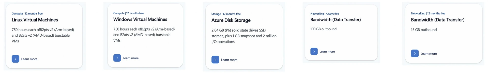

Entre os benefícios estudantis, eu coloco esse do Azure bem no topo da lista: são 100 dólares de crédito por ano, sem precisar de cartão de crédito, e nos primeiros 12 meses ainda tem cota gratuita para um servidor de configuração básica e dois discos de sistema — perfeito para hospedar projetos próprios

Eu recomendo começar criando na região do Japão, usando Ubuntu como sistema, conectar primeiro via SSH e depois ir mexendo com calma no que você quiser rodar. Este post vai só até deixar o servidor pronto, sem entrar na parte de deploy de aplicações — se tiver interesse, dá uma pesquisada de como configurar por conta própria~

Abaixo organizei tudo com base nos benefícios e preços de 17 de outubro de 2026; é só escolher um dos dois métodos, pela interface web ou via CLI

Os prints do passo a passo são baseados nas páginas normais da Microsoft, com as informações pessoais alteradas

## Primeiro, resgate o Azure for Students

Para solicitar, é preciso ter pelo menos 18 anos, estar matriculado em tempo integral em uma instituição de ensino superior elegível e ter em mãos uma conta Microsoft e um e-mail institucional que receba mensagens

### Caminho 1: Entrando pelo GitHub Student Pack

Se você já foi aprovado no GitHub Education, acesse direto o [GitHub Student Developer Pack](https://education.github.com/pack), encontre o Microsoft Azure, clique no link de resgate e faça login com a sua conta Microsoft para concluir o pedido

Confirme se o que você está resgatando é o **Azure for Students, 100 dólares, 12 meses**, para não confundir com o Azure for Students Starter, que é voltado para faixas etárias menores

Se aparecer a tela de verificação acadêmica pedindo para escolher um método, selecione GitHub e siga as instruções na tela para autorizar a conta


### Caminho 2: Verificando com o e-mail institucional

Abra o [Azure for Students](https://azure.microsoft.com/en-us/free/students/), entre com a sua conta Microsoft e preencha o nome da instituição e o e-mail acadêmico conforme solicitado na página


O `student@example.edu` acima é só um exemplo; na hora de pedir, preencha com os seus dados reais e selecione o país verdadeiro da sua instituição — isso não tem nada a ver com escolher a região do Japão para o servidor mais adiante

Depois de receber o e-mail de verificação acadêmica, clique no link dentro dele e volte para a página de solicitação para terminar os próximos passos. O prazo de validade do link aparece no próprio e-mail; se expirar, é só pedir outro

Receber o e-mail de verificação ainda não significa que o resgate terminou: por fim, vá até "Assinaturas" no [Portal do Azure](https://portal.azure.com/) para confirmar se **Azure for Students** aparece por lá e conferir o saldo e a data de validade


Esses dois caminhos resgatam exatamente o mesmo benefício; se empacar na verificação por e-mail, tente entrar pelo pacote de estudante do GitHub

## O que é gratuito

Antes de tudo, separe duas coisas: **os 100 dólares de crédito valem por 12 meses e podem ser renovados ano a ano enquanto você mantiver o vínculo estudantil; já os recursos gratuitos dos primeiros 12 meses para novos clientes não zeram nem recomeçam a cada renovação anual**

| Item | Escopo gratuito | O que escolher neste guia |
| ------------------- | ------------------------------------ | ------------------ |
| `Standard_B2ats_v2` | Primeiros 12 meses para novos clientes, 750 horas/mês | x64, escolha este como prioridade |
| `Standard_B2pts_v2` | Primeiros 12 meses para novos clientes, 750 horas/mês | Arm64, bom para uma segunda máquina de testes |
| `Standard_B1s` | A página de estudantes ainda lista 750 horas/mês | Confira antes na sua página de serviços gratuitos se ainda está disponível na região |
| Disco gerenciado do SO | Primeiros 12 meses, dois P6 Premium SSD LRS de 64 GiB | `Premium_LRS`, um por máquina |
| Tráfego de saída na Internet | Primeiros 100 GB por mês | Somado entre todas as máquinas, não multiplica por instância |
| Endereço IPv6 público | Sem cobrança pelo endereço | O tráfego de saída continua sendo medido normalmente |
| IPv4 público Standard | Não entra nessa cota gratuita de endereços | Cerca de 0,005 dólar/hora na região do Japão |

As 750 horas de cada tamanho gratuito de VM são contadas separadamente: dá para deixar uma máquina ligada o mês inteiro, mas duas da mesma configuração vão consumir juntas essa mesma cota de horas. Se quiser subir duas máquinas, vale considerar uma B2ats_v2 mais uma B2pts_v2

Outro detalhe fácil de errar na hora de escolher: **os discos gratuitos são dois P6 Premium SSD LRS de 64 GiB**



Na imagem, fique de olho principalmente em Linux Virtual Machines, Azure Disk Storage e nos 100 GB de saída; o orçamento de tráfego mais abaixo também usa essa faixa de 100 GB mensais como base

Entre em "Assinaturas → Azure for Students → Serviços gratuitos" para conferir suas cotas disponíveis. Depois de criar a máquina e o uso começar a aparecer, volte lá para confirmar que as horas da VM e o disco realmente entraram nos serviços gratuitos

## Para região, recomendo o Japão

Primeiro descubra onde você pode criar recursos: no topo do [Portal do Azure](https://portal.azure.com/), pesquise por **Política (Policy)**, entre e clique em **Atribuições (Assignments)** no menu esquerdo, filtrando o escopo pela sua assinatura **Azure for Students**

Abra **Allowed resource deployment regions**, vá em **Parâmetros (Parameters)** e veja o valor de **Allowed locations** — normalmente aparecem ali as cinco regiões permitidas para essa assinatura

No meu caso, por exemplo, apareceu isto:

```json
["centralindia","indiasouthcentral","uaenorth","malaysiawest","japaneast"]
```

Essa lista não é igual para todo mundo; como na minha tem Leste do Japão, fui direto em `japaneast`

Acessando da China, minha ordem de recomendação é **Japão → Singapura → Índia → Hong Kong**, deixando os EUA de fora das opções habituais — procure nessa ordem dentro das regiões permitidas para a sua conta

| Região | Nome na CLI | Minha escolha |
| --- | --- | --- |
| Japão | `japaneast` / `japanwest` | Primeira opção, com preferência para Leste do Japão |
| Singapura | `southeastasia` | Segunda opção, caso não consiga criar no Japão |
| Índia | `centralindia` / `indiasouthcentral` etc. | Escolha a região indiana que aparecer na sua política |
| Hong Kong | `eastasia` | Deixe por último e atenção às restrições de serviços de IA abaixo |

**Atualmente, Hong Kong não faz parte das [regiões oficialmente suportadas pelo ChatGPT](https://help.openai.com/en/articles/7947663-chatgpt-supported-countries) nem das [regiões oficialmente suportadas pelo Claude](https://support.claude.com/en/articles/8461763-where-can-i-access-claude)**; se a ideia for usar esses serviços de IA, não use Hong Kong para desbloqueá-los — dê preferência a Japão, Singapura ou Índia

Depois de confirmar que a região está na lista permitida, cheque o tamanho da VM e as cotas: o fato de uma região aparecer no menu suspenso da página de criação não garante que essa assinatura estudantil consiga criar lá

Se der erro `RequestDisallowedByAzure`, olhe qual política de região o erro aponta; se o tamanho não estiver disponível ou faltar capacidade na região, troque para outra região permitida — mudar apenas a zona de disponibilidade não contorna a política de região

## Versão web: criando pelo Portal do Azure

### Informações básicas e disco do sistema

Acesse "Máquinas virtuais → Criar → Máquina virtual do Azure" e configure conforme abaixo:

| Configuração | O que preencher |
| --- | --- |
| Assinatura | Azure for Students |
| Grupo de recursos | Criar novo `rg-student-jp` |
| Nome da máquina virtual | `student-jp` |
| Região | Japan East |
| Opções de disponibilidade | Para começar, escolha "Nenhuma redundância de infraestrutura necessária"; se precisar de particionamento, escolha zonas de disponibilidade |
| Imagem | Ubuntu Server 24.04 LTS, x64 Gen2 |
| Tipo de segurança | Padrão |
| Tamanho | `Standard_B2ats_v2` |
| Tipo de autenticação | Chave pública SSH |
| Nome de usuário | `student` |
| Portas de entrada públicas | Permitir apenas SSH 22 |
| Tipo de disco do SO | Premium SSD LRS |
| Tamanho do disco do SO | 64 GiB, P6 |
| Discos de dados | Não adicionar |

Preencha primeiro a assinatura, o grupo de recursos e a região. Aqui no grupo de recursos, crie direto o `rg-student-jp` — o IP público e a interface de rede depois também vão ficar nesse grupo


Descendo um pouco, escolha o sistema e a especificação: B2ats_v2 corresponde a x64, na autenticação selecione chave pública SSH, e o nome de usuário aqui fica padronizado como `student`


Se optar por gerar o par de chaves SSH pelo portal, baixe a chave privada na hora da criação, pois você vai precisar dela para conectar depois; se já tiver sua própria chave pública SSH, pode colar direto também

Não confunda **Premium SSD v2** com **Premium SSD LRS**. Ao entrar na aba de discos, confira mais uma vez se está marcado P6 e 64 GiB

### Como escolher a rede

Para quem está usando pela primeira vez, recomendo criar um **IPv4 público Standard** novo. Dá para adicionar IPv6 depois; na maioria das redes você consegue conectar via SSH direto e instalar pacotes sem dor de cabeça

Se criar o IP público direto na aba de rede da VM não estiver muito prático, você também pode pesquisar por "Endereços IP públicos" no portal e criar um separado: selecione o mesmo grupo de recursos e Japan East, use o nome `student-jp-ip4`, escolha a versão IPv4, SKU Standard, e depois volte na aba de rede da VM para selecioná-lo


Se você tiver certeza de que a internet de onde você acessa suporta IPv6, pode deixar o IPv4 público como "Nenhum" e adicionar o IPv6 depois de criar a VM:

1. Abra a rede virtual onde a VM está e adicione `fd12:3456:789a::/48` no espaço de endereço
2. Adicione `fd12:3456:789a:1::/64` na sub-rede da VM — sub-redes IPv6 no Azure usam fixamente `/64`
3. Crie um IP público Standard na mesma região, selecione IPv6 como versão do endereço e atribuição estática
4. Abra a interface de rede da VM e, em "Configurações de IP", adicione uma nova configuração IPv6 selecionando a sub-rede criada e o IPv6 público
5. Mantenha a configuração de IPv4 privado original e verifique se o grupo de segurança de rede permite TCP 22

A tela do passo 3 é bem parecida com a de criação do IPv4: troque o nome para `student-jp-ip6`, escolha IPv6 como versão do IP e mantenha o SKU como Standard — cuidado para não escolher o Standard v2 com NAT Gateway


Quando falo aqui em "só IPv6", significa **não contratar IPv4 público**. A placa de rede da VM no Azure ainda precisa manter o IPv4 privado, não precisa apagar ele

Deixe backups, monitoramento extra e complementos pagos de fora por enquanto. Confira os recursos em "Revisar + criar" e mande criar. O preço exibido para a VM no portal também precisa ser analisado junto com a sua cota de serviços gratuitos — ver um preço listado ali não significa que você perdeu o benefício gratuito

### Conectando ao servidor

Com IPv4 público:

```powershell
ssh -i "$HOME\.ssh\azure-student" student@你的公网IPv4
```

Apenas com IPv6 público:

```powershell
ssh -6 -i "$HOME\.ssh\azure-student" student@你的公网IPv6
```

Troque `$HOME\.ssh\azure-student` pelo caminho onde você salvou sua chave privada; o endereço público pode ser consultado na aba de rede da VM

## Versão CLI: criando por comandos

Abaixo vamos usar o PowerShell 7.4 ou mais recente no Windows, com a chave privada SSH salva no seu computador

### Instalação, login e verificação

Instale a Azure CLI seguindo o [método de instalação da Microsoft para Windows](https://learn.microsoft.com/en-us/cli/azure/install-azure-cli-windows). Se já tiver instalado, pode pular os comandos correspondentes:

```powershell
winget install --exact --id Microsoft.AzureCLI
winget install --exact --id Microsoft.PowerShell
```

Depois de instalar, abra o PowerShell 7 novamente. Todos os comandos abaixo serão executados nessa janela. Primeiro, configure para parar caso algum comando falhe, depois faça login e selecione a assinatura:

```powershell
$ErrorActionPreference = 'Stop'
$PSNativeCommandUseErrorActionPreference = $true

az login
az account list -o table
az account set --subscription '你的 Azure for Students 订阅 ID'
```

Defina estas variáveis abaixo: `$publicIpv4 = $true` indica a compra de um IPv4 público; mudando para `$false`, cria-se apenas um IPv6 público. Em ambos os casos, a rede privada dual-stack é mantida

```powershell
$region = 'japaneast'
$group = 'rg-student-jp'
$vm = 'student-jp'
$size = 'Standard_B2ats_v2'
$image = 'Canonical:ubuntu-24_04-lts:server:latest'
$publicIpv4 = $true

az policy assignment list -o jsonc
az vm list-usage --location $region -o table
az vm list-skus --location $region --size $size `
  --resource-type virtualMachines --all `
  --query '[].{SKU:name,Restrictions:restrictions,Zones:locationInfo[0].zones}' -o jsonc
az vm image show --location $region --urn $image -o table
```

Confira primeiro as regiões permitidas pela política, as zonas e o saldo de vCPUs da família de instâncias, depois veja `Restrictions`. O campo `Zones` mostra apenas o suporte por zona, não é garantia de capacidade, e a elegibilidade gratuita continua sendo confirmada em "Serviços gratuitos" dentro da assinatura

Se trocar para B2pts_v2, lembre-se de alterar também `$size` para `'Standard_B2pts_v2'` e `$image` para `'Canonical:ubuntu-24_04-lts:server-arm64:latest'`

### Criando a rede e os endereços

Continue executando no mesmo terminal do PowerShell 7. A crase nos comandos serve para quebra de linha, então basta pular de linha logo depois dela

```powershell
New-Item -ItemType Directory -Path "$HOME\.ssh" -Force | Out-Null
ssh-keygen -t ed25519 -f "$HOME\.ssh\azure-student" -C azure-student

az group create --name $group --location $region

az network vnet create -g $group -n vnet-student -l $region `
  --address-prefixes 10.20.0.0/16 fd12:3456:789a::/48 `
  --subnet-name snet-student `
  --subnet-prefixes 10.20.1.0/24 fd12:3456:789a:1::/64

az network nsg create -g $group -n nsg-student -l $region
az network nsg rule create -g $group --nsg-name nsg-student `
  -n allow-ssh --priority 1000 --direction Inbound --access Allow `
  --protocol Tcp --source-address-prefixes Internet `
  --source-port-ranges '*' --destination-address-prefixes '*' `
  --destination-port-ranges 22

az network public-ip create -g $group -n "${vm}-ip6" -l $region `
  --sku Standard --version IPv6 --allocation-method Static

az network nic create -g $group -n "${vm}-nic" -l $region `
  --vnet-name vnet-student --subnet snet-student `
  --network-security-group nsg-student

az network nic ip-config create -g $group --nic-name "${vm}-nic" `
  -n ipconfig6 --private-ip-address-version IPv6 `
  --vnet-name vnet-student --subnet snet-student `
  --public-ip-address "${vm}-ip6"

if ($publicIpv4) {
  az network public-ip create -g $group -n "${vm}-ip4" -l $region `
    --sku Standard --version IPv4 --allocation-method Static
  az network nic ip-config update -g $group --nic-name "${vm}-nic" `
    -n ipconfig1 --public-ip-address "${vm}-ip4"
}
```

Quando o `ssh-keygen` perguntar se deseja sobrescrever um arquivo existente, não sobrescreva sua chave antiga — escolha um novo nome de arquivo e atualize o caminho da chave pública mais adiante

### Criando a VM e conferindo o disco do sistema

```powershell
az vm create -g $group -n $vm -l $region `
  --size $size --image $image --security-type Standard `
  --admin-username student --authentication-type ssh `
  --ssh-key-values "$HOME\.ssh\azure-student.pub" `
  --nics "${vm}-nic" --os-disk-name "${vm}-os" `
  --storage-sku Premium_LRS --os-disk-size-gb 64

az vm get-instance-view -g $group -n $vm `
  --query 'instanceView.statuses[].displayStatus' -o tsv
az disk show -g $group -n "${vm}-os" `
  --query '{Disk:name,Storage:sku.name,GiB:diskSizeGb,Tier:tier}' -o table
az network public-ip list -g $group `
  --query '[].{Name:name,Version:publicIPAddressVersion,Address:ipAddress}' -o table
```

O disco do sistema deve ficar como `Premium_LRS`, 64 GiB, P6. Anote o endereço público exibido na saída e conecte usando os comandos SSH mostrados anteriormente. Essa sequência de comandos não fixa nenhuma zona de disponibilidade por padrão, evitando travar a criação na capacidade de uma zona específica

## Você também pode pedir para uma IA configurar

Se estiver usando um assistente de IA capaz de operar o terminal local, envie esse trecho para ele; o login na conta e o código de verificação você mesmo conclui na página da Microsoft

```text
帮我用 PowerShell 7 安装 Azure CLI、登录 Azure for Students，检查允许地区、配额和免费服务；地区依次选日本、新加坡、印度、香港，列出费用等我确认，再创建一台 B2ats_v2、Ubuntu 24.04 LTS x64 Gen2、64 GiB P6 Premium_LRS 的 VM，配好双栈网络、公网 IPv4 和 IPv6、SSH 公钥与 TCP 22，验证 SSH 后给出地址、连接命令和资源清单
```

Se quiser usar apenas IPv6, mude o plano de rede pública para "IPv6 público Standard, mantendo rede privada dual-stack"; se for usar uma IA comum de chat, peça para ela gerar os comandos do PowerShell e você mesmo copia e executa

## Vale a pena pagar por um IPv4 público?

**Se quer sossego, mantenha um IPv4; se quer economizar a taxa do endereço e aceita abrir mão de parte da compatibilidade, fique só com o IPv6 público**

O endereço IPv6 em si é gratuito, mas os dados enviados continuam contando como tráfego de saída. Além disso, a rede de onde você acessa o servidor também precisa ter IPv6, e quando o servidor tentar acessar sites ou espelhos de pacotes que só suportam IPv4, pode não conseguir conectar


Por isso, depois de deixar só o IPv6, conecte via SSH no servidor Ubuntu e confira o endereço IPv6 e as rotas no terminal Bash do servidor, testando atualizações e os repositórios que você pretende usar:

```bash
ip -6 addr show scope global
ip -6 route
curl -6 -I https://www.microsoft.com/
sudo apt update
curl -I https://github.com/
curl -I https://registry-1.docker.io/v2/
```

O Docker Registry retornar `401 Unauthorized` normalmente significa que já houve conexão com o serviço, faltando apenas autenticação; se o GitHub ou algum repositório de pacotes não conectar, verifique o suporte a IPv6 de cada serviço específico em vez de sair adicionando um NAT Gateway com custo fixo só para contornar isso

## Quanto de tráfego dá para usar por mês?

**O tráfego de entrada da Internet é gratuito, e os primeiros 100 GB de saída por mês também são gratuitos.** Os valores abaixo seguem o roteamento padrão da rede global da Microsoft: no Japão, Singapura, Índia e Hong Kong, o excedente custa US$ 0,12/GB

Nas regiões acima, o IPv4 público Standard custa US$ 0,005/hora; considerando 730 horas por mês, um endereço sai por cerca de **US$ 3,65/mês**, ou uns US$ 43,80 por ano; já o IPv6 público não tem taxa de endereço


Se dividirmos os US$ 100 igualmente pelos 12 meses, dá um orçamento de uns US$ 8,33 por mês. Com a VM e os dois primeiros discos P6 dentro da faixa gratuita e sem outros custos, a conta fica assim:

| Região e configuração de rede pública | Custo de endereço/mês | Tráfego de saída extra coberto pelo crédito/mês | Somando os 100 GB grátis |
| --- | --- | --- | --- |
| Japão / Singapura / Índia / Hong Kong, um IPv4, com IPv6 opcional em paralelo | Cerca de $3,65 | Cerca de 39 GB | **Cerca de 139 GB/mês** |
| Japão / Singapura / Índia / Hong Kong, apenas IPv6 público | $0 | Cerca de 69 GB | **Cerca de 169 GB/mês** |

A fórmula também é bem simples:

```text
每月总出站 GB
= 100 + (100 ÷ 12 - 公网 IPv4 月费 - 其他月费) ÷ 每 GB 出站价格
```

Essa conta é o orçamento total do setup inteiro, e não 100 GB e US$ 100 separados para cada VM. Se duas máquinas usarem apenas um IPv4, o total na região do Japão continua sendo uns 139 GB/mês; se comprar dois IPv4, a taxa de endereço sobe para cerca de US$ 7,30/mês e sobra bem menos crédito para tráfego

Além disso, os US$ 100 caem de uma vez como saldo anual, não são US$ 8,33 depositados todo mês. Já os 100 GB grátis zeram mensalmente e o que não for usado não acumula para o mês seguinte; tráfego entre regiões e outros itens são cobrados à parte

## Como limpar tudo depois de usar

No dia a dia, acompanhe o uso de recursos em "Serviços gratuitos" da assinatura e confira o IPv4 e o tráfego extra em "Gerenciamento de custos"; aproveite para anotar também o saldo e a data de vencimento do crédito de estudante

Enquanto ainda tiver elegibilidade de estudante, dá para renovar os US$ 100 ano a ano. Depois que os primeiros 12 meses gratuitos de VM e disco acabarem, vai ser preciso incluir o custo deles de volta no orçamento, e o crédito antigo não acumula

Se não for mais usar, salve seus dados primeiro e depois apague esse grupo de recursos criado só para testes — a VM, os discos, a placa de rede e o IP público vão todos juntos:

```powershell
az group delete --name rg-student-jp
```

Apenas parar a VM não faz os discos e o IPv4 estático reservado sumirem, e é por isso que recomendo colocar tudo num grupo separado: na hora de limpar, dá bem menos trabalho

## Referências

- [Azure for Students: detalhes sobre os US$ 100, renovação e VMs gratuitas](https://azure.microsoft.com/en-us/free/students/)
- [Termos de elegibilidade e cota do Azure for Students](https://azure.microsoft.com/en-us/pricing/offers/ms-azr-0170p/)
- [GitHub Student Developer Pack](https://education.github.com/pack)
- [Lista de serviços gratuitos do Azure](https://azure.microsoft.com/en-us/pricing/free-services/)
- [Comunidade Microsoft: como ver as cinco regiões permitidas na assinatura de estudante](https://learn.microsoft.com/en-us/answers/questions/5924508/requestdisallowedbyazure-allowed-resource-deployme)
- [Explicação da Comunidade Microsoft sobre os dois discos P6 de 64 GiB gratuitos](https://learn.microsoft.com/en-us/answers/questions/5556769/which-storage-type-is-free-12months-in-free-tier)
- [Preços de IP público](https://azure.microsoft.com/en-us/pricing/details/ip-addresses/)
- [API oficial de preços de varejo de IP público na região do Japão](https://prices.azure.com/api/retail/prices?$filter=serviceName%20eq%20%27Virtual%20Network%27%20and%20armRegionName%20eq%20%27japaneast%27)
- [Preços de largura de banda de saída](https://azure.microsoft.com/en-us/pricing/details/bandwidth/)
- [IPv6 no Azure: custos de endereço, placas de rede dual-stack e limites de sub-rede](https://learn.microsoft.com/en-us/azure/virtual-network/ip-services/ipv6-overview)
- [Acesso de saída padrão e criação de novas sub-redes privadas](https://learn.microsoft.com/en-us/azure/virtual-network/ip-services/default-outbound-access)
- [Como instalar a CLI do Azure no Windows](https://learn.microsoft.com/en-us/cli/azure/install-azure-cli-windows)
- [Como usar a CLI do Azure no PowerShell](https://learn.microsoft.com/en-us/cli/azure/use-azure-cli-successfully-powershell)
- [Login interativo e seleção de assinatura na CLI do Azure](https://learn.microsoft.com/en-us/cli/azure/authenticate-azure-cli-interactively)

## Continue lendo

Os outros benefícios oficiais estão na [[edumails-glados-student-benefits|lista geral de benefícios para estudantes]], e você também pode comparar com o [[aliyun-student-300-voucher-guide|cupom de estudante da Alibaba Cloud]] para escolher a máquina que faz mais sentido para você

Com o servidor de pé, siga para [[docker-compose-minimum-start|introdução ao Docker]] e a [[2c2g-server-service-index|lista de serviços para servidores pequenos]], depois escolha entre [[selfhost-ntfy-on-2c2g|notificações com ntfy]] ou o [[selfhost-vaultwarden-on-2c2g|cofre de senhas Vaultwarden]], deixando domínio e HTTPS por conta do [[cloudflare-free-tier-developer-guide|Cloudflare]]
