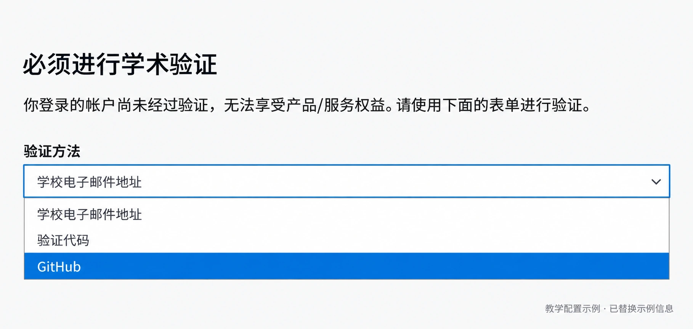
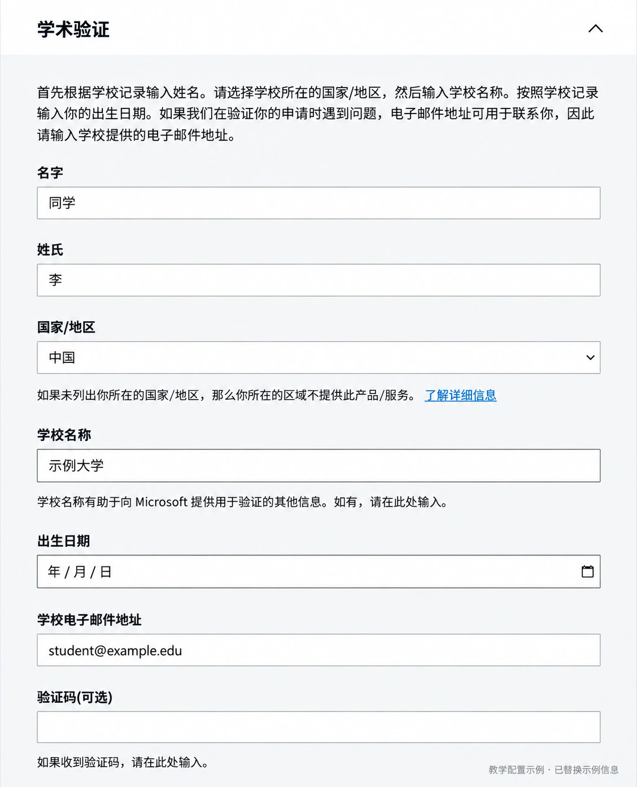
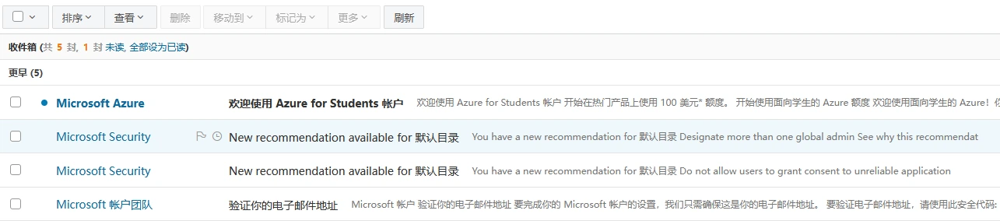
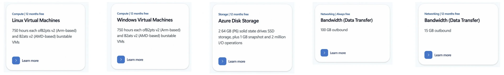
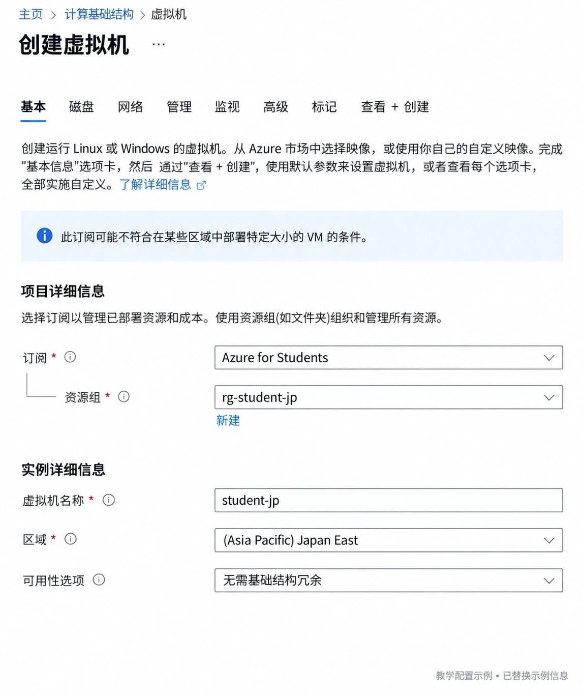
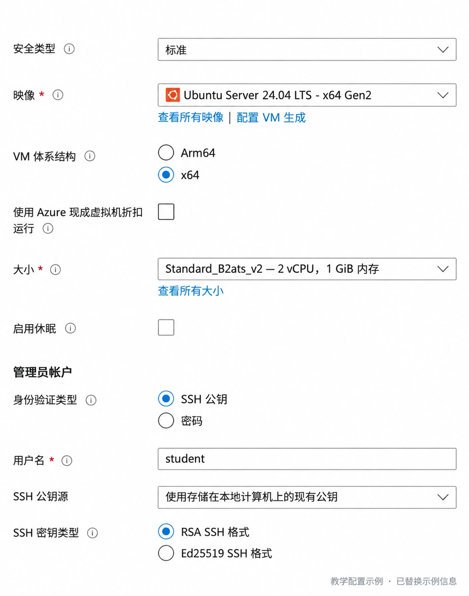
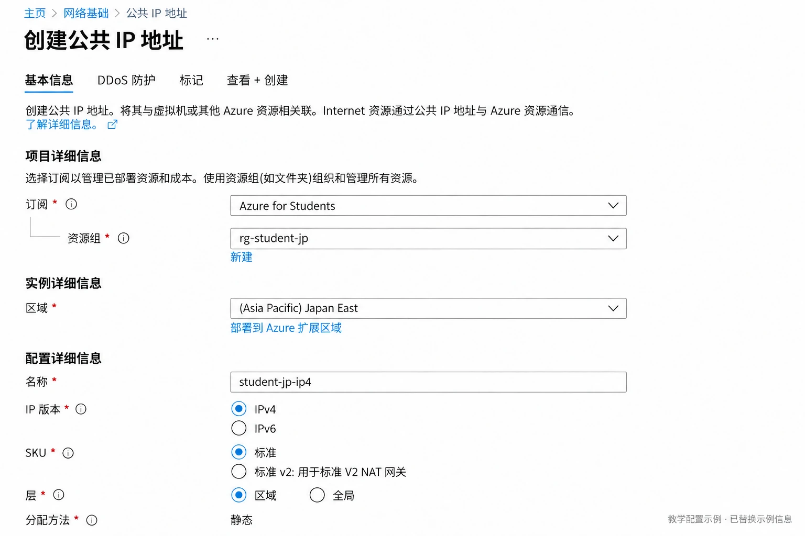
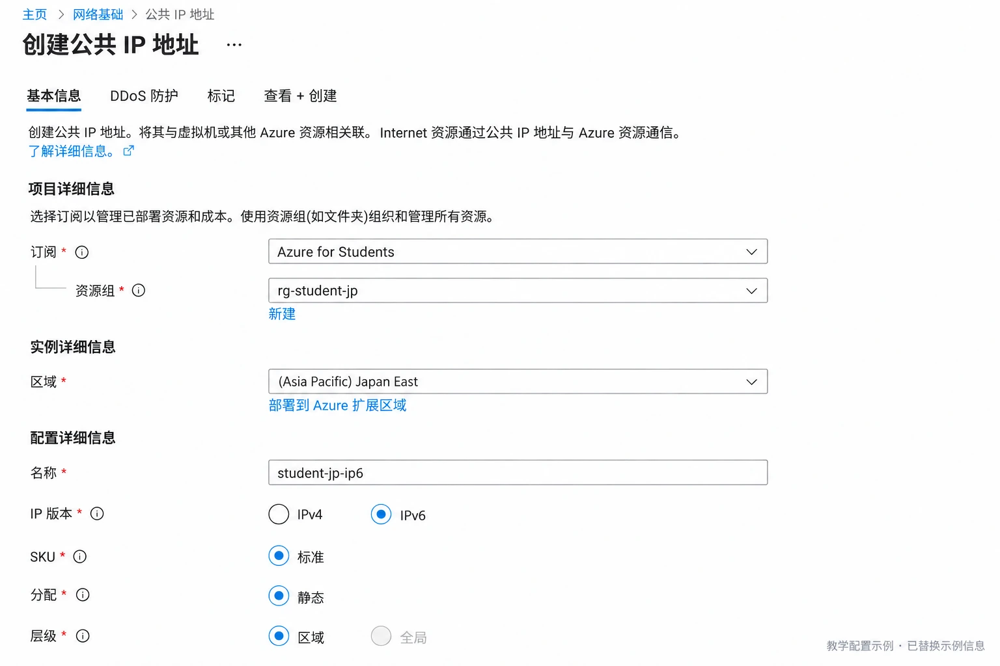
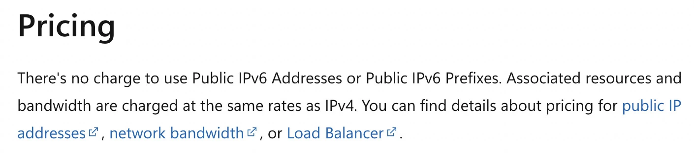
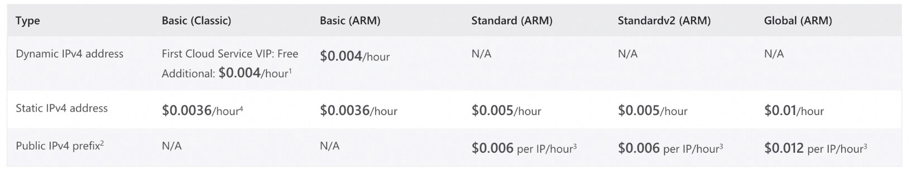

學生權益裡，我會把 Azure 這項放在比較靠前的位置，每年 100 美元贈金，不用信用卡，前 12 個月還有小規格服務器和兩塊系統盤的免費額度，拿來放自己的項目剛剛好

我更推薦先開日本區，系統用 Ubuntu，先把 SSH 連通，再慢慢折騰自己想放的東西，這篇就寫到服務器開好，不展開應用部署，感興趣的可以自己去搜怎麼搭建哦～

下面按 2026 年 10 月 16 日的權益和價格整理，網頁和 CLI 兩種方法選一種做就行

步驟圖參考正常的微軟頁面，改成了隱私的信息

## 先領 Azure for Students

申請要求年滿 18 歲，在符合條件的高校全日制就讀，準備一個微軟賬號和能收到郵件的學校郵箱

### 路線一：從 GitHub 學生包進入

如果你已經通過 GitHub Education 認證，直接打開 [GitHub Student Developer Pack](https://education.github.com/pack)，找到 Microsoft Azure，點擊領取入口，再登錄自己的微軟賬號完成申請

確認領取的是 **Azure for Students，100 美元，12 個月**，不要和麵向更低年齡段的 Azure for Students Starter 混在一起

如果進入學術驗證頁面後需要選擇驗證方法，就選 GitHub，再按頁面提示完成賬號授權



### 路線二：用學校郵箱驗證

打開 [Azure for Students](https://azure.microsoft.com/en-us/free/students/)，登錄微軟賬號，按頁面提示填寫學校和學校郵箱



上面的 `student@example.edu` 只是示例，申請時填自己的真實資料，學校所在國家也按實際情況選，和後面服務器選日本區是兩回事

收到學術身份驗證郵件後，點擊郵件裡的驗證鏈接，再回到申請頁面完成後面的步驟，鏈接有效期看郵件顯示，過期就重新申請一封

收到了驗證郵件，還不算已經領完，最後到 [Azure 門戶](https://portal.azure.com/) 的「訂閱」裡確認出現 **Azure for Students**，再看餘額和到期日



這兩個入口領取的是同一份權益，郵箱路線卡住了可以換學生包入口試試

## 免費的是哪些

先分清兩件事：**100 美元贈金用 12 個月，符合學生資格可以逐年續領；新客戶前 12 個月的免費資源，不會跟著每年續領重新來一輪**

| 項目                  | 免費範圍                                 | 這篇怎麼選              |
| ------------------- | ------------------------------------ | ------------------ |
| `Standard_B2ats_v2` | 新客戶前 12 個月，每月 750 小時                 | x64，優先選這個          |
| `Standard_B2pts_v2` | 新客戶前 12 個月，每月 750 小時                 | Arm64，適合做第二臺實驗機    |
| `Standard_B1s`      | 學生說明頁仍列有每月 750 小時                    | 先看自己的免費服務頁和地區是否還可用 |
| 託管系統盤               | 前 12 個月，兩塊 64 GiB P6 Premium SSD LRS | `Premium_LRS`，每臺一塊 |
| Internet 出站流量       | 每月前 100 GB                           | 多臺機器合計算，不按每臺重複加    |
| 公網 IPv6 地址          | 無地址費                                 | 出站流量照常計量           |
| Standard 公網 IPv4    | 不在這裡的免費地址額度裡                         | 日本區約 0.005 美元/小時   |

每種免費 VM 規格的 750 小時分別計算，一個月夠一臺常開，但兩臺相同規格會一起消耗這份小時數，想開兩臺可以考慮一臺 B2ats_v2 加一臺 B2pts_v2

還有一個容易選錯的地方：**免費盤是兩個 P6 Premium SSD LRS，64 GiB**



圖裡這幾項重點看 Linux Virtual Machines、Azure Disk Storage 和 100 GB 出站，下面的流量預算也按每月 100 GB 這一檔來算

進入「訂閱 → Azure for Students → 免費服務」核對自己的可用額度，創建之後，等用量出現，再回來確認 VM 小時數和磁盤確實計入免費服務

## 區域我推薦日本

優先順序可以這樣試：

| 地區 | CLI 名稱 | 我的選擇 |
| --- | --- | --- |
| Japan East | `japaneast` | 首選，日本東部 |
| Japan West | `japanwest` | 日本東部開不出時再看 |
| Southeast Asia | `southeastasia` | 新加坡，作為亞洲備選 |
| East US / West US 2 等 | `eastus` / `westus2` | 從自己訂閱允許的美國地區裡選 |

先看訂閱策略中的 **Allowed resource deployment regions**，再看目標區域的規格和配額，區域出現在下拉框裡，不代表這個學生訂閱就能創建

遇到 `RequestDisallowedByAzure`，看錯誤裡指出的地區策略；遇到規格不可用或區域容量不足，再換允許的區域，單純換可用區不能繞過區域策略

## 網頁版：在 Azure 門戶裡創建

### 基本信息和系統盤

進入「虛擬機 → 創建 → Azure 虛擬機」，按下面選：

| 設置 | 填寫內容 |
| --- | --- |
| 訂閱 | Azure for Students |
| 資源組 | 新建 `rg-student-jp` |
| 虛擬機名稱 | `student-jp` |
| 區域 | Japan East |
| 可用性選項 | 入門先選無需基礎結構冗餘；有分區需求再選可用區 |
| 映像 | Ubuntu Server 24.04 LTS，x64 Gen2 |
| 安全類型 | 標準 |
| 大小 | `Standard_B2ats_v2` |
| 身份驗證 | SSH 公鑰 |
| 用戶名 | `student` |
| 公共入站端口 | 只允許 SSH 22 |
| OS 磁盤類型 | Premium SSD LRS |
| OS 磁盤大小 | 64 GiB，P6 |
| 數據盤 | 不添加 |

先填訂閱、資源組和區域，資源組這裡直接新建 `rg-student-jp`，後面公網 IP 和網卡也放在這個組裡



再往下選系統和規格，B2ats_v2 對應 x64，身份驗證選 SSH 公鑰，用戶名這裡統一用 `student`



如果用門戶生成 SSH 密鑰，創建時下載好私鑰，之後連接就靠它；已經有自己的 SSH 公鑰，也可以直接填進去

不要把 **Premium SSD v2** 和 **Premium SSD LRS** 選混，進入磁盤頁後再確認一次 P6 和 64 GiB

### 網絡怎麼選

第一次用，我更推薦新建一個 **Standard 公網 IPv4**，IPv6 可以以後再加，大多數網絡都能直接 SSH，裝軟件也省心

如果 VM 的網絡頁裡新建公網 IP 不順手，也可以從門戶搜索「公共 IP 地址」單獨創建，選擇同一個資源組和 Japan East，名字用 `student-jp-ip4`，版本選 IPv4，SKU 選標準，再回到 VM 網絡頁選擇它



如果確定自己上網的地方支持 IPv6，可以把公網 IPv4 選成「無」，創建之後再補 IPv6：

1. 打開 VM 所在的虛擬網絡，在地址空間裡增加 `fd12:3456:789a::/48`
2. 給 VM 所在子網增加 `fd12:3456:789a:1::/64`，Azure 的 IPv6 子網固定用 `/64`
3. 創建一個同區域的 Standard 公網 IP，地址版本選 IPv6，分配方式選靜態
4. 打開 VM 的網絡接口，在「IP 配置」裡新增 IPv6 配置，選擇剛才的子網和公網 IPv6
5. 保留原來的私網 IPv4 配置，檢查網絡安全組允許 TCP 22

第 3 步的頁面和創建 IPv4 很像，名字換成 `student-jp-ip6`，IP 版本選 IPv6，SKU 仍選標準，別選成帶 NAT Gateway 的標準 v2



這裡說的純 IPv6，是**不買公網 IPv4**，Azure 的 VM 網卡仍要保留私網 IPv4，不需要刪它

備份、額外監控和付費附加服務都先不加，在「查看 + 創建」核對資源後創建，門戶顯示的 VM 標價也要結合自己的免費服務額度看，不是看到標價就說明沒有免費權益

### 連上服務器

有公網 IPv4：

```powershell
ssh -i "$HOME\.ssh\azure-student" student@你的公网IPv4
```

只有公網 IPv6：

```powershell
ssh -6 -i "$HOME\.ssh\azure-student" student@你的公网IPv6
```

`$HOME\.ssh\azure-student` 換成自己保存的私鑰路徑，公網地址在 VM 的網絡頁查看

## CLI 版：用命令創建

下面用 Windows 上的 PowerShell 7.4 或更新版本，SSH 私鑰保存在自己電腦上

### 安裝、登錄和檢查

按 [微軟的 Windows 安裝方法](https://learn.microsoft.com/en-us/cli/azure/install-azure-cli-windows) 安裝 Azure CLI，已經裝好的可以跳過對應命令：

```powershell
winget install --exact --id Microsoft.AzureCLI
winget install --exact --id Microsoft.PowerShell
```

安裝完成後重新打開 PowerShell 7，下面的命令都在這個窗口裡執行，先設置遇到命令失敗就停止，再登錄和選擇訂閱：

```powershell
$ErrorActionPreference = 'Stop'
$PSNativeCommandUseErrorActionPreference = $true

az login
az account list -o table
az account set --subscription '你的 Azure for Students 订阅 ID'
```

設置下面這幾個變量，`$publicIpv4 = $true` 表示購買一個公網 IPv4，改成 `$false` 就只創建公網 IPv6，兩種都保留雙棧私網

```powershell
$region = 'japaneast'
$group = 'rg-student-jp'
$vm = 'student-jp'
$size = 'Standard_B2ats_v2'
$image = 'Canonical:ubuntu-24_04-lts:server:latest'
$publicIpv4 = $true

az policy assignment list -o jsonc
az vm list-usage --location $region -o table
az vm list-skus --location $region --size $size `
  --resource-type virtualMachines --all `
  --query '[].{SKU:name,Restrictions:restrictions,Zones:locationInfo[0].zones}' -o jsonc
az vm image show --location $region --urn $image -o table
```

先看策略允許的地區、區域和規格家族的 vCPU 餘額，再看 `Restrictions`，`Zones` 只是分區支持情況，不等於容量保證，免費資格仍在訂閱的「免費服務」裡確認

如果換成 B2pts_v2，要同時把 `$size` 改成 `'Standard_B2pts_v2'`、`$image` 改成 `'Canonical:ubuntu-24_04-lts:server-arm64:latest'`

### 創建網絡和地址

後面繼續在同一個 PowerShell 7 窗口執行，命令中的反引號是續行符，它後面直接換行

```powershell
New-Item -ItemType Directory -Path "$HOME\.ssh" -Force | Out-Null
ssh-keygen -t ed25519 -f "$HOME\.ssh\azure-student" -C azure-student

az group create --name $group --location $region

az network vnet create -g $group -n vnet-student -l $region `
  --address-prefixes 10.20.0.0/16 fd12:3456:789a::/48 `
  --subnet-name snet-student `
  --subnet-prefixes 10.20.1.0/24 fd12:3456:789a:1::/64

az network nsg create -g $group -n nsg-student -l $region
az network nsg rule create -g $group --nsg-name nsg-student `
  -n allow-ssh --priority 1000 --direction Inbound --access Allow `
  --protocol Tcp --source-address-prefixes Internet `
  --source-port-ranges '*' --destination-address-prefixes '*' `
  --destination-port-ranges 22

az network public-ip create -g $group -n "${vm}-ip6" -l $region `
  --sku Standard --version IPv6 --allocation-method Static

az network nic create -g $group -n "${vm}-nic" -l $region `
  --vnet-name vnet-student --subnet snet-student `
  --network-security-group nsg-student

az network nic ip-config create -g $group --nic-name "${vm}-nic" `
  -n ipconfig6 --private-ip-address-version IPv6 `
  --vnet-name vnet-student --subnet snet-student `
  --public-ip-address "${vm}-ip6"

if ($publicIpv4) {
  az network public-ip create -g $group -n "${vm}-ip4" -l $region `
    --sku Standard --version IPv4 --allocation-method Static
  az network nic ip-config update -g $group --nic-name "${vm}-nic" `
    -n ipconfig1 --public-ip-address "${vm}-ip4"
}
```

`ssh-keygen` 問到覆蓋已有文件時不要覆蓋自己的舊密鑰，可以換一個新文件名，並同步修改後面的公鑰路徑

### 創建 VM，再確認系統盤

```powershell
az vm create -g $group -n $vm -l $region `
  --size $size --image $image --security-type Standard `
  --admin-username student --authentication-type ssh `
  --ssh-key-values "$HOME\.ssh\azure-student.pub" `
  --nics "${vm}-nic" --os-disk-name "${vm}-os" `
  --storage-sku Premium_LRS --os-disk-size-gb 64

az vm get-instance-view -g $group -n $vm `
  --query 'instanceView.statuses[].displayStatus' -o tsv
az disk show -g $group -n "${vm}-os" `
  --query '{Disk:name,Storage:sku.name,GiB:diskSizeGb,Tier:tier}' -o table
az network public-ip list -g $group `
  --query '[].{Name:name,Version:publicIPAddressVersion,Address:ipAddress}' -o table
```

系統盤應是 `Premium_LRS`、64 GiB、P6，記下輸出的公網地址，用前面的 SSH 命令連接，這套命令默認不指定可用區，避免把某個區的容量要求寫死

## 也可以讓 AI 幫你配置

用能操作本機終端的 AI 助手時，把這一段發過去，賬號登錄和驗證碼自己在微軟頁面完成

```text
帮我用 PowerShell 7 安装 Azure CLI、登录 Azure for Students，检查配额和免费服务；地区优先日本，其次新加坡或美国，列出费用等我确认，再创建一台 B2ats_v2、Ubuntu 24.04 LTS x64 Gen2、64 GiB P6 Premium_LRS 的 VM，配好双栈网络、公网 IPv4 和 IPv6、SSH 公钥与 TCP 22，验证 SSH 后给出地址、连接命令和资源清单
```

想只用 IPv6，把公網方案改成「Standard 公網 IPv6，保留雙棧私網」；用普通聊天 AI，就讓它給出 PowerShell 命令，自己複製執行

## 公網 IPv4 值不值得買

**想省心就保留一個 IPv4，想省地址費又能接受兼容性取捨，就只掛公網 IPv6**

IPv6 地址本身免費，傳出去的數據仍然算出站流量，而且你連接服務器的網絡也得有 IPv6，服務器訪問只支持 IPv4 的網站或鏡像源時，也可能連不上



所以只掛 IPv6 後，先 SSH 連進 Ubuntu 服務器，再在服務器的 Bash 終端裡看 IPv6 地址和路由，試試更新和自己會用到的軟件源：

```bash
ip -6 addr show scope global
ip -6 route
curl -6 -I https://www.microsoft.com/
sudo apt update
curl -I https://github.com/
curl -I https://registry-1.docker.io/v2/
```

Docker Registry 返回 `401 Unauthorized` 通常表示已經連到服務，只是還沒有認證；如果 GitHub 或軟件源不通，就按具體服務檢查 IPv6 支持，不用為了補這個自動加一個有固定費用的 NAT Gateway

## 每月能用多少流量

**Internet 入站免費，出站每月前 100 GB 免費**，下面按默認的 Microsoft 全球網絡路由計算，日本和新加坡超出部分為 0.12 美元/GB，美國為 0.087 美元/GB

日本的 Standard 公網 IPv4 是 0.005 美元/小時，按每月 730 小時算，一個地址約 **3.65 美元/月**，全年約 43.80 美元；公網 IPv6 沒有地址費



如果把 100 美元平均留給 12 個月，每月預算約 8.33 美元，VM 和前兩塊 P6 都落在免費範圍內，且沒有其他費用，那麼可以這樣算：

| 地區和公網配置 | 地址費/月 | 贈金可覆蓋的額外出站/月 | 加上免費 100 GB 後 |
| --- | --- | --- | --- |
| 日本，一個 IPv4，可同時掛 IPv6 | 約 $3.65 | 約 39 GB | **約 139 GB/月** |
| 日本，只有公網 IPv6 | $0 | 約 69 GB | **約 169 GB/月** |
| 新加坡，一個 IPv4 | 約 $3.65 | 約 39 GB | **約 139 GB/月** |
| 新加坡，只有公網 IPv6 | $0 | 約 69 GB | **約 169 GB/月** |
| 美國，一個 IPv4 | 約 $3.65 | 約 54 GB | **約 154 GB/月** |
| 美國，只有公網 IPv6 | $0 | 約 96 GB | **約 196 GB/月** |

公式也很簡單：

```text
每月总出站 GB
= 100 + (100 ÷ 12 - 公网 IPv4 月费 - 其他月费) ÷ 每 GB 出站价格
```

這裡算的是整個方案的合計預算，不是每臺 VM 都拿一份 100 GB 和 100 美元，兩臺機器只買一個 IPv4，日區合計仍約 139 GB/月；買兩個 IPv4，地址費就變成約 7.30 美元/月，能留給流量的贈金少很多

另外，100 美元是一次到賬的一年餘額，不是每月重新發 8.33 美元，免費 100 GB 則按月重置，沒用完不會累到下個月，區域間流量等其他項目另算

## 用完以後怎麼收拾

平時在訂閱的「免費服務」看資源用量，在「成本管理」看 IPv4 和額外流量，學生贈金餘額和到期日也順手記下來

還符合學生資格時可以逐年續領 100 美元，前 12 個月的 VM 和磁盤免費期結束後，要重新把它們的費用算進預算，舊贈金不會結轉

如果不用了，先保存自己的數據，再刪這個專門用來練習的資源組，裡面的 VM、磁盤、網卡和公網 IP 會一起刪除：

```powershell
az group delete --name rg-student-jp
```

只停 VM 不會讓磁盤和保留的靜態 IPv4 一起消失，這也是我推薦把這套資源單獨放一個組的原因，清理起來簡單很多

## 參考資料

- [Azure for Students：100 美元、續領和免費 VM 說明](https://azure.microsoft.com/en-us/free/students/)
- [Azure for Students 資格和額度條款](https://azure.microsoft.com/en-us/pricing/offers/ms-azr-0170p/)
- [GitHub Student Developer Pack](https://education.github.com/pack)
- [Azure 免費服務清單](https://azure.microsoft.com/en-us/pricing/free-services/)
- [微軟社區對兩塊 64 GiB P6 免費盤的說明](https://learn.microsoft.com/en-us/answers/questions/5556769/which-storage-type-is-free-12months-in-free-tier)
- [公網 IP 定價](https://azure.microsoft.com/en-us/pricing/details/ip-addresses/)
- [日本區公網 IP 官方零售價格 API](https://prices.azure.com/api/retail/prices?$filter=serviceName%20eq%20%27Virtual%20Network%27%20and%20armRegionName%20eq%20%27japaneast%27)
- [出站帶寬定價](https://azure.microsoft.com/en-us/pricing/details/bandwidth/)
- [Azure IPv6：地址費用、雙棧網卡和子網限制](https://learn.microsoft.com/en-us/azure/virtual-network/ip-services/ipv6-overview)
- [默認出站訪問與新建私有子網](https://learn.microsoft.com/en-us/azure/virtual-network/ip-services/default-outbound-access)
- [在 Windows 上安裝 Azure CLI](https://learn.microsoft.com/en-us/cli/azure/install-azure-cli-windows)
- [在 PowerShell 中使用 Azure CLI](https://learn.microsoft.com/en-us/cli/azure/use-azure-cli-successfully-powershell)
- [Azure CLI 交互登錄與訂閱選擇](https://learn.microsoft.com/en-us/cli/azure/authenticate-azure-cli-interactively)

## 繼續讀

其他官方權益放在 [[edumails-glados-student-benefits|學生權益總表]]，也可以對照 [[aliyun-student-300-voucher-guide|阿里雲學生券]] 選一臺適合自己的機器

服務器開好了，接著看 [[docker-compose-minimum-start|Docker 入門]] 和 [[2c2g-server-service-index|小服務器服務清單]]，再挑 [[selfhost-ntfy-on-2c2g|ntfy 通知]] 或 [[selfhost-vaultwarden-on-2c2g|Vaultwarden 密碼庫]]，域名和 HTTPS 交給 [[cloudflare-free-tier-developer-guide|Cloudflare]]
