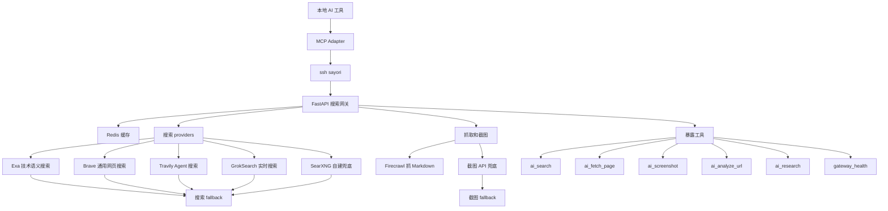

# Einleitung

Der Webmaster hat kürzlich auf seinem eigenen Server ein eigenes, benutzerdefiniertes MCP eingerichtet, um Such- und Screenshot-Upstreams zu bündeln und so ein eigenes Such-Gateway zu realisieren. Hier beschreibe ich den Aufbau des Gateways und den Workflow, bei dem es sich um ein auf dem Server laufendes FastAPI-Projekt handelt.

# Such-Upstreams

## Exa

[https://exa.ai/pricing](https://exa.ai/pricing), hier ist zu sehen, dass das kostenlose Kontingent 1.000 Abfragen pro Monat beträgt und es nach dem Hinterlegen einer Karte weitere 7 US-Dollar Testguthaben pro Monat sowie nach Abschluss der Registrierungsaufgaben ein Kontingent von 20 US-Dollar gibt. Die Suchqualität ist im Grunde die beste.

Es eignet sich für semantische Suchen wie nach Technologie, wissenschaftlichen Arbeiten und Open-Source-Projekten. Die Qualität ist hoch, aber man muss sparsam mit dem Kontingent umgehen.

## Brave

[Brave Search API | Brave](https://brave.com/search/api/), erfordert das Hinterlegen einer Karte. Danach gibt es ein Suchguthaben von fünf US-Dollar. Über das Festlegen eines Betragslimits lässt sich sicherstellen, dass keine Kosten anfallen. Die Suchqualität ist in Ordnung.

Es eignet sich für allgemeine Suchen wie offizielle Websites, Nachrichten, Blogs und normale Webseiten. Die Ergebnisse sind stabil.

## Tavily

[https://app.tavily.com/home](https://app.tavily.com/home), monatlich 1.000 Suchanfragen, was relativ großzügig ist. Es ist auch recht einfach, mehrere Konten zu registrieren, wobei eine übermäßige Nutzung natürlich nicht empfohlen wird. Die Suchqualität ist ziemlich gut.

Es eignet sich für Agent-Suchen, aktuelle Informationen und die Vervollständigung von Webseiteninhalten, was gut zum KI-Workflow passt.

## Firecrawl

[https://firecrawl.org.cn/](https://firecrawl.org.cn/), jeden Monat 1.000 Abfragen, um Seiten in Markdown zu konvertieren.

Es ist hauptsächlich dafür zuständig, Webseiten als Fließtext auszulesen, und eignet sich nicht als normale Suchquelle.

## Grok-search

Einstiegspunkt für das GrokSearch-Projekt: [GuDaStudio/GrokSearch: Integrate Grok's powerful real-time search capabilities into Claude via the MCP protocol!](https://github.com/GuDaStudio/GrokSearch), ich nutze es zur Einbindung der neuen Grok-Suche.

Dank einer Public-Welfare-Site in der L-Community ist die Grok-Freiheit im Grunde erreicht, und das einzige, was an Grok wirklich nutzbar ist, ist die Suche. Also habe ich das Projekt von GitHub verwendet, um die Suche einzubinden.

Es eignet sich für Echtzeitnachrichten und das Abfragen neuer Dinge.

# SearXNG

[https://github.com/searxng/searxng](https://github.com/searxng/searxng), ein Open-Source-Projekt auf GitHub, eine Open-Source-Suchmaschine. In der Infoseite steht Folgendes: `SearXNG 是一个免费的互联网元搜索引擎，可汇总来自各种搜索服务和数据库的结果。用户既不会被跟踪，也不会被描述`

Es eignet sich als selbstgehostete Fallback-Lösung und ist unabhängig von kommerziellen APIs, allerdings schwankt die Qualität je nach Instanz.
## Weitere kostenlose oder kostengünstige Upstreams

Diese können ebenfalls angebunden werden:

- DuckDuckGo Instant Answer API: Kein Schlüssel erforderlich, gut für leichte Abfragen von Entitäten.
- GitHub Search API: Sehr nützlich für die Suche nach Open-Source-Projekten. Mit einem GitHub-Konto lässt sich ein Token mit höherem Kontingent generieren.
- Stack Exchange API: Zum Durchsuchen von Stack-Overflow-Fragen und -Antworten. Den Schlüssel beantragt man bei Stack Apps.
- Wikipedia und Wikidata: Zum Nachschlagen von Enzyklopädien und Entitäten, ohne Schlüssel.
- Hacker News Algolia: Zum Durchsuchen von Diskussionen in der Tech-Community.
- arXiv, OpenAlex, Crossref, PubMed, Semantic Scholar: Zum Suchen nach wissenschaftlichen Arbeiten.
- Internet Archive: Zum Aufrufen historischer Seiten.
- Common Crawl: Zum Durchsuchen öffentlicher Indizes.

Diese werden nicht in die Standardsuche aufgenommen.
Spezifische Fragen erfordern professionelle Quellen.

Die Fallback-Reihenfolge meiner Suche lautet im Grunde: `auto` wählt die Quelle zunächst nach Fragetyp aus, technische Fragen gehen an Exa, Echtzeitfragen an Tavily oder Grok, normale Webseiten an Brave, und dann erfolgt das Fallback über Brave -> Tavily -> Exa -> Searxng.

# Screenshot-Upstreams

[Screenshot-API für kostenlose Entwicklerdienste](https://github.com/xzulab/free-for-dev-zh#%E6%88%AA%E5%9B%BE-api), der Webmaster hat dort einfach alle registriert, wodurch es im Grunde an nichts mehr mangelt. Der Fallback-Reihenfolge der KI folgend sieht das Ganze so aus: snapapi -> apiflash -> microlink -> screenshotlayer -> phantomjscloud -> screenshotbase -> screenshotscout -> screenshotmachine -> thumbnailws -> hqapi.

# Preisvergleichs-Upstream

Tickerr-Einstiegspunkt: [https://tickerr.ai/mcp-server](https://tickerr.ai/mcp-server), dies kann verwendet werden, um die aktuellen Neupreise verschiedener KI-Dienste abzurufen. Ich werde es jedoch nicht in mein eigenes Gateway integrieren; solche Dinge verbindet man einfach bei Bedarf.

# Mein Workflow

Zuerst analysiert ein normales Modell den Bedarf, dann werden gemäß dem Bedarf die Such- und Screenshot-APIs aufgerufen, und schließlich übermittelt das Modell die Ergebnisse der Suche und der Screenshots im JSON-Format. Zudem werden einige Inhalte lokal in Redis zwischengespeichert, und die bereitgestellten Tools decken viele verschiedene Anwendungsszenarien ab.

Mindmap

Die bereitgestellten Tools

- `ai_search`: Normaler Sucheinstiegspunkt, standardmäßig auf `auto`, wodurch das Gateway die Upstreams nach Fragetyp auswählt.
- `ai_fetch_page`: Einzelne Webseitentexte abrufen, hauptsächlich über Firecrawl in Markdown konvertiert.
- `ai_screenshot`: Proaktives Erstellen von Webseiten-Screenshots, geeignet, wenn eine Seite keinen Fließtext liefert oder der Status der Seite eingesehen werden muss.
- `ai_analyze_url`: Nach dem Abrufen einer URL diese vom Modell analysieren lassen, geeignet zum Lesen von Dokumentationen, Ankündigungen und Projektseiten.
- `ai_research`: Suche, Scraping und Zusammenfassung in einem Rutsch, geeignet zum Recherchieren eines Themas.
- `gateway_health`: Prüfen, ob das Remote-Gateway und die einzelnen Upstreams aktuell korrekt konfiguriert sind.

# Fazit

Dieses Gateway führt im Wesentlichen Suche, Scraping, Screenshots und Analyse in einem einzigen Einstiegspunkt zusammen.

Die Schlüssel verbleiben auf dem Server, lokal wird nur über MCP aufgerufen.

Standardfragen gehen an `auto`, bei fachlichen Fragen wird der Upstream gezielt genannt, und bei einem Fehler wird per Fallback auf eine andere gewechselt.

Auf diese Weise beeinträchtigt der Ausfall eines Upstreams nicht den gesamten KI-Such-Workflow.

## Weiterführende Lektüre

Wie lokale KI-Tools Modelle anbinden und den Anbieter wechseln, wird in [[anyrouter-sharedchat-cc-switch-student-guide|KI-Guthaben und cc-switch]] beschrieben. Das Such-Gateway kann auf diesem Workflow aufbauen.

Wer mit der Serverseite noch nicht vertraut ist, liest am besten zuerst [[docker-compose-minimum-start|Docker – Minimaler Einstieg]]; wer diese Dienste auf einem alten Computer zu Hause betreiben möchte, kann sich meine [[make-home-server|Dokumentation zum Umbau der Heim-Cloud]] ansehen.
