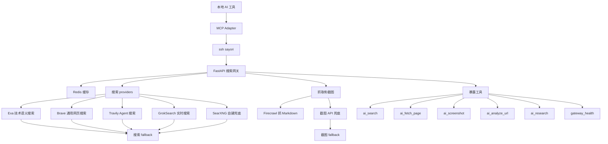

# Introducción

Hace poco monté en mi propio servidor un MCP personalizado para aglutinar upstreams de búsqueda y de capturas de pantalla, logrando así mi propio gateway de búsqueda a medida. Aquí anoto cómo está armado el gateway y cómo es su flujo de trabajo: es un proyecto de FastAPI corriendo en el servidor.

# Upstreams de búsqueda

## Exa

[https://exa.ai/pricing](https://exa.ai/pricing), aquí se ve que tiene 1000 búsquedas gratis al mes; además, al vincular tarjeta dan 7 dólares de crédito de prueba al mes, y al completar tareas de registro hay otros 20 dólares de saldo. La calidad de búsqueda suele ser la mejor.

Encaja bien con búsquedas semánticas tipo temas técnicos, papers y proyectos open source: da muy buena calidad, pero hay que gastar el saldo con tiento.

## Brave

[Brave Search API | Brave](https://brave.com/search/api/), pide vincular tarjeta y al hacerlo da 5 dólares de crédito para búsquedas; se puede poner un tope de gasto para asegurarse de no pagar de más. La calidad está bastante bien.

Sirve para búsquedas generales como webs oficiales, noticias, blogs y páginas normales; los resultados son estables.

## Travily

[https://app.tavily.com/home](https://app.tavily.com/home), 1000 búsquedas al mes, bastante holgado, y crear varias cuentas tampoco cuesta mucho (aunque no recomiendo abusar). La calidad de búsqueda es decente.

Va bien para búsquedas de agentes, información reciente y completar contenido web; encaja bastante con flujos de trabajo de IA.

## Firecrawl

[https://firecrawl.org.cn/](https://firecrawl.org.cn/), trae 1000 créditos al mes y sirve para extraer páginas a Markdown.

Su fuerte es leer páginas como texto principal; no conviene usarlo como buscador normal.

## Grok-search

Entrada del proyecto GrokSearch: [GuDaStudio/GrokSearch: Integrate Grok's powerful real-time search capabilities into Claude via the MCP protocol!](https://github.com/GuDaStudio/GrokSearch), yo lo uso para integrar la nueva búsqueda de Grok.

Gracias a los sitios gratuitos de la comunidad L, básicamente logré libertad con Grok, y lo que de verdad rinde de Grok es la búsqueda, así que tiré de un proyecto de GitHub para coserlo aquí dentro.

Le viene bien a noticias en tiempo real y consultas sobre cosas nuevas.

# SearXNG

[https://github.com/searxng/searxng](https://github.com/searxng/searxng), un proyecto open source en GitHub, un motor de búsqueda abierto; en su About pone esto: `SearXNG 是一个免费的互联网元搜索引擎，可汇总来自各种搜索服务和数据库的结果。用户既不会被跟踪，也不会被描述`

Sirve como respaldo autohospedado sin depender de APIs comerciales, aunque la calidad varía según la instancia.

## Otros upstreams gratuitos o de bajo coste

Estos también se pueden enchufar:

- DuckDuckGo Instant Answer API: sin key, bueno para consultas ligeras de entidades.
- GitHub Search API: muy útil para buscar proyectos open source; si tienes cuenta de GitHub puedes generar un token para tener más cuota.
- Stack Exchange API: para preguntas y respuestas de Stack Overflow; la key se pide en Stack Apps.
- Wikipedia y Wikidata: para enciclopedia y entidades, sin key.
- Hacker News Algolia: para debates de la comunidad técnica.
- arXiv, OpenAlex, Crossref, PubMed, Semantic Scholar: para papers.
- Internet Archive: para páginas históricas.
- Common Crawl: para índices públicos.

Estos no los meto en la búsqueda por defecto; las fuentes especializadas las uso solo cuando toca una pregunta especializada.

Mi orden de fallback en la búsqueda es básicamente `auto` primero para elegir fuente según el tipo de pregunta: lo técnico va a Exa, lo reciente o en tiempo real a Tavily o Grok, y las webs normales a Brave; luego tira de respaldo en este orden: brave -> tavily -> exa -> searxng.

# Upstreams de capturas de pantalla

[免费开发者服务之截图API](https://github.com/xzulab/free-for-dev-zh#%E6%88%AA%E5%9B%BE-api), básicamente me registré en todos los que salían ahí y con eso ya voy sobrado; luego, haciéndole caso a la IA, mi orden de fallback quedó más o menos así: snapapi -> apiflash -> microlink -> screenshotlayer -> phantomjscloud -> screenshotbase -> screenshotscout -> screenshotmachine -> thumbnailws -> hqapi.

# Upstream de comparación de precios

Entrada a Tickerr: [https://tickerr.ai/mcp-server](https://tickerr.ai/mcp-server), sirve para sacar los precios actuales de distintos servicios de IA, aunque yo no lo voy a meter dentro de mi gateway: para cosas así basta con consultarlo cuando haga falta.

# Mi flujo de trabajo

Primero uso un modelo normal para analizar lo que se necesita, luego llamo a las APIs de búsqueda y de capturas según esa necesidad, y al final vuelvo a usar un modelo para devolver los resultados de búsqueda y capturas en JSON; además, un Redis local cachea parte del contenido, y las herramientas expuestas también se separan según el caso de uso.

Mapa mental

Herramientas expuestas

- `ai_search`: entrada de búsqueda normal; por defecto va en `auto` para que el gateway elija upstream según el tipo de pregunta.
- `ai_fetch_page`: extrae el texto principal de una sola página, apoyándose sobre todo en Firecrawl para convertirlo a Markdown.
- `ai_screenshot`: saca una captura de pantalla de la web a propósito, útil cuando no se puede raspar el texto o hay que ver el estado de la página.
- `ai_analyze_url`: raspa una URL y deja que el modelo la analice, ideal para leer documentación, anuncios o páginas de proyectos.
- `ai_research`: combo de buscar, raspar y resumir de una tirada, pensado para investigar un tema.
- `gateway_health`: revisa si el gateway remoto y cada upstream están bien configurados en ese momento.

# Resumen

En el fondo, este gateway unifica búsqueda, extracción, capturas y análisis en una sola entrada.

Las keys van todas al servidor y en local solo se llama vía MCP.

Las preguntas normales van por `auto`, las especializadas apuntan directo a un upstream, y si algo falla se cambia de fuente siguiendo el fallback.

Así, si un upstream se cae, no tumba todo el flujo de búsqueda con IA.

## Seguir leyendo

Cómo conectar modelos y cambiar de proveedor en herramientas locales de IA está en [[anyrouter-sharedchat-cc-switch-student-guide|Cuota de IA y cc-switch]], y el gateway de búsqueda se puede seguir montando sobre ese flujo.

Si todavía no te manejas bien con el servidor, echa un ojo primero a [[docker-compose-minimum-start|Introducción mínima a Docker]]; y si quieres levantar estos servicios con un PC viejo en casa, puedes mirar mi [[make-home-server|Registro de transformación de nube casera]].
