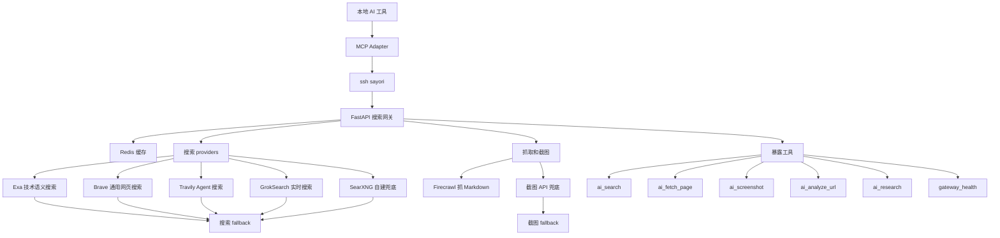

# Intro

Récemment, j'ai monté mon propre MCP perso sur mon serveur pour agréger des sources de recherche et de capture d'écran en amont, et ainsi avoir ma propre passerelle de recherche sur mesure. Je note ici la structure de la passerelle et son workflow — c'est un projet FastAPI qui tourne sur le serveur.

# Sources de recherche en amont

## Exa

[https://exa.ai/pricing](https://exa.ai/pricing) — on y voit 1000 requêtes gratuites par mois, plus 7 $ de crédit d'essai par mois après ajout d'une carte, et 20 $ de crédit en terminant les tâches d'inscription. La qualité de recherche est globalement au top.

C'est taillé pour la recherche sémantique (technique, articles, projets open source) : haute qualité, mais il faut économiser le quota.

## Brave

[Brave Search API | Brave](https://brave.com/search/api/) — carte requise, avec 5 $ de crédit de recherche une fois ajoutée ; on peut fixer un plafond de dépenses pour éviter toute mauvaise surprise, et la qualité est correcte.

Pratique pour la recherche généraliste (sites officiels, actus, blogs, pages web classiques), avec des résultats stables.

## Travily

[https://app.tavily.com/home](https://app.tavily.com/home) — 1000 requêtes de recherche par mois, plutôt souple, et créer plusieurs comptes est assez simple (bon, à ne pas abuser non plus). Qualité tout à fait convenable.

Bien adapté à la recherche par agent, aux infos récentes et à l'enrichissement de contenu web, ça colle bien aux workflows IA.

## Firecrawl

[https://firecrawl.org.cn/](https://firecrawl.org.cn/) — 1000 crédits par mois, pour extraire des pages en Markdown.

Sert surtout à transformer une page en corps de texte, pas vraiment fait comme source de recherche classique.

## Grok-search

Entrée du projet GrokSearch : [GuDaStudio/GrokSearch: Integrate Grok's powerful real-time search capabilities into Claude via the MCP protocol!](https://github.com/GuDaStudio/GrokSearch), que j'utilise pour brancher la recherche Grok.

Merci aux instances publiques de la communauté L pour la liberté Grok — et comme la recherche est ce qui marche le mieux côté Grok, j'ai recousu ça via un projet GitHub.

Bon pour l'actu en temps réel et les nouveautés.

# SearXNG

[https://github.com/searxng/searxng](https://github.com/searxng/searxng) — un moteur de recherche open source sur GitHub, dont la description est : `SearXNG 是一个免费的互联网元搜索引擎，可汇总来自各种搜索服务和数据库的结果。用户既不会被跟踪，也不会被描述`

Bien en repli auto-hébergé sans dépendre d'une API commerciale, même si la qualité varie selon les instances.
## Autres sources gratuites ou peu coûteuses

On peut aussi brancher celles-ci :

- DuckDuckGo Instant Answer API : pas de clé requise, pratique pour des requêtes d'entités légères
- GitHub Search API : très utile pour chercher des projets open source ; avec un compte GitHub on peut générer un token pour plus de quota
- Stack Exchange API : pour les questions/réponses Stack Overflow, clé à demander sur Stack Apps
- Wikipedia et Wikidata : encyclopédie et entités, sans clé
- Hacker News Algolia : discussions de la communauté tech
- arXiv, OpenAlex, Crossref, PubMed, Semantic Scholar : articles scientifiques
- Internet Archive : anciennes versions de pages
- Common Crawl : index public

Je ne les mets pas dans la recherche par défaut ; les questions pointues iront vers les sources spécialisées.

Mon ordre de fallback côté recherche ressemble en gros à `auto` : d'abord choisir la source selon le type de question — technique vers Exa, temps réel vers Tavily ou Grok, web classique vers Brave — puis repli en cascade `brave -> tavily -> exa -> searxng`.
# Sources de capture d'écran en amont

[免费开发者服务之截图API](https://github.com/xzulab/free-for-dev-zh#%E6%88%AA%E5%9B%BE-api) — j'ai tout simplement créé un compte sur chacun pour ne plus en manquer, et en suivant l'ordre de fallback suggéré par l'IA ça donne en gros `snapapi -> apiflash -> microlink -> screenshotlayer -> phantomjscloud -> screenshotbase -> screenshotscout -> screenshotmachine -> thumbnailws -> hqapi`.

# Source de comparaison tarifaire

Entrée Tickerr : [https://tickerr.ai/mcp-server](https://tickerr.ai/mcp-server) — pratique pour consulter les tarifs récents de divers services IA, mais je ne l'intègre pas dans ma passerelle : un coup d'œil quand j'en ai besoin suffit.

# Mon workflow

D'abord un modèle léger analyse le besoin, puis appelle les API de recherche et de capture d'écran selon la demande, et enfin un modèle ressort les résultats de recherche et de capture en JSON. Un Redis local met aussi une partie des données en cache, et les outils exposés couvrent plusieurs cas d'usage.

Carte mentale

Outils exposés

- `ai_search` : point d'entrée de recherche classique, en `auto` par défaut pour laisser la passerelle choisir la source selon le type de question
- `ai_fetch_page` : récupère le texte d'une page web, surtout via Firecrawl pour convertir en Markdown
- `ai_screenshot` : capture une page web à la demande, utile quand l'extraction de texte échoue ou qu'il faut voir l'état de la page
- `ai_analyze_url` : récupère une URL puis fait analyser par le modèle, pratique pour lire docs, annonces ou pages de projet
- `ai_research` : recherche, extraction et résumé d'un bloc, pratique pour explorer un sujet
- `gateway_health` : vérifie si la passerelle distante et les sources en amont sont bien configurées

# Bilan

Au fond, cette passerelle centralise recherche, extraction, capture d'écran et analyse en un seul point d'entrée.

Toutes les clés restent sur le serveur, et le poste local n'appelle que via MCP.

Questions courantes en `auto`, sources spécialisées nommées pour les sujets pointus, et repli via fallback en cas d'échec.

Comme ça, si une source tombe, tout le workflow de recherche IA ne s'effondre pas avec.

## Pour aller plus loin

Comment brancher des modèles et changer de fournisseur sur ses outils IA locaux, c'est dans [[anyrouter-sharedchat-cc-switch-student-guide|Crédits IA et cc-switch]] — la passerelle de recherche peut s'enchaîner sur ce workflow.

Si le côté serveur est encore un peu flou, commence par [[docker-compose-minimum-start|Prise en main minimale de Docker]] ; et pour faire tourner ces services sur un vieux PC à la maison, jette un œil à [[make-home-server|Mes notes de transformation d'un vieux PC en cloud maison]].
