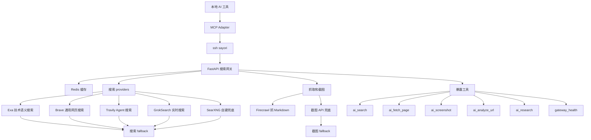

# はじめに

管理人は最近、自分のサーバー上にカスタム MCP を立てて検索の上流やスクショの上流をまとめ、自前の検索ゲートウェイを作った。ここではゲートウェイの構成とワークフローを書いておく。サーバー上で動く FastAPI プロジェクトだ。

# 検索上流

## Exa

[https://exa.ai/pricing](https://exa.ai/pricing)。無料枠は月1000回で、カード紐付けで毎月7ドルのトライアル枠があり、登録後にタスクをこなすとさらに20ドルの枠がもらえる。検索品質はだいたい一番いい。

技術系、論文、OSS プロジェクトみたいなセマンティック検索に向いていて、品質は高いけど枠はケチって使いたい。

## Brave

[Brave Search API | Brave](https://brave.com/search/api/)。カード紐付けが必要で、紐付けると5ドルの検索枠がつく。上限金額を設定しておけば課金されないようにできて、検索品質もまあまあ。

公式サイト、ニュース、ブログ、普通の Web ページみたいな汎用検索向きで、結果が安定している。

## Travily

[https://app.tavily.com/home](https://app.tavily.com/home)。月1000回の検索枠で割とゆるく、複数アカウント登録もしやすい（もちろん乱用はおすすめしない）。検索品質もなかなかいい。

agent 検索、直近の情報、Web ページ内容の補完に向いていて、AI ワークフローと相性がいい。

## Firecrawl

[https://firecrawl.org.cn/](https://firecrawl.org.cn/)。毎月1000回枠があって、ページを Markdown に取得する用途。

Web ページを本文として読み込むのがメインで、普通の検索ソースには向かない。

## Grok-search

GrokSearch プロジェクト入口：[GuDaStudio/GrokSearch: Integrate Grok's powerful real-time search capabilities into Claude via the MCP protocol!](https://github.com/GuDaStudio/GrokSearch)。新しい Grok 検索の接続に使っている。

L 站内の公益站のおかげでほぼ Grok 自由が達成できたのだが、Grok で使えるものといえば検索くらいなので、GitHub のプロジェクトをつぎはぎして検索を取り込んだ。

リアルタイムな話題や新しいものを調べるのに向いている。

# SearXNG

[https://github.com/searxng/searxng](https://github.com/searxng/searxng)。GitHub にあるオープンソースの検索エンジン。About にはこう書かれている：`SearXNG 是一个免费的互联网元搜索引擎，可汇总来自各种搜索服务和数据库的结果。用户既不会被跟踪，也不会被描述`

商用 API に頼らない自前のフォールバック向きだが、インスタンスによって品質にムラが出る。

## その他の無料・低コスト上流

このあたりもつなげる。

- DuckDuckGo Instant Answer API：キー不要で、軽めのエンティティ検索向き
- GitHub Search API：OSS を探すのに便利。GitHub アカウントがあればトークンを発行して枠を増やせる
- Stack Exchange API：Stack Overflow の Q&A 検索用。キーは Stack Apps で申請
- Wikipedia と Wikidata：百科事典やエンティティ調べに便利、キー不要
- Hacker News Algolia：技術コミュニティの議論検索
- arXiv、OpenAlex、Crossref、PubMed、Semantic Scholar：論文検索
- Internet Archive：過去ページの検索
- Common Crawl：公開インデックスの検索

これらはデフォルト検索には入れず、専門的な質問のときに専門ソースとして使う。

俺の検索 fallback 順はだいたい `auto` で、まず質問タイプごとにソースを選ぶ（技術系は Exa、リアルタイム系は Tavily か Grok、普通の Web ページは Brave）。その後は brave -> tavily -> exa -> searxng の順でフォールバックする。

# スクショ上流

[無料开发者服务之截图API](https://github.com/xzulab/free-for-dev-zh#%E6%88%AA%E5%9B%BE-api)。管理人は載っているものを一通り全部登録して、だいたい困らないようにした。管理人が AI に言われるまま組んだ fallback 順はだいたい snapapi -> apiflash -> microlink -> screenshotlayer -> phantomjscloud -> screenshotbase -> screenshotscout -> screenshotmachine -> thumbnailws -> hqapi。

# 価格比較上流

Tickerr 入口：[https://tickerr.ai/mcp-server](https://tickerr.ai/mcp-server)。各種 AI サービスの最新価格を取るのに使えるが、自分のゲートウェイには組み込まない。必要なときに繋ぐだけで十分。

# 俺のワークフロー

まず普通のモデルで要件を分析し、要件に合わせて検索 API やスクショ API を呼び出し、最後にモデルで検索結果とスクショ結果を JSON 形式で返す。ローカルの Redis でも一部をキャッシュしていて、公開するツールも用途ごとにかなり分けている。

マインドマップ

公開しているツールたち

- `ai_search`：通常の検索窓口。デフォルトは `auto` で、ゲートウェイが質問タイプに応じて上流を選ぶ
- `ai_fetch_page`：単一 Web ページの本文取得。主に Firecrawl で Markdown に変換する
- `ai_screenshot`：能動的に Web ページのスクショを撮る。本文が取れないページや、ページの状態を見たいときに使う
- `ai_analyze_url`：URL を取得してからモデルに分析させる。ドキュメントや告知、プロジェクトページを読むのに向く
- `ai_research`：検索・取得・要約をまとめてやる。1つのテーマを調べるときに便利
- `gateway_health`：リモートゲートウェイや各上流が今ちゃんと設定できているか確認する

# まとめ

このゲートウェイは突き詰めると、検索・取得・スクショ・分析を1つの窓口にまとめたものだ。

キー類は全部サーバーに置き、ローカルからは MCP 経由で呼ぶだけ。

普通の質問は `auto`、専門的な質問は上流を指定し、失敗したら fallback で別ソースに切り替える。

こうしておけば1つの上流が落ちても、AI 検索ワークフロー全体が止まらなくて済む。

## 続きを読む

ローカルの AI ツールにモデルを繋いでプロバイダを切り替える方法は [[anyrouter-sharedchat-cc-switch-student-guide|AI 枠と cc-switch]] にまとめてあり、検索ゲートウェイはこのワークフローに続けて組める。

サーバー側にまだ慣れていないなら先に [[docker-compose-minimum-start|Docker 最小入門]] をどうぞ。家の古い PC でこれらのサービスを動かしたいなら、俺の [[make-home-server|ホームクラウド改造記録]] も見てみてほしい。
