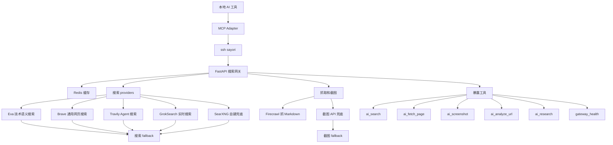

# 시작하며

웹서핑 관리자 본인이 서버에 커스텀 MCP를 직접 구축해서 검색 업스트림과 스크린샷 업스트림을 집계하고, 나만의 커스텀 검색 게이트웨이를 만들었습니다. 여기서는 그 게이트웨이의 구성과 워크플로우를 적어보려 합니다. 서버에서 실행되는 FastAPI 프로젝트입니다.

# 검색 업스트림

## Exa

[https://exa.ai/pricing](https://exa.ai/pricing), 여기를 보면 무료 크레딧이 매월 1,000회 제공되고, 카드를 등록하면 매월 7달러의 트라이얼 크레딧도 줍니다. 회원가입 완료 미션을 깨면 20달러어치 크레딧도 더 주는데, 검색 퀄리티가 거의 최고 수준입니다.

기술, 논문, 오픈소스 프로젝트 같은 시맨틱 검색에 알맞으며 품질은 좋지만 크레딧은 아껴 써야 합니다.

## Brave

[Brave Search API | Brave](https://brave.com/search/api/), 카드를 등록해야 하며 등록 시 5달러어치 검색 크레딧을 줍니다. 금액 한도를 설정해 두면 유료 결제될 걱정 없이 쓸 수 있고 검색 퀄리티도 쓸만합니다.

공식 홈페이지, 뉴스, 블로그, 일반 웹페이지 같은 범용 검색에 알맞으며 결과가 안정적입니다.

## Tavily

[https://app.tavily.com/home](https://app.tavily.com/home), 매월 1,000회의 검색 크레딧을 주어 꽤 넉넉한 편입니다. 계정을 여러 개 가입하기도 편하지만 물론 남용하는 것은 권장하지 않으며, 검색 퀄리티는 꽤 괜찮은 편입니다.

에이전트 검색, 최근 정보, 웹페이지 내용 보완에 적합하며 AI 워크플로우와 궁합이 잘 맞습니다.

## Firecrawl

[https://firecrawl.org.cn/](https://firecrawl.org.cn/), 매월 1,000회의 크레딧이 주어지며 웹페이지를 마크다운으로 크롤링하는 용도로 씁니다.

주로 웹페이지를 읽어서 본문으로 만들어 주는 역할을 하며 일반적인 검색 소스로는 적합하지 않습니다.

## Grok-search

GrokSearch 프로젝트 진입점: [GuDaStudio/GrokSearch: Integrate Grok's powerful real-time search capabilities into Claude via the MCP protocol!](https://github.com/GuDaStudio/GrokSearch), 저는 이걸로 새로운 Grok 검색을 연동했습니다.

L커뮤니티 내 공익 사이트 덕분에 사실상 Grok 프리덤을 달성했는데, Grok에서 쓸만한 기능이라곤 결국 검색뿐이라 GitHub에 있는 프로젝트를 짜깁기해서 검색 기능을 엮었습니다.

실시간 소식과 새로운 정보 조회용으로 알맞습니다.

# SearXNG

[https://github.com/searxng/searxng](https://github.com/searxng/searxng), GitHub에 있는 오픈소스 프로젝트이자 오픈소스 검색엔진입니다. 소개글(About)에는 이렇게 적혀 있습니다: `SearXNG 是一个免费的互联网元搜索引擎，可汇总来自各种搜索服务和数据库的结果。用户既不会被跟踪，也不会被描述`

상업용 API에 의존하지 않고 자체 구축하여 예비용(fallback)으로 쓰기 좋습니다. 다만 인스턴스마다 퀄리티가 다소 흔들릴 수 있습니다.
## 기타 무료 또는 저비용 업스트림

이런 것들도 연동할 수 있습니다.

- DuckDuckGo Instant Answer API: 키가 필요 없어 가벼운 엔티티 조회에 적합
- GitHub Search API: 오픈소스 프로젝트 검색에 아주 좋으며, GitHub 계정이 있으면 토큰을 발급받아 더 많은 크레딧 사용 가능
- Stack Exchange API: Stack Overflow Q&A 검색용, 키는 Stack Apps에서 신청
- Wikipedia 및 Wikidata: 백과사전 및 엔티티 조회용, 키 불필요
- Hacker News Algolia: 기술 커뮤니티 토론 내용 조회
- arXiv, OpenAlex, Crossref, PubMed, Semantic Scholar: 논문 조회용
- Internet Archive: 과거 웹페이지 조회용
- Common Crawl: 공개 인덱스 조회용

이런 것들은 기본 검색에 억지로 넣지 않고,
전문적인 질문일 때만 전문 소스를 사용합니다.

저의 검색 fallback 순서는 기본적으로 auto로 먼저 질문 유형에 따라 소스를 고릅니다. 기술 관련은 Exa, 실시간 관련은 Tavily나 Grok, 일반 웹페이지는 Brave를 거친 뒤 brave -> tavily -> exa -> searxng 순으로 예비용 소스를 타게 됩니다.

# 스크린샷 업스트림

[무료 개발자 서비스 중 스크린샷 API](https://github.com/xzulab/free-for-dev-zh#%E6%88%AA%E5%9B%BE-api), 웹서핑 관리자가 그 안의 서비스들을 싹 다 가입해 두니 부족할 일이 거의 없어졌습니다. AI가 제안해 준 fallback 순서대로 대략 snapapi -> apiflash -> microlink -> screenshotlayer -> phantomjscloud -> screenshotbase -> screenshotscout -> screenshotmachine -> thumbnailws -> hqapi 순으로 작동합니다.

# 가격 비교 업스트림

Tickerr 진입점: [https://tickerr.ai/mcp-server](https://tickerr.ai/mcp-server), 현재 각종 AI 서비스와 관련된 최신 가격들을 확인하는 데 쓸 수 있습니다. 다만 제 검색 게이트웨이에 직접 연동하지는 않고, 필요할 때만 살짝 들어가서 확인합니다.

# 나의 워크플로우

먼저 일반 모델로 요구사항을 분석한 뒤, 요구사항에 맞춰 검색 및 스크린샷 API를 호출합니다. 마지막으로 검색과 스크린샷 결과를 JSON 형식으로 모델에 전달하고, 로컬 Redis에도 일부 내용을 캐싱합니다. 외부에 노출하는 도구들도 여러 이용 시나리오에 따라 세분화했습니다.

마인드맵

노출하는 도구들

- `ai_search`: 일반적인 검색 진입점, 기본값으로 auto를 타며 게이트웨이가 질문 유형에 따라 업스트림을 선택함
- `ai_fetch_page`: 단일 웹페이지 본문을 크롤링, 주로 Firecrawl에 의존하여 마크다운으로 변환함
- `ai_screenshot`: 웹페이지 스크린샷을 능동적으로 캡처, 페이지에서 본문을 긁어오지 못하거나 페이지 상태를 직접 봐야 할 때 적합함
- `ai_analyze_url`: URL을 크롤링한 뒤 모델에게 분석을 요청, 문서·공지사항·프로젝트 페이지를 읽을 때 적합함
- `ai_research`: 검색, 크롤링, 요약을 원스톱으로 처리, 특정 주제를 조사할 때 적합함
- `gateway_health`: 원격 게이트웨이와 각 업스트림들의 현재 설정 상태를 확인

# 요약

이 게이트웨이는 본질적으로 검색, 크롤링, 스크린샷, 분석 기능을 하나의 진입점으로 통합한 것입니다.

비밀키는 전부 서버에 두고, 로컬에서는 MCP를 통해서만 호출합니다.

일반적인 질문은 auto로 보내고, 전문적인 질문은 업스트림을 직접 지정하며, 실패할 경우 fallback에 따라 소스를 바꿉니다.

이렇게 하면 특정 업스트림 하나가 고장 나더라도 전체 AI 검색 워크플로우에 영향을 주지 않습니다.

## 더 읽어보기

로컬 AI 도구에 모델을 연동하고 공급자를 전환하는 방법은 [[anyrouter-sharedchat-cc-switch-student-guide|AI 크레딧과 cc-switch]]에 정리해 두었으며, 검색 게이트웨이는 이 워크플로우를 이어 붙여서 계속 구축할 수 있습니다.

서버가 아직 낯설다면 [[docker-compose-minimum-start|Docker 최소한의 입문]]부터 보세요. 집안의 구형 PC로 이러한 서비스들을 구동해 보고 싶다면 제 [[make-home-server|홈 서버 개조 기록]]을 참고해 보세요.
