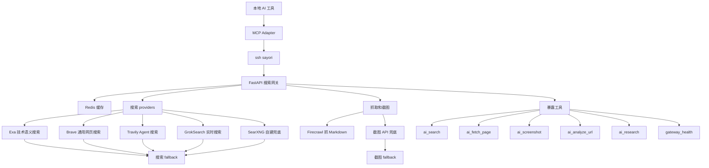

# Introdução

Recentemente, o webmaster configurou seu próprio MCP personalizado no servidor para agregar upstreams de busca e de captura de tela, criando seu próprio gateway de busca personalizado. Aqui está a descrição da estrutura e do fluxo de trabalho do gateway, que é um projeto FastAPI executado no servidor.

# Upstreams de Busca

## Exa

[https://exa.ai/pricing](https://exa.ai/pricing), aqui você pode ver que a cota gratuita oferece 1000 vezes por mês, e após vincular um cartão há também um bônus de teste de 7 dólares por mês, além de 20 dólares de cota após concluir as tarefas de cadastro. A qualidade da busca é basicamente a melhor.

É adequado para buscas semânticas como tecnologia, papers e projetos open source. A qualidade é alta, mas a cota precisa ser usada com moderação.

## Brave

[Brave Search API | Brave](https://brave.com/search/api/), requer vinculação de cartão. Após vincular, há 5 dólares de cota de busca. Você pode garantir que não será cobrado definindo um limite máximo de gastos. A qualidade da busca é razoável.

É adequado para buscas gerais como sites oficiais, notícias, blogs e páginas web comuns. Os resultados são estáveis.

## Tavily

[https://app.tavily.com/home](https://app.tavily.com/home), 1000 buscas por mês de cota, o que é bem flexível. Também é prático registrar várias contas (claro, abusar não é recomendado). A qualidade da busca é muito boa.

É adequado para buscas de agentes, informações recentes e complementação de conteúdo de páginas web, combinando bem com fluxos de trabalho de IA.

## Firecrawl

[https://firecrawl.org.cn/](https://firecrawl.org.cn/), com 1000 requisições de cota todos os meses, usado para raspar páginas web transformando-as em Markdown.

Ele é o principal responsável por ler páginas web em formato de texto principal, não sendo adequado para ser usado como fonte de busca comum.

## Grok-search

Ponto de entrada do projeto GrokSearch: [GuDaStudio/GrokSearch: Integrate Grok's powerful real-time search capabilities into Claude via the MCP protocol!](https://github.com/GuDaStudio/GrokSearch), uso isso para a nova integração de busca do Grok.

Agradecimentos à comunidade L-forum, alcancei basicamente a liberdade de usar o Grok. E a única coisa útil no Grok é a busca, então usei o projeto do GitHub para integrá-la por meio de "costura".

É adequado para consultas de notícias em tempo real e novidades.

# SearXNG

[https://github.com/searxng/searxng](https://github.com/searxng/searxng), um projeto de código aberto no GitHub, um mecanismo de busca open source. Sua seção "Sobre" diz o seguinte: `SearXNG 是一个免费的互联网元搜索引擎，可汇总来自各种搜索服务和数据库的结果。用户既不会被跟踪，也不会被描述`

É adequado para auto-hospedagem como fallback, sem depender de APIs comerciais, embora a qualidade possa variar entre diferentes instâncias.
## Outros upstreams gratuitos ou de baixo custo

Estes também podem ser conectados:

- DuckDuckGo Instant Answer API: sem necessidade de chave, adequado para consultas de entidades leves.
- GitHub Search API: ótimo para buscar projetos open source, ter uma conta no GitHub permite gerar um token com mais cota.
- Stack Exchange API: busca perguntas e respostas do Stack Overflow, chave solicitada em Stack Apps.
- Wikipedia e Wikidata: consulta enciclopédias e entidades, sem chave.
- Hacker News Algolia: consulta discussões da comunidade de tecnologia.
- arXiv, OpenAlex, Crossref,PubMed, Semantic Scholar: consulta de papers.
- Internet Archive: consulta páginas históricas.
- Common Crawl: consulta índices públicos.

Estes não são colocados na busca padrão.
Problemas especializados usam fontes especializadas.

Minha ordem de fallback de busca é basicamente: `auto` seleciona a fonte primeiro com base no tipo de pergunta; a categoria de tecnologia vai para o Exa, a categoria em tempo real vai para Tavily ou Grok, páginas comuns vão para Brave; depois usa o fallback `brave -> tavily -> exa -> searxng`.

# Upstreams de Captura de Tela

[API de Captura de Tela de Serviços Gratuitos para Desenvolvedores](https://github.com/xzulab/free-for-dev-zh#%E6%88%AA%E5%9B%BE-api), o webmaster basicamente se registrou em todos eles para nunca ficar sem. Em seguida, o webmaster seguiu a ordem de fallback ditada pela IA, que é basicamente `snapapi -> apiflash -> microlink -> screenshotlayer -> phantomjscloud -> screenshotbase -> screenshotscout -> screenshotmachine -> thumbnailws -> hqapi`.

# Upstreams de Comparação de Preços

Ponto de entrada do Tickerr: [https://tickerr.ai/mcp-server](https://tickerr.ai/mcp-server), isto pode ser usado para obter os preços mais recentes de vários serviços de IA relacionados no momento, mas não vou integrá-lo ao meu próprio gateway. Coisas assim só precisam ser consultadas quando necessário.

# Meu Fluxo de Trabalho

Primeiro, usa um modelo comum para analisar os requisitos, depois chama as APIs de busca e captura de tela de acordo com os requisitos e, por fim, usa o modelo para retornar os resultados da busca e da captura de tela no formato JSON. Além disso, o Redis local armazena em cache parte do conteúdo, e as ferramentas expostas também diferenciam muitos cenários de aplicação.

Mapa mental

Ferramentas expostas

- `ai_search`: Entrada de busca comum, usa `auto` por padrão, permitindo que o gateway escolha o upstream com base no tipo de pergunta.
- `ai_fetch_page`: Raspa o texto principal de uma página web individual, convertendo-a principalmente em Markdown através do Firecrawl.
- `ai_screenshot`: Captura ativamente a tela de uma página web, adequado para quando a página não consegue raspar o texto principal ou quando é necessário verificar o estado da página.
- `ai_analyze_url`: Analisa via modelo após capturar uma URL, adequado para ler documentação, avisos e páginas de projetos.
- `ai_research`: Pacote completo de busca, raspagem, resumo e conclusão, adequado para pesquisar um tópico.
- `gateway_health`: Verifica se o gateway remoto e os vários upstreams estão configurados corretamente no momento.

# Conclusão

Este gateway unifica essencialmente a busca, a raspagem, a captura de tela e a análise em uma única entrada.

Todas as chaves ficam no servidor, e o local chama apenas via MCP.

Perguntas comuns vão para o `auto`, perguntas especializadas especificam o upstream, e em caso de falha, troca-se a fonte de acordo com o fallback.

Dessa forma, se um upstream cair, isso não afetará todo o fluxo de trabalho de busca por IA.

## Leitura Contínua

Como ferramentas de IA locais se conectam a modelos e alternam provedores está em [[anyrouter-sharedchat-cc-switch-student-guide|Cotas de IA e cc-switch]]. O gateway de busca pode continuar a ser construído a partir deste fluxo de trabalho.

Se você ainda não estiver familiarizado com o lado do servidor, consulte primeiro [[docker-compose-minimum-start|Introdução Mínima ao Docker]]; se quiser usar computadores antigos de casa para hospedar esses serviços, dê uma olhada no meu [[make-home-server|Registro de Reforma da Nuvem Doméstica]].
