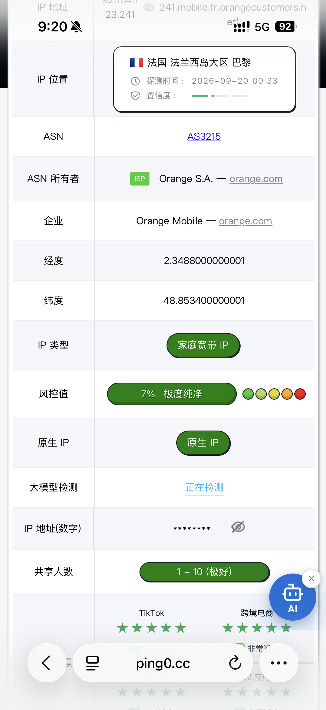

> [!WARNING]
> Dieser Beitrag wurde am **2026-09-21** veröffentlicht. Die Infos stammen aus Nutzertests vom selben Tag, Empfehlungslinks und öffentlichen Seiten – es gibt keine Garantie, dass die Angebote nach dem Veröffentlichungsdatum noch gelten. Ob du teilnahmeberechtigt bist, wie hoch Kontingente oder Geschwindigkeiten ausfallen, wie lange Mitgliedschaften laufen, ob eine Kreditkarte hinterlegt werden muss und welche Bedingungen am Ende auf der Bezahlseite stehen, hängt allein davon ab, was dir auf der offiziellen Seite angezeigt wird.

Hier sammle ich erst einmal drei Zugänge, über die ich kürzlich gestolpert bin. Gemeinsam haben sie, dass sich die Aktionsbedingungen schnell ändern – taugen also eher als Spur denn als dauerhaftes Versprechen.

## AnySearch: Such-API

**Stand der Notiz: 2026-09-21**

- Offizielle Website: [AnySearch](https://www.anysearch.com/)
- Skill-Beschreibung: [anysearch-skill](https://github.com/anysearch-ai/anysearch-skill/blob/main/)
- Typ: Such-API

Nach aktuellem Nutzer-Feedback lassen sich mit chinesischen Hochschul-E-Mail-Adressen 2.000 Abfragen pro Tag nutzen; laut Praxistest ging auch eine spontan besorgte `edu.kg`-Adresse durch den Einlöseprozess.

Das verbuche ich hier ausdrücklich nur als **Nutzertest**, nicht als dauerhafte offizielle Zusage von AnySearch. E-Mail-Berechtigung, Tageslimits und verfügbare Schnittstellen können sich je nach Aktionswelle, Region oder Kontostatus ändern. Nutze außerdem keine Uni-Adressen, die dir gar nicht gehören, um die Teilnahmebedingungen zu umgehen – maßgeblich sind am Ende die Nutzungsbedingungen und das, was im Dashboard angezeigt wird.

## Brain.fm: 365 Tage Mitgliedschaft gegen Kartendaten?

**Stand der Notiz: 2026-09-21**

- Empfehlungszugang: [Brain.fm referral](https://brain.fm/refer?extended_promo=30&utm_source=referafriend)
- Einsatzzweck: Funktionale Musik, Fokus- und Entspannungsklänge im Stil von White Noise

Laut Nutzerberichten gibt es über diesen Link nach Hinterlegen einer Bank- oder Kreditkarte **365 Tage Mitgliedschaft**. Ich werte diese Laufzeit hier bewusst nicht als offiziell bestätigte Tatsache; ob du berechtigt bist, ob zuerst eine Testphase läuft und ob sich das Abo automatisch verlängert, musst du auf deiner eigenen Registrierungs- und Bezahlseite prüfen.

Brain.fm kann beim Arbeiten, Lernen oder Abschalten eine ganz angenehme Klangkulisse liefern. Eine ADHS-Diagnose oder -Therapie ersetzt das natürlich nicht; wenn du einfach nur ein Tool suchst, das Umgebungsgeräusche abblockt, schau dir vor dem Hinterlegen deiner Karte genau die Test- und Verlängerungsbedingungen an.

Das ist ein Referral-Link, über den der Empfehlende unter Umständen eine Prämie oder Zuordnung erhält. Wenn du das nicht möchtest, geh einfach direkt über die [offizielle Brain.fm-Website](https://www.brain.fm/).

## USIMS: Kostenlose eSIM, 1 GB Highspeed und danach dauerhaft gedrosselt

**Stand der Notiz: 2026-09-20**

- Empfehlungszugang: [USIMS referral](https://referral.usims.com/ROBq/s1iqwqqr)
- Nutzerbeschreibung: Kostenlose Residential-eSIM, erst 1 GB Highspeed-Datenvolumen, danach dauerhaft mit 128 kbps nutzbar

Genau diese Datenkonditionen werden in den Nutzerberichten als Hauptargument genannt. In der öffentlichen App-Store-Beschreibung von USIMS findet sich tatsächlich **Free Essentials Forever**: kostenlose, nicht ablaufende Daten mit niedriger Geschwindigkeit in über 200 Ländern und Regionen, gedacht für Messenger, Karten, Anrufe und grundlegende Reise-Apps. Konkrete Angaben wie „1 GB Highspeed“, „128 kbps“ oder „Residential-IP“ ließen sich in den öffentlichen Infos diesmal aber nicht unabhängig bestätigen und laufen daher weiter als Nutzertest.

Auf dem Screenshot, der mir geschickt wurde, zeigte der IP-Check Paris (Frankreich), Orange Mobile und eine Residential-IP mit einem angegebenen Sharing-Bereich von 1–10. Das spiegelt allerdings nur diesen einen Test wider und heißt nicht, dass jede eSIM, jede Region oder jedes Zeitfenster denselben Exit-Knoten bekommt.

Vor der Aktivierung solltest du prüfen, ob dein Smartphone eSIM unterstützt, ob das Zielland abgedeckt ist, wie schnell und wofür genau die kostenlosen Daten gedacht sind und ob die Referral-Seite zusätzliche Bedingungen stellt. Offizieller App-Store-Zugang: [USIMS](https://apps.apple.com/au/app/esim-built-for-travel-usims/id1555283998).

## Noch ein kurzer Hinweis zum Schluss

- Veröffentlichungsdatum des Beitrags: **2026-09-21**.
- Stand der Notizen zu AnySearch, Brain.fm und USIMS: **2026-09-21, 2026-09-21 bzw. 2026-09-20**.
- „Nutzer-Feedback/Praxistests“ und „auf offiziellen Seiten bestätigte Angaben“ sind bewusst getrennt aufgeführt; nicht unabhängig bestätigte Zahlen sind keine Garantie.
- Jede Aktion kann nach dem Veröffentlichungsdatum auslaufen, ihre Regeln ändern oder auf bestimmte Konten beschränkt werden. Achte vor dem Klick auf Referral-Links außerdem auf Empfehlungszuordnungen, automatische Verlängerungen, Kartenpflicht und Datenschutzbestimmungen.
