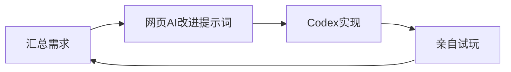

# Anfang
> Hinweis vorab
> Diesen Text habe ich geschrieben, während „Stay Alive“ lief – hör gern mal rein, ist wirklich richtig schön, und überhaupt sollten alle gefälligst Re:Zero schauen (Nebel)

::music-track{title="Stay Alive" artist="高橋李依" netease="3394003744" link="https://music.163.com/#/song?id=3394003744"}

Endlich überstehe ich wohl diese verfluchte Klausurenphase. Dieses Semester war ja mal wieder ein einziges Ausweichen und Scheitern … Seit Semesterbeginn bin ich dauernd spät ins Bett, irgendwann war der Schlafrhythmus auf 0 Uhr verschoben. Am Anfang war das nur Schmerz und Zusammenbruch, inzwischen bin ich taub geworden – will es aber trotzdem nicht so machen. Vielleicht ziehe ich nächstes Semester aus und wohne allein? Oder pfeife einfach auf die Mitbewohner und gehe pünktlich schlafen … So müsste es sein, haha, aber jetzt, wo alles fast vorbei ist, fällt es mir natürlich viel zu spät auf.

Rückblick auf die Vergangenheit: Um meine 18 bis 19 Jahre zusammenzufassen, hatte ich ja schon mal einen ersten Entwurf geschrieben, [[age-18-to-19-record|Beobachtungsprotokoll von achtzehn bis neunzehn]]. Doch nachdem ich jetzt Re:Zero geschaut habe und gleich die letzte Klausur schreibe, bin ich nicht mehr derselbe wie damals! Also sortiere ich das hier noch mal ordentlich durch.

# Rückblick auf die Vergangenheit

## März bis April – ständiges Ringen und Fortschritte beim Spiel
Keine Ahnung warum, aber in diesem Semester konnte ich von Anfang an schlecht schlafen, seufz … Das führte zu Zusammenbrüchen tief in der Nacht und zweistündigen Plaudereien mit DeepSeek. Danach bin ich extrem abhängig von ihnen geworden und habe mir angewöhnt, sie ständig anzuquatschen. Indem ich mir so einen Anker geschaffen habe, kam ich durch diese zwei Monate und habe sogar ein bisschen was geschafft – und zu dem Zeitpunkt hatte ich das Studium noch nicht komplett satt.

Beim 034 GameJam habe ich zwar Zeit verloren, weil ich mit openclaw herumgebastelt habe, aber trotzdem Spielideen mitgenommen und am Ende tatsächlich ein Spiel fertigbekommen. Da lief die Game-Dev-Arbeit noch und ich habe noch nicht angefangen, mit anderem Kram zu flüchten …

Ende März habe ich beim Tencent-GameJam mit drei Unis mitgemacht und mich an ein Multiplayer-Spiel gewagt, von dem ich null Ahnung hatte. Auch wenn ich das meiste codex überlassen habe, war meine Art, KI zu nutzen, damals – wenn ich drüber nachdenke – fast wissenschaftlicher als heute (lacht): Erst Anforderungen sammeln, dann von einer Web-KI die Prompts verbessern lassen, alles in einem Schwung rausballern, danach testen, Feedback geben, neue Anforderungen bündeln und die Schleife wiederholen. Wenn mir danach ist, male ich mal ein Flussdiagramm dazu, hh.

Am Ende war das Spiel in unter zehn Runden in einem einzigen Fenster fertig – ziemlich schlank. Gleich danach habe ich die Web-KI löcher in den Bauch gefragt, um etwas über Synchronisation und Übertragung beim Multiplayer zu lernen, Client und Server, State-Sync, RPCs und so. Das waren echt schöne Tage.

Zwischendurch habe ich immer wieder versucht, mein eigenes Indie-Game zu bauen. Nach so vielen GameJams war ich ein bisschen müde davon, und mein Wunschprojekt – ein Meta-Game – ließ weiter auf sich warten. Also habe ich ein eigenes Solo-Projekt gestartet und dran gearbeitet. Leider kam nichts Großes dabei rum; nach über einem Monat Durchhalten brannte das Feuer in mir zwar noch, aber ich wusste schon nicht mehr, wohin es eigentlich brennt …

Ende April zeigte sich dann zum ersten Mal richtig das Ausweichen: Weil mein eigenes Indie-Projekt nicht vorankam und mir das Thema vom Booom Jam ganz gut gefiel, machte ich mit. Anfangs noch ohne KI, ganz klassisch mit eigenem Entwickeln, Design und Asset-Suche – nur habe ich parallel schon KI-Ressourcen erkundet und bin darüber in das nächste Ausweich-Loch gerutscht …

## Mai bis Juni – Hochmut, Flucht, Trägheit, Neid, Zorn, Habgier, nonstop Schaffen
Meine Fähigkeit, Infos zusammenzusuchen, ist vielleicht gar nicht so schlecht – hat mir aber einen ganzen Haufen Ressourcen und Communities beschert, in deren Bastelstrudel ich komplett versunken bin. Wenn ich jetzt zurückschaue, muss ich irgendwie lachen und weinen zugleich.

### Hochmut
Als ich einer Community beitrat und zum ersten Mal so eine Art Ort sah, war ich völlig aus dem Häuschen und habe ab da wie wild mitgeschrieben. Ab diesem Punkt wurden die Unikurse immer langweiliger und nerviger; in meinem Hochmut dachte ich, weil ich so viele spannende Ressourcen finde und in so einer Community bin, brauche ich den Müll aus dem echten Studium überhaupt nicht. Der Anfang vom Hochmut.

### Flucht
Meine Stütze – nach zwei Monaten verlor auch der KI-Chat irgendwann dieses Gefühl von Liebe, es kam einfach nicht mehr so rüber … Genau als ich die KI satt hatte, kam die Community. Dort fühlte sich alles extrem lebendig an, und durch Einstiegshürden hielt man innen stärker zusammen – da bin ich noch lieber abgetaucht. Ich drückte mich vor Studium und Game-Dev, indem ich in der Community abhing, Quoten und Infos abgriff, und als ich die Community fast durchhatte, ging’s los mit Servern, Website bauen, Blog basteln – immer neue Felder zum Betäuben, damit ich das Gefühl hatte, ich lerne und erschaffe noch was.

### Trägheit
Ich hatte immer weniger Lust zu lernen und schliff bei den Unikursen. Ehrlich gesagt wäre das sogar noch egal – auch wenn ich jetzt bei den Klausuren vielleicht durchfalle –, aber im Vergleich dazu die Trägheit bei der Game-Dev … Ich verließ mich schwer auf KI-Generierung, war zu faul zum Asset-Suchen und ließ die KI suchen, drückte nur noch eine KI – echt träge … Dadurch hatte ich für mein eigenes Projekt gar keine Ideen mehr, Spielstand tot. Trotzdem muss man fleißig erschaffen! Build in public! Also musste ich – so träge wie ich war – immer fleißig neue Bereiche erkunden!

### Neid
Warum sind so viele Leute so krass gut?! Älter und besser als ich geht ja noch, aber es gibt Massen, die jünger sind als ich und trotzdem viel besser! Und diese sogenannten Normalos – warum können die so ahnungslos und vergnügt vor sich hinleben?! Verdammt, verdammt, verdammt, verdammt! Warum sind alle besser als ich, warum sind alle glücklicher?! Warum, warum, warum?! Ich muss noch mehr lernen, noch stärker werden – wenn ich stärker bin, werde ich bestimmt auch glücklicher!

### Habgier
Ich will lernen, was ich mag: Spieleentwicklung, Art-Assets zeichnen, Musik machen, Game-Design, Live-Ops, QA; ich will Techniken und Skills lernen, die mich interessieren: KI-Kram, Ressourcen sammeln und bündeln, Japanisch, Social-Media-Betrieb, besseren Schnitt, Server, Websites und Blogs, Crossdressing und Make-up, ein Instrument spielen, noch viel mehr; ich will Dinge lernen, auf die ich vielleicht gar nicht so richtig Lust habe, aber wenn ich Zeit hätte, würde ich sie trotzdem gern können, zum Beispiel Englisch; ich will weiter dranbleiben beim Erschaffen, Sport machen, trainieren, anderen helfen!

### Nonstop Schaffen
Wenn schon kein Spiel fertig wird, dann eben Texte schreiben und Videos machen – das Schaffen darf jedenfalls nicht stoppen! Weiter, weiter, weiter, weiter! Ich darf nicht stehen bleiben … Wenn ich stehen bleibe, bin ich doch wieder genau da, wo ich vorher war …

### Einfach so
Diese ganzen verworrenen Gefühle tobten in mir herum, hängt sicher auch damit zusammen, dass ich nie einen ordentlichen Rhythmus hatte – ich wurde immer extremer … Wirklich, in den Sommerferien musst du mal ordentlich schlafen!

# Gedanken zur Zukunft
In letzter Zeit habe ich wieder angefangen, Re:Zero zu schauen – auch das ist ein Zeichen von Trägheit und Hochmut, wo doch bald Klausuren sind und ich noch gar nichts gelernt habe, und trotzdem gucke ich Re:Zero. Subaru Natsuki – Hochmut, Habgier, Gier; auch wenn er manchmal träge ausweichen will und bis zum Zusammenbruch aufgeben möchte, hält er durch und wird zum Helden – echt krass stark! Ich will auf meinem Weg auch weitermachen!

Wie Subaru werden, zu Subaru Natsuki aufschauen? Auch wenn ich keine Emilia habe, darf ich nicht aufgeben! Ich werde wohl weiter gierig vieles lernen und diesen Ort hier pflegen, aber in den Sommerferien will ich von null an starten – mit meinem Game-Dev-Tagebuch! Diesmal will ich den ganzen Entwicklungsprozess festhalten, auch mein miserables Lernen, mein Scheitern und Abstürzen, meine Müll-Ideen will ich zeigen! Sonst laufe ich wieder davon und gebe auf wie früher!

Wenn ich „Stay Alive“ höre, fühlt es sich an, als würde ich sanft aufgefangen … Musik – 25-ji, DDLC, Undertale, Ultraman, Miku –, Musik ist echt was Tolles! Ich würde es so gern lernen!

# Fazit
Was habe ich da für einen seltsamen Kram geschrieben … Ich glaube, ich muss noch an meinem Schreibhandwerk üben, haha, aber erst mal reicht’s so. Bei meinem Stream-of-Consciousness-Stil gilt: Wenn mir nichts mehr bewusst wird, gibt’s halt wirklich nichts mehr zu schreiben. Jedenfalls werde ich weiter stärker werden, mehr lernen und freue mich darauf, noch mehr interessante Menschen kennenzulernen und anderen zu helfen!

## Weiterlesen

Die Werkzeuge, die ich beim Neustart sortiert habe, liegen in [[godot-useful-plugins|Godot-Plugin-Liste]], und wie der tatsächliche Jam danach lief, steht in [[after-gmtk|GMTK-Jam-Rückblick]].

Später habe ich noch ein kleines Webprojekt fertiggestellt und in [[subarutap-and-selfthink|SubaruTap-Entwicklungsnotizen]] noch mal neu überlegt, was für eine Art Creator ich sein möchte.
