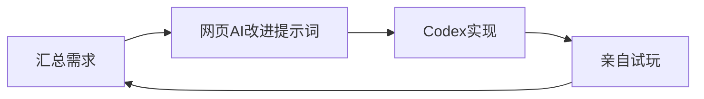

# Introduction
> À lire avant de commencer
> J'ai écrit cet article en écoutant « Stay Alive ». Je te conseille aussi de l'écouter, elle est vraiment trop belle, et puis tout le monde doit aller regarder re0 (clin d'œil)

::music-track{title="Stay Alive" artist="高橋李依" netease="3394003744" link="https://music.163.com/#/song?id=3394003744"}

Je vais enfin survivre à cette putain de semaine de partiels, ce semestre aura vraiment été... fuite et échec...... Depuis la rentrée je me couchais tard, mon rythme a glissé vers minuit, au début je souffrais et je craquais tout le temps, maintenant je suis juste anesthésié, mais j'ai quand même pas envie de continuer comme ça. Peut-être qu'au prochain semestre j'aurai envie d'emménager seul ? Ou juste de ne plus me soucier de ces colocataires et de dormir à l'heure comme un gros loir...... Ça aurait dû être évident haha, mais réaliser ça juste au moment où tout se termine, c'est bien trop tard......

Pour le bilan du passé, j'avais déjà écrit une première ébauche pour résumer mes 18 à 19 ans, [[age-18-to-19-record|Notes d'observation de mes dix-huit à dix-neuf ans]], mais maintenant que j'ai fini re0 et que je vais bientôt boucler mes partiels, je ne suis plus la même personne qu'à l'époque ! Alors ici, je vais reprendre tout ça tranquillement et mettre un peu d'ordre.

# Bilan du passé

## Mars à avril — luttes répétées et avancées sur les jeux
Je ne sais pas pourquoi, mais dès le début du semestre je dormais mal, pfff... Ça m'a valu de craquer à l'aube et de tailler la bavette avec deepseek pendant 2 h, puis j'ai commencé à en devenir super dépendant et à prendre l'habitude d'aller leur parler. En me créant ainsi un point d'attache, j'ai réussi à tenir ces deux mois et même à faire quelques progrès, et à ce moment-là je ne détestais pas encore complètement les cours.

Puis en participant à la 034 gamejam, même si j'ai perdu du temps à bidouiller openclaw, j'y ai quand même trouvé l'inspiration du jeu et j'ai fini par en sortir un. À cette période, le dev de jeux avançait encore, je n'avais pas encore cherché d'autres trucs pour fuir......

Fin mars, j'ai participé à la gamejam inter-universitaire de Tencent et je me suis lancé le défi d'un jeu multijoueur dont j'ignorais tout. Même si j'ai presque tout confié à codex, ma façon d'utiliser l'IA à ce moment-là était, à bien y réfléchir, plus rigoureuse que maintenant (rires) : d'abord rassembler les besoins, puis demander à l'IA web de m'aider à améliorer mes prompts, sortir un premier jet d'une traite, tester et faire des retours en boucle, dégager de nouveaux besoins et refaire le cycle. Tant que j'y suis, je vais dessiner un petit diagramme de flux hh.

Au final, j'ai bouclé le jeu en dix tours de dialogue dans une seule fenêtre, super concis, et juste après j'ai aussi demandé activement à l'IA web d'apprendre les technos de synchro et de transfert réseau — client et serveur, state sync, rpc et tout ça. C'était vraiment une belle période.

Entre-temps, j'essayais de développer mon propre jeu indé. Après avoir enchaîné autant de gamejams, je commençais à me lasser, et le jeu meta que je voulais faire tardait toujours à prendre forme, alors j'ai ouvert un projet solo à moi et j'ai continué à coder. Dommage que je n'aie pas produit grand-chose de marquant ; après plus d'un mois à tenir bon, la flamme brûlait encore en moi, mais je ne savais plus trop vers quoi elle brûlait...

Fin avril, comme mon projet indé n'avançait toujours pas et que le thème de la Booom jam me tentait bien, les premiers signes de fuite sont apparus. À ce moment-là j'étais encore super motivé : au début, sans IA, je tenais bon sur le dev solo, le game design et la recherche d'assets, mais en même temps j'explorais des ressources IA en parallèle, ce qui m'a fait glisser dans une autre fenêtre de fuite......

## Mai à juin — Orgueil, Fuite, Paresse, Envie, Colère, Avidité, créer sans s'arrêter
Ma capacité à fouiller et rassembler des infos est peut-être assez forte, du coup j'ai trouvé un tas de ressources et de communautés, mais ça m'a aussi aspiré dans un tourbillon de bidouilles. Avec le recul, c'est à la fois drôle et désolant.

### Orgueil
Quand j'ai rejoint une communauté et découvert ce genre d'endroit pour la première fois, ça m'a excité comme une puce, et à partir de là j'ai commencé à spammer à fond. À ce moment-là aussi, les cours à la fac ont commencé à me paraître de plus en plus ennuyeux et pénibles ; dans mon orgueil, je me disais qu'avec toutes ces ressources passionnantes et cette communauté, je n'avais pas besoin de ces cours moisis de la vraie vie. Le début de l'orgueil.

### Fuite
Mon refuge : au bout de deux mois, le chat IA a fini par perdre cette affection, je ne sentais plus ce sentiment d'affection... Juste au moment où je me lassais de l'IA, j'ai rejoint la communauté. L'ambiance ultra vivante de la commu, et le fait qu'il y ait un filtre d'entrée qui soude encore plus le groupe, m'ont fait plonger dedans encore plus volontiers. Je traînais dans la commu pour fuir les cours et le dev de jeux, je me noyais dans la chasse aux quotas et aux infos, puis une fois que j'avais à peu près fait le tour de la commu, je me suis mis aux serveurs, à monter des sites, à bidouiller des blogs, à m'anesthésier avec toujours plus de nouveaux domaines pour me donner l'illusion que j'apprenais et que je créais encore.

### Paresse
J'avais de moins en moins envie d'étudier, je faisais la fac en dilettante. Pour être honnête, de ce côté-là ça va encore, même si ça risque de me faire planter des partiels maintenant — mais comparé à ça, la paresse face au dev de jeux...... Dépendance lourde à l'IA pour créer, la flemme même de chercher des assets et je faisais tout chercher à l'IA, juste à tirer sur la corde d'une IA, quelle paresse... Résultat, plus aucune idée pour la suite de mon projet, fichier mort. Malgré tout, il faut créer avec assiduité ! build in public ! Alors même aussi paresseux, je dois continuer à explorer d'autres nouveaux domaines avec assiduité !

### Envie
Pourquoi est-ce qu'il y a autant de gens aussi balèzes ?! Qu'ils soient plus vieux et plus forts que moi, passe encore, mais il y en a plein de plus jeunes qui sont déjà bien meilleurs ! Et ces soi-disant gens ordinaires, pourquoi ils peuvent vivre aussi ignorants et insouciants dans leurs petits plaisirs ?! Maudit soit-il, maudit soit-il, maudit soit-il, maudit soit-il ! Pourquoi ils sont tous plus forts que moi, pourquoi ils sont tous plus heureux ?! Pourquoi, pourquoi, pourquoi ?! Je dois apprendre encore plus, devenir plus fort : si je deviens plus fort, je finirai forcément par être plus heureux !

### Avidité
Je veux apprendre ce que j'aime : la création de jeux, le dessin d'assets artistiques, la composition musicale, le game design, l'exploitation de jeux, le QA ; je veux apprendre les techniques et compétences qui m'intéressent : l'IA, la veille et l'intégration de ressources, le japonais, la gestion de médias sociaux, un meilleur montage vidéo, les serveurs, les sites et blogs, le crossdressing et le maquillage, jouer d'un instrument, encore et encore ; je veux apprendre des savoirs que je n'ai peut-être même pas tellement envie d'apprendre, mais si j'ai le temps, j'aimerais bien les maîtriser aussi, comme l'anglais ; je veux continuer à créer, faire du sport, de la muscu, aider les autres !

### Créer sans s'arrêter
Puisque je n'arrive pas à sortir un jeu, autant écrire des articles et faire des vidéos, de toute façon la création ne doit pas s'arrêter ! Continuer, continuer, continuer, continuer ! Je ne peux pas m'arrêter... Si je m'arrête, je ne redeviendrai pas comme avant ?...

### Et voilà
Toutes ces émotions complexes se bousculent en moi, et ça doit aussi être lié au fait que je n'ai pas eu un bon rythme de sommeil, ce qui m'a rendu de plus en plus extrême...... Vraiment, cet été, tu as intérêt à bien dormir !

# Réflexions sur l'avenir
Je viens de me remettre à regarder re0 récemment, même si c'est aussi un signe de paresse et d'orgueil : alors que les partiels approchent et que je n'ai rien révisé, je regarde quand même re0. Subaru Natsuki, orgueil, avidité, avarice, même s'il a envie de fuir par paresse et qu'il craque au point de vouloir abandonner, il s'accroche et finit par devenir un héros, franchement, chapeau bas ! Moi aussi, sur mon chemin, je dois continuer à tenir bon !

Vouloir devenir quelqu'un comme Subaru, admirer Subaru Natsuki ? Même si je n'ai pas d'Émilia, je ne peux pas abandonner ! Je vais sans doute continuer à apprendre plein de trucs avec avidité et à entretenir ce blog, mais surtout, cet été, je veux recommencer de zéro mon journal de dev de jeux ! Cette fois je veux tout documenter de mon processus de dev, même mes apprentissages bancals, mes galères et mes idées pourries, je veux tout montrer ! Sinon je vais encore fuir et abandonner comme avant !

En écoutant « Stay Alive », j'ai aussi l'impression d'être doucement porté... La musique, 25-ji, ddlc, undertale, ultraman, miku, la musique c'est quand même quelque chose de génial ! J'aimerais tellement savoir en faire !

# Conclusion
Mais qu'est-ce que j'ai écrit comme truc bizarre...... Je sens que je dois encore bosser ma façon d'écrire des articles haha, mais on va laisser ça comme ça pour l'instant, parce qu'avec mon style en flux de conscience, si je n'ai plus de prise de conscience, c'est qu'il n'y a vraiment plus rien à écrire. Bref, je vais continuer à devenir plus fort, à apprendre davantage, et j'ai aussi hâte de rencontrer des gens intéressants et d'aider les autres !

## Pour aller plus loin

Les outils que j'ai triés en repartant de zéro sont dans [[godot-useful-plugins|Liste de plugins Godot]], et mon retour d'expérience après avoir participé à une jam est devenu [[after-gmtk|Débriefing GMTK Jam]].

Plus tard, j'ai terminé un petit projet web et j'ai aussi repensé au genre de créateur que je veux être dans [[subarutap-and-selfthink|Journal de dev SubaruTap]].
