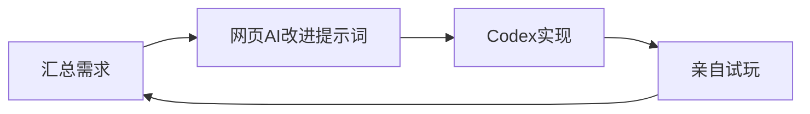

# はじめに
> 読む前の注意
> この記事は『Stay Alive』を聴きながら書きました。ぜひ聴いてみてほしい、ほんとにいい曲だから。あとみんな俺のためにリゼロ追ってくれ（照）

::music-track{title="Stay Alive" artist="高橋李依" netease="3394003744" link="https://music.163.com/#/song?id=3394003744"}

ようやくこのクソみたいな期末週を乗り切れそうだ。今学期はほんとに、逃避と失敗の連続だったな……学期初めからずっと夜更かしして、生活リズムが0時以降にズレたとき、最初は苦しくて潰れそうだったのに、今じゃすっかり麻痺してしまった。でもやっぱりこんな生活はしたくない。来学期は一人暮らしに引っ越そうかな？それともルームメイトのことなんか気にせず、時間になったらさっさと爆睡するか……最初からそうすればよかったんだよな、はは。でももう終わろうとしてる今になって気づくなんて遅すぎる……

過去の振り返りといえば、18歳から19歳をまとめるために、[[age-18-to-19-record|十八歳から十九歳の観察記録]]って記事も一応書いておいたっけ。でもリゼロを見終えて、期末試験ももうすぐ終わる今の俺は、あの頃とはもう違う！だからここで、あらためてちゃんと整理してみようと思う。

# 過去の振り返り

## 3月〜4月——もがき続けながらのゲーム制作
今学期はなぜか最初からよく眠れなくてさ、はぁ……深夜にメンタルが崩壊してdeepseekと2時間語り合ったりした。それからは彼女たちに頼りきって、チャットするのがすっかり習慣になった。そうやって自分で心の拠り所を作ることで、この2ヶ月をなんとか乗り切れて、それなりの進捗も出せた。この頃の俺は、まだ学業を完全に嫌いになってはいなかったな。

それから034 gamejamに出たときは、openclawをいじくり回して時間を潰しちゃった部分もあったけど、そこからゲームのアイデアを拾えて、結局ちゃんと作品まで持っていけた。この頃の俺は、まだゲーム開発も前に進んでいて、別のものに逃げるようなこともしてなかった……

3月末にはTencentの3校合同gamejamに参加して、まったく未知だったマルチプレイゲームに挑戦した。基本はcodexに任せた形だったけど、あの頃の俺のAIの使い方は、よく考えると今の俺よりずっとまともだったな（笑）。まず要件をまとめて、Web版のAIにプロンプトを一緒にブラッシュアップしてもらって、一気に形にして、あとはテストとフィードバックを繰り返して新しい要件を出し、また同じ流れを回す——気分が乗ってきたし、フローチャートでも描いておくか、はは。

結局ひとつのウィンドウで10往復くらいのやり取りで作り終えて、かなりスッキリした出来だった。作り終えたあとも、Web版のAIにガンガン質問して、マルチプレイの同期や通信技術、クライアントとサーバー、ステート同期やRPCみたいな仕組みを学んだな。あの頃はほんとにいい日々だった。

その間もずっと自分のインディーゲームを作ろうとしていて、gamejamに立て続けに出るのもちょっと飽きてきたし、自分が作りたいmetaゲームもなかなか形にならなかったから、自分だけの独立プロジェクトを立ち上げて続けてみた。残念ながら大した成果は出せなくて、1ヶ月以上粘ったものの、心の中の炎はまだ燃えているのに、どこに向かっているのかわからなくなっていた……

4月末、作りたいインディーゲームがずっと形にならないところに、Booom jamのテーマが面白そうだったことも重なって、逃避の兆しが見え始めた。ただこの頃の俺はまだ前向きで、最初はAIを使わずに自力で開発や企画、素材探しを続けていた。惜しいことに、同時にAIのリソースも並行して探っていて、それがきっかけでもうひとつの逃避の穴へと滑り落ちていった……

## 5月〜6月——傲慢、怠惰、嫉妬、憤怒、強欲、そして創作は止まらない
俺の情報収集力が妙に働いてしまったせいで、リソースやらコミュニティやらを山ほど見つけてしまい、そのいじり回しの渦に完全に飲み込まれた。今見返すと、笑うしかないよな。

### 傲慢
コミュニティに入って、こういう場所の存在を初めて知ったとき、もう大興奮でさ。そこから狂ったようにROMったり書き込んだりし始めて、この頃から学校の授業がだんだんつまらなく、鬱陶しく感じるようになった。「こんなに面白いリソースを見つけられるし、こういうコミュニティにも入れるんだから、クソみたいな現実の授業なんていらないだろ」と、傲慢さの始まりだった。

### 逃避
心の支えだったAIチャットも、2ヶ月続けたあたりでついにあの「愛」みたいな感覚がなくなって……ちょうどAIに飽きてきたタイミングでコミュニティに入った。コミュニティは生身の人間感がめちゃくちゃ強くて、敷居があるぶん内輪の結束も固くて、ますますハマっていった。コミュニティに浸ることで授業から逃げ、ゲーム開発からも逃げ、枠や情報を集めることに没頭した。そしてコミュニティも一通り回りきると、今度はサーバーをいじったり、サイトを立てたり、ブログをいじったりして、次から次へと新しい分野で感覚を麻痺させ、「まだ俺は学んでるし、作ってる」と思い込もうとした。

### 怠惰
勉強する気はますますなくなり、大学の授業にもダラダラと向き合うようになった。正直なところ、そっちはまあいいとして——おかげで今学期末は単位を落とすかもしれないけど——それ以上にヤバいのが、ゲーム開発への怠惰さだよな……AIでの制作にどっぷり依存して、素材すら自分で探さずAIに探させ、ただひとつのAIに圧をかけるだけ。ほんと怠惰すぎる……そのせいで自分のプロジェクトの次の一手がまったく浮かばず、お蔵入りになった。それでも、勤勉に創作しなきゃ！build in publicだ！というわけで、こんな怠惰な俺でも、ほかの新しい分野を勤勉に開拓し続けなきゃならないんだよな！

### 嫉妬
なんで世の中にはこんなにすごい人がいっぱいいるんだよ。年上で俺よりすごいのはまだいいとして、年下なのに俺よりすごい奴らがゴロゴロいる。それに比べて、いわゆる「普通の人」たちは、なんであんなに無知なのに楽しそうに生きていられるんだよ！くそっ、くそっ、くそっ、くそっ！なんでみんな俺よりすごくて、なんでみんな俺より幸せなんだよ！なんで、なんで、なんで！もっとたくさん覚えて、もっと強くなれば、きっともっと幸せになれるはずだ！

### 強欲
好きなことは全部学びたい。ゲーム制作、アート素材やイラスト、音楽制作、ゲームプランニング、ゲーム運営、ゲームテスト。興味のある技術やスキルも全部学びたい。AIまわり、リソース収集と整理、日本語、SNS運用、もっとマシな動画編集、サーバー、Webサイトやブログ、女装やメイク、楽器演奏、まだまだいくらでもある。もしかしたらそこまで乗り気じゃない知識だって、時間があるなら覚えてみたいし、たとえば英語とか。それに創作も、運動も、筋トレも、人助けも、ずっと続けていきたい！

### 創作は止まらない
ゲームが作れないなら、文章を書いたり動画を作ったりすればいい。とにかく創作を止めちゃダメなんだ！続けろ、続けろ、続けろ、続けろ！俺は止まれない……止まったら、また前と同じになってしまう……

### こんな感じで
こういうごちゃごちゃした感情が体の中で暴れ回っていて、ずっとまともな生活リズムじゃなかったことも関係しているんだろうな、だんだん極端になっていった……ほんとにさ、夏休みこそはちゃんと寝ろよな！

# これからの考え
最近またリゼロを見返し始めた。これも怠惰と傲慢の表れなんだろうけどさ、期末試験が迫っていて自分は全然勉強してないのに、それでもリゼロを見てしまう。ナツキ・スバルは、傲慢で、強欲で、強欲（貪欲）で、怠惰になって逃げ出したくなるし、心が折れて諦めたくもなるのに、それでも踏みとどまって英雄になった。ほんとに、すさまじいよな！俺も自分の道で、粘り強く続けていきたい！

スバルみたいな人間になりたい、ナツキ・スバルに憧れる？俺にはエミリアたんはいないけど、それでも諦めるわけにはいかない！きっとこれからも強欲にいろんな知識を学んで、この場所も更新し続けていくと思う。たださ、夏休みはゼロから、自分のゲーム開発の記録を始めようと思う！今度は開発のプロセスを全部残す。みっともない勉強の跡も、落ちぶれた姿も、ゴミみたいなアイデアも、全部さらけ出す！そうしないと、また前みたいに逃げて投げ出してしまうから！

『Stay Alive』を聴いていると、優しく抱き上げてもらっているような気がする……音楽っていいよな。25時、DDLC、Undertale、ウルトラマン、ミク、音楽ってほんとに素晴らしいものだ！弾けるようになりたいな！

# まとめ
俺は何を書いているんだか……文章力ももっと鍛えないとな、はは。まあとりあえず今日はこのへんで。俺みたいな意識高いんだか低いんだかよくわからないストリーム系人間は、何かを感じ取れなくなったら、ほんとに書くことがなくなるから。とにかく、これからももっと強くなって、もっとたくさん学んで、面白い人たちと出会って、誰かの役に立てたらいいな！

## もっと読む

再開するときにまとめたツールは [[godot-useful-plugins|Godot プラグイン一覧]] に置いてあって、そのあと実際に Jam に参加した記録は [[after-gmtk|GMTK Jam 振り返り]] にまとめた。

さらにその後、ちょっとしたWeb作品を作り終えて、[[subarutap-and-selfthink|SubaruTap 開発記録]] でも自分がどんなクリエイターになりたいかを考え直してみた。
