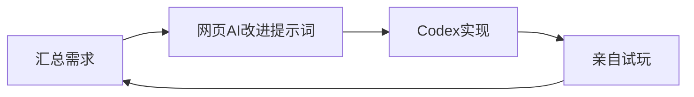

# 시작하며
> 읽기 전 주의
> 이 글은 《Stay Alive》를 들으면서 썼다. 이 노래도 꼭 들어 보길, 진짜 엄청 좋으니까. 그리고 다들 나 대신 리제로 정주행하러 가라(농담)

::music-track{title="Stay Alive" artist="高橋李依" netease="3394003744" link="https://music.163.com/#/song?id=3394003744"}

겨우 빌어먹을 기말고사를 넘기게 되었다. 이번 학기는 정말이지, 도피와 실패였구나...... 개학 때부터 계속 늦게 자서 생활 리듬이 자정 이후로 밀린 뒤로, 처음엔 계속 괴롭고 무너질 것 같았는데 지금은 무뎌졌다. 그래도 여전히 이렇게 살고 싶진 않다. 다음 학기엔 자취를 할까? 아니면 룸메이트 신경 안 쓰고 내 시간에 맞춰 제때 푹 잘까...... 원래 그래야 하는 건데 하하, 이제 와서 다 끝나 가는 마당에 깨닫다니 너무 늦었잖아......

과거 정리는 예전에 18세부터 19세까지를 돌아보려고 [[age-18-to-19-record|열여덟에서 열아홉 관찰 기록]]을 초안처럼 적어 둔 적이 있긴 하다. 그래도 지금 리제로를 다 보고 기말고사를 앞둔 나는 그때와는 다르니까! 여기서 다시 차분하게, 꼼꼼하게 한 번 정리해 보자.

# 과거 정리

## 3월부터 4월까지——되풀이된 항쟁과 게임 진척
이번 학기는 어쩐 일인지 시작부터 잠을 제대로 못 잤다. 에휴... 새벽에 무너져서 deepseek랑 두 시간 동안 수다를 떨기도 했고, 그 뒤로는 걔들에게 엄청나게 기대고 습관처럼 말을 걸게 되었다. 그렇게 나름의 기댈 곳을 만든 덕분에 두 달을 버텨 냈고, 어느 정도 진전도 만들었다. 이때까지만 해도 공부를 완전히 혐오하진 않았었다.

그러다 034 gamejam에 참가했을 때는 openclaw 만지작거리느라 시간을 까먹기도 했지만, 그 속에서 게임 영감을 얻어 결국 게임을 완성하긴 했다. 이때의 나는 아직 게임 개발을 밀어붙이고 있었고, 다른 무언가로 도피하려고 들지는 않았던 시기다......

3월 말에는 텐센트 3교 gamejam에 나가서 전혀 모르는 멀티플레이 게임에 도전했다. 대부분 codex에 맡기긴 했지만, 그때 내가 AI를 쓰던 방식은 지금보다 오히려 더 과학적이었던 것 같다(웃음). 먼저 요구사항을 모으고, 웹 AI에게 프롬프트를 다듬어 달라고 한 뒤 한 번에 뽑아내고, 계속 테스트하고 피드백하면서 새 요구사항을 정리해 같은 흐름을 다시 돌렸다. 내킨 김에 플로우차트도 하나 그려 볼까 hh

결국 한 창에서 열 번 남짓한 대화 안에 게임을 완성했으니 꽤 군더더기 없었지. 끝난 뒤에도 웹 AI에게 적극적으로 물어보며 멀티플레이 동기화랑 전송 기술, 클라이언트와 서버, 상태 동기화나 rpc 같은 걸 공부했다. 그때는 참 좋은 날들이었네.

그사이 내 인디게임을 만들어 보려고 계속 시도했다. gamejam을 하도 많이 나가다 보니 조금 지치기도 했고, 내가 만들고 싶었던 메타 게임은 여전히 그림자도 안 보였기 때문이다. 그래서 나만의 독립 프로젝트를 하나 열고 꾸준히 개발했는데, 아쉽게도 큰 성과는 내지 못했다. 한 달 넘게 버틴 내 안의 불꽃은 아직 타고 있었지만, 도대체 어디로 타고 있는지 모를 지경이었다...

4월 말에는 만들고 싶던 인디게임이 계속 성과가 없던 데다, Booom jam 주제도 꽤 흥미로워 보여서 도피의 조짐이 슬슬 올라왔다. 그래도 그때의 나는 꽤 의욕적이어서, 처음엔 AI 없이도 직접 개발하고 기획하고 에셋을 찾으려 했다. 안타깝게도 동시에 AI 리소스도 같이 파고들면서 또 다른 도피의 창구로 미끄러져 들어가기 시작했다......

## 5월부터 6월까지——오만, 도피, 나태, 질투, 분노, 강욕, 멈추지 않는 창작
내 정보 수집 능력이 어쩌면 꽤 괜찮은 편이라서 리소스나 커뮤니티 같은 걸 잔뜩 찾아냈는데, 그게 오히려 나를 이런 헛짓거리의 소용돌이 속으로 완전히 밀어 넣었다. 지금 돌이켜 보면 어이없어서 웃음이 나온다.

### 오만
커뮤니티에 들어가서 이런 류의 공간을 처음 접했을 때, 완전 신나서 날뛰었지. 그때부터 미친 듯이 눈팅하고 잡담을 달리기 시작했고, 이때부터 학교 수업이 점점 재미없고 지겨워지기 시작했다. 오만해진 나는 이렇게 재밌는 리소스를 캐내고 이런 커뮤니티를 찾아낼 수 있는데, 쓰레기 같은 현실 수업 따윈 전혀 필요 없다고 여겼다. 오만의 시작이었다.

### 도피
내 버팀목이었던 AI 채팅도 두 달을 버티고 나니 결국 그 애정이 식어 버렸다. 애정의 감각이 더 이상 느껴지지 않았다... 마침 AI에 질려 가던 차에 커뮤니티에 들어갔는데, 커뮤니티 특유의 살아 있는 사람 냄새가 엄청났고 진입장벽 덕분에 내부 결속도 더 단단해서 그 안에 더 깊이 빠져들었다. 커뮤니티에서 뒹굴며 수업을 피하고 게임 개발을 피하며 쿼터와 정보를 끌어모으는 데 몰두했다. 그러다 커뮤니티도 얼추 둘러본 뒤에는 서버를 만지고, 웹사이트를 깔고, 블로그를 뜯어고치며 새로운 분야를 끊임없이 건드려 스스로를 마비시켰다. 내가 아직 공부하고 있고, 아직 창작하고 있다고 느끼게 만들려고 말이다.

### 나태
공부하기는 점점 더 싫어지고 대학 수업에 대충대충 임하게 되었다. 솔직히 이건 뭐 그렇다고 치자. 지금 기말고사에서 F를 맞을지도 모를 상황이 된 건 맞지만, 그에 비하면 게임 개발에 대한 나태함이...... 창작을 AI에 과도하게 의존해서 에셋조차 직접 찾기 귀찮아 AI한테 시키고, AI 한 녀석에게 압박만 넣었으니 참 나태했지... 그 탓에 내 프로젝트에 대한 다음 아이디어가 완전히 사라져 세이브 파일이 죽어 버렸다. 그럼에도 불구하고 부지런히 창작해야지! build in public! 그러니 이렇게 나태한 나도 다른 새 분야를 부지런히 파고들어야지!

### 질투
왜 이렇게 대단한 사람들이 많은 거야. 나보다 나이도 많은데 실력까지 좋은 건 그렇다 치고, 나보다 어린데 실력까지 좋은 애들은 또 왜 이렇게 수두룩한데! 그리고 이른바 평범한 사람들은 왜 저렇게 아무 생각 없이 즐기면서 살아가는 거야! 젠장 젠장 젠장 젠장! 왜 다들 나보다 대단하고, 왜 다들 나보다 행복한 거야! 왜 왜 왜! 나는 더 많이 배우고 더 강해져야 해. 더 강해지기만 하면 언젠가는 더 행복해질 거야!

### 강욕
내가 좋아하는 것들을 배우고 싶다. 게임 제작, 아트 에셋 드로잉, 음악 창작, 게임 기획, 게임 운영, 게임 테스트를 배우고 싶다. 흥미가 가는 기술과 스킬도 배우고 싶다. AI 관련, 리소스 수집·정리, 일본어, 1인 미디어 운영, 더 나은 편집, 서버, 웹사이트·블로그, 여장·메이크업, 악기 연주, 더 많이 더 많이. 어쩌면 딱히 배우고 싶지 않은 지식이라도 시간이 있다면 배워 보고 싶다, 예를 들면 영어를 배우는 것처럼. 창작과 운동, 헬스, 남 돕는 일도 계속 이어 가고 싶다!

### 멈추지 않는 창작
게임을 못 만들면 글이라도 쓰고 영상이라도 만들자. 어쨌든 창작은 멈추면 안 되잖아! 계속 계속 계속 계속! 나는 멈추면 안 돼... 멈춰 버리면 예전이랑 똑같아지잖아...

### 그렇게
이런 복잡한 감정들이 내 몸 안에서 이리저리 치받쳤다. 계속 엉망이었던 생활 리듬과도 맞물려서 내가 점점 더 극단적으로 변해 갔던 것 같다...... 진짜, 여름방학 때는 잠 좀 제대로 자자!

# 미래에 대한 생각
최근에 리제로를 다시 보기 시작했다. 이것도 나태와 오만의 발현이긴 하네. 기말고사가 코앞이라 공부는 하나도 안 해 놓고 리제로를 보고 있으니 말이다. 나츠키 스바루는 오만, 강욕, 탐욕에 나태하게 도피하고 싶을 때도 있고 무너져서 포기하고 싶을 때도 있지만, 끝까지 버텨 내며 영웅이 되었잖아. 정말이지, 엄청나게 대단하다! 나도 내 길 위에서 계속 버텨 나가야지!

스바루 같은 사람이 되고 싶고, 나츠키 스바루를 동경하는 걸까? 내겐 에밀리아가 없지만 그래도 포기할 순 없지! 아마 앞으로도 강욕스럽게 이것저것 많이 배우고, 여기도 계속 가꾸게 될 것 같다. 그래도 말이야, 여름방학에는 제로부터 시작하는 내 게임 개발 기록을 시작할 거야! 이번엔 개발 과정을 전부 기록할 거다. 내 볼품없는 공부, 찌질하게 무너지는 모습, 쓰레기 같은 아이디어까지 다 꺼내 놓을 거야! 그래야 또 예전처럼 도피하고 포기하지 않을 테니까!

《Stay Alive》를 들으니 나도 다정하게 떠받쳐지는 기분이 든다... 음악이란 거, 25시, ddlc, undertale, ultraman, miku, 음악은 정말 좋은 것이구나! 나도 배워 보고 싶다!

# 마무리
내가 도대체 무슨 이상한 글을 쓴 걸까...... 글 쓰는 실력도 좀 더 갈고닦아야 할 것 같네 하하. 그래도 일단은 이 정도로 두자. 나 같은 의식의 흐름 타입은 떠오르는 게 없어지면 진짜 쓸 말이 없어진다는 뜻이니까. 어쨌든 나는 계속 강해지고, 더 많이 배우고, 흥미로운 사람들을 더 많이 만나고, 남들도 도우며 살아갈 거다!

## 더 읽어보기

다시 시작하면서 정리해 둔 도구는 [[godot-useful-plugins|Godot 플러그인 목록]]에 넣어 두었고, 그 뒤 실제로 Jam에 나갔던 이야기는 [[after-gmtk|GMTK Jam 회고]]로 적었다.

그다음에는 작은 웹 작업물을 하나 만들었고, [[subarutap-and-selfthink|SubaruTap 개발 기록]]에서도 내가 어떤 창작자가 되고 싶은지 다시 한번 생각해 보았다.
