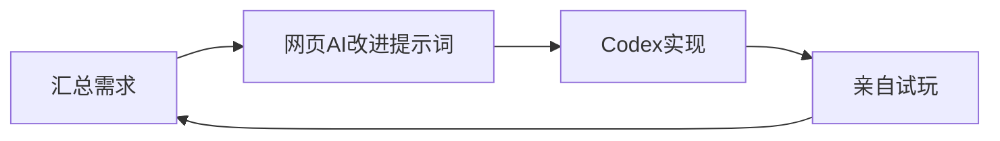

# Começo
> Aviso antes de ler
> Escrevi esse texto ouvindo "Stay Alive". Recomendo muito que você ouça também, é boa demais — e todo mundo vá assistir Re:Zero (risos)

::music-track{title="Stay Alive" artist="高橋李依" netease="3394003744" link="https://music.163.com/#/song?id=3394003744"}

Finalmente vou sobreviver à maldita semana de provas finais. Esse semestre foi, sério mesmo, pura fuga e fracasso... Desde que as aulas começaram eu só fui dormir tarde; depois que meu horário virou meia-noite, no começo eu sofria e surtava, agora já fiquei dormente, mas ainda não queria viver assim. Talvez no próximo semestre eu pense em me mudar pra morar sozinho? Ou só ligar o foda-se pros colegas de quarto e dormir na hora certa como gente normal... Era pra ser assim, haha, mas agora que tá tudo acabando, cair na ficha tarde demais também é osso...

Sobre fazer um balanço do passado, antes, pra resumir dos 18 aos 19 anos, eu até cheguei a escrever um rascunho, [[age-18-to-19-record|Observações dos dezoito aos dezenove anos]]. Só que agora, depois de ver Re:Zero e estar quase terminando as provas finais, já não sou mais o mesmo de antes! Então deixa eu destrinchar tudo direito aqui de novo.

# Balanço do passado

## Março a abril — idas e vindas na luta e avanço nos jogos
Nem sei por que, nesse semestre, dormi mal desde o início, ai... Teve madrugada que eu surtei e conversei por 2h seguidas com o DeepSeek, e daí pra frente fui ficando bem dependente delas e peguei o hábito de ir desabafar com elas. Criando esse tipo de muleta pra mim mesmo, consegui aguentar esses dois meses e ainda tive algum progresso; nessa época eu também não tinha pegado ranço total dos estudos.

Aí, quando participei da 034 Game Jam, mesmo perdendo tempo mexendo no OpenClaw, tirei boas ideias de jogo de lá e acabei fazendo o jogo no fim das contas. Nessa fase o desenvolvimento de jogos ainda tava andando, eu ainda não tinha ido buscar outras coisas pra fugir...

No fim de março, participei da game jam das três universidades da Tencent e encarei o desafio de fazer um jogo multiplayer, algo que eu não manjava nada. Apesar de ter jogado basicamente tudo no colo do Codex, o jeito que eu usei IA naquela época, pensando bem, era até mais metódico do que agora (risos): primeiro juntava os requisitos, depois pedia pra IA na web me ajudar a refinar os prompts, saía tudo de uma vez, e aí eu ia testando, dando feedback, anotando novos requisitos e repetindo o ciclo. Se bater a empolgação, desenho um fluxograma depois, haha.

No fim terminei o jogo em umas dez mensagens numa única janela, bem enxuto mesmo. Depois de pronto, também fui perguntar na IA web pra aprender sobre sincronização e transmissão de rede, cliente e servidor, state sync, RPC e essas coisas — foram dias bem bons aqueles.

Nesse meio tempo fui tentando tocar meu próprio jogo indie. Depois de tantas game jams, bateu um certo cansaço, e o jogo meta que eu queria fazer continuava sem dar as caras, então abri um projeto solo meu e fui tocando. Pena que não saiu nada muito grande; depois de mais de um mês insistindo, a chama no peito ainda tava acesa, mas eu já não sabia direito pra onde tava queimando...

No fim de abril, como meu jogo indie não saía do lugar e o tema da Booom Jam me chamou atenção, os primeiros sinais de fuga apareceram. Mesmo assim, naquela hora eu ainda tava bem animado — no começo fui na raça, sem IA, fazendo design e caçando assets por conta própria, só que ao mesmo tempo fui explorando recursos de IA e acabei escorregando pra outra janela de fuga...

## Maio a junho — soberba, fuga, preguiça, inveja, ira, ganância e criando sem parar
Talvez eu tenha um faro até decente pra garimpar informação, porque achei um monte de recurso e comunidade, mas isso também me puxou de cabeça pro redemoinho de ficar fuçando tudo. Olhando pra trás agora, dá vontade de rir de nervoso.

### Soberba
Quando entrei numa comunidade e vi um espaço desse tipo pela primeira vez, o moleque aqui surtou de empolgação e comecei a flodar sem parar. A partir daí, as matérias da faculdade foram ficando cada vez mais sem graça e irritantes; na minha soberba, achava que por ter achado tanta coisa legal e entrado numa comunidade dessas, eu não precisava nem um pouco do lixo das obrigações da vida real. Foi o começo da soberba.

### Fuga
Meu porto seguro, depois de dois meses aguentando firme, acabou perdendo aquela graça no chat com IA — não dava mais aquela sensação de carinho... Justo quando eu tava enjoando da IA, entrei na comunidade, onde a sensação de ter gente real de verdade é fortíssima e, por ter barreiras de entrada, o pessoal é mais unido. Acabei mergulhando nisso, usando a comunidade pra fugir da faculdade e fugir de fazer jogo, viciado em pegar convites/cotas e informação. Quando já tinha rodado quase tudo por lá, fui mexer com servidor, montar site e fuçar em blog, anestesiando a cabeça com áreas novas atrás da outra pra fingir que ainda tava estudando e criando.

### Preguiça
Cada vez com menos vontade de estudar, empurrando a faculdade com a barriga. Pra falar a real, até que tanto faz — mesmo que isso provavelmente me faça reprovar em alguma coisa agora nas finais —, mas o relaxo com o desenvolvimento de jogos, puts... Dependência pesada de IA pra criar, preguiça até de procurar asset e mandando a IA procurar, só sabendo pressionar uma IA, que preguiça braba... E isso acabou deixando meu projeto sem ideia nenhuma do que fazer depois, arquivo morto. Mesmo assim, bora criar com disciplina! Build in public! Então eu, todo preguiçoso desse jeito, ainda tenho que continuar explorando áreas novas com disciplina!

### Inveja
Por que tem tanta gente tão foda assim?! Já é tenso quem é mais velho e manda muito bem, e ainda tem um monte mais novo que eu e muito mais foda; e aquele povo que se diz comum, por que consegue viver tão sem noção e curtindo a vida?! Droga, droga, droga, droga! Por que todo mundo é melhor que eu, por que todo mundo é mais feliz?! Por quê, por quê, por quê?! Eu preciso aprender mais, ficar mais forte — se eu ficar mais forte, uma hora eu vou ser mais feliz!

### Ganância
Quero aprender tudo que eu gosto: fazer jogo, desenhar arte e assets, compor música, game design, operação de jogos, QA; quero aprender as técnicas e habilidades que me interessam: coisas de IA, curadoria e organização de recursos, japonês, tocar o próprio canal/mídia, editar melhor, servidor, site e blog, crossdressing e maquiagem, tocar instrumento, e muito mais; quero aprender umas coisas que talvez eu nem tenha tanta vontade assim, mas se sobrar tempo eu até topo pegar, tipo inglês; e quero continuar criando, me mexendo, treinando na academia e ajudando os outros!

### Criando sem parar
Se o jogo não sai, então bora escrever texto e fazer vídeo — o que não dá é pra parar de criar! Vai, vai, vai, vai! Eu não posso parar... Se eu parar, não vai dar na mesma de antes?...

### É isso
Essas sensações todas emboladas batendo dentro de mim também devem ter a ver com o fato de eu nunca ter tido um sono decente, o que me deixou cada vez mais extremo... Sério mesmo, nas férias você tem que dormir direito, hein!

# Pensamentos sobre o futuro
Voltei a assistir Re:Zero esses dias — o que também é coisa de preguiça e soberba, né, prova final encostando, eu sem ter estudado nada, e lá estou vendo Re:Zero. O Subaru Natsuki, soberba, ganância, avareza, até bate preguiça de querer fugir e surto de querer desistir, mas mesmo assim ele insiste e vira um herói — caramba, muito foda! Eu também vou continuar insistindo no meu caminho!

Querer virar alguém tipo o Subaru, admirar o Subaru Natsuki? Mesmo sem ter uma Emília, não dá pra desistir! Eu provavelmente ainda vou aprender um monte de coisa por pura ganância e continuar cuidando desse cantinho aqui, mas, nas férias, eu vou começar do zero o meu diário de desenvolvimento de jogos! Dessa vez quero registrar todo o processo: meus estudos capengas, meus perrengues de quando tô na pior, minhas ideias lixo — quero mostrar tudo isso também! Senão eu acabo fugindo e desistindo de novo como antes!

Ouvindo "Stay Alive", também sinto como se estivesse sendo amparado com gentileza... Música, 25-ji, DDLC, Undertale, Ultraman, Miku — música é bom demais! Queria tanto aprender!

# Resumo
O que foi que eu escrevi, meu Deus... Acho que eu preciso treinar mais minha escrita, haha, mas vai ficar assim por enquanto, porque no meu estilo fluxo de consciência, se já não vem mais nada na cabeça, é sinal de que realmente não tem mais o que escrever. Enfim, vou continuar ficando mais forte, aprendendo mais, e também quero conhecer gente legal e ajudar os outros!

## Continue lendo

As ferramentas que separei quando recomecei ficaram em [[godot-useful-plugins|Lista de plugins do Godot]], e a experiência participando de jam na prática virou o [[after-gmtk|Post-mortem da GMTK Jam]]

Mais pra frente, terminei um projetinho web e também repensei que tipo de criador eu quero ser em [[subarutap-and-selfthink|Diário de desenvolvimento do SubaruTap]]
